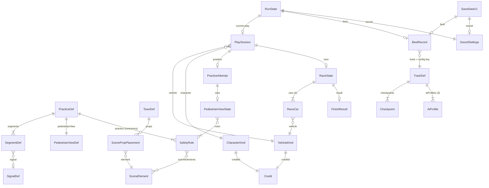

# Data Model Design — 001 아동용 3D 운전·보행 안전 게임

- 작성: spec-plan-data-modeler / plan 단계 / 2026-10-12
- 기준 원문(읽은 순서): `_workspace/00_plan_context.md`, `AGENTS.md`, `docs/PRD.md`, `GLOSSARY.md`, `spec.md`(1~639줄 전부), `.specify/memory/constitution.md`(빈 템플릿), 참고 `_workspace/01_domain-analyst_analysis.md`, `_workspace/01_edge-analyst_analysis.md`
- 적용 기준: AGENTS.md:16·25의 치환 기준. IVI entity.md(DB 컬럼 축약·어노테이션 순서)·JPA 규칙은 적용하지 않음. constitution은 해당 없음(사용자 결정, spec.md:28·577)
- 승인 스택 전제: TypeScript + Vite + three.js, localStorage, 물리 엔진 없는 고정 시간 간격 주행, 실행 중 외부 주소 요청 없음(00_plan_context.md:31~46)
- 역할 양식 항목 치환

  | 역할 양식 | 이 문서에서 대신하는 것 |
  |---|---|
  | 테이블·컬럼 | TypeScript 타입과 필드 표(2장), localStorage 키와 JSON 모양(5장) |
  | 패키지 | 모듈 소속은 중립 표기("콘텐츠 데이터", "저장", "주행 규칙", "레이싱 규칙", "연습 진행", "화면 흐름", "소리"). 실제 이름은 구조 설계와 맞춤(9.3) |
  | 인덱스 | 해당 없음. 데이터가 최대 수십 건(규칙 38, 차량 5, 체크포인트 수십)이라 배열 순회로 충분 |
  | 마이그레이션 노트 | 저장 형식 버전 처리(5.7) |
  | 쿼리 전략 | 저장소를 읽고 쓰는 시점(5.6) |

- 좌표 약속(구조 설계와 맞출 것): 판정은 바닥 평면 2D(x, z, 단위 m), 높이는 화면 표현에만 씀. 점프가 없으므로(PRD:45) 판정에 높이가 필요 없음. `Pose = { x: number; z: number; heading: number }`(heading은 라디안), `Vec2 = { x: number; z: number }`.

## 0. 핵심 결정 요약

1. 저장은 localStorage 키 1개(`driving_game:save`)에 JSON 하나(형식 버전 `v: 1` + 3항목). GitHub Pages 프로젝트 사이트는 같은 소유자의 모든 저장소가 출처 하나(`https://<owner>.github.io`)를 함께 쓰므로 키에 프로젝트 이름을 붙임.
2. 읽은 값은 항목마다 따로 검사. 버전이 1이 아니거나 JSON이 깨졌으면 3항목 모두 기본값, 버전 1 안에서는 잘못된 항목만 기본값(FR-081, SC-018).
3. 최고 기록은 1/100초 단위 정수(`timeCs`) 하나로 저장·비교·표시해서 정밀도를 맞추고, 엄격히 짧을 때만 갱신(FR-064).
4. 최고 기록에 트랙 구성 키 `"<트랙id>:<revision>:<바퀴 수>"`를 함께 저장. 바퀴 수가 바뀌면 키가 저절로 바뀌고, 코스 모양이 바뀌면 revision을 올림(FR-082).
5. 모든 저장은 "최신 저장 값 다시 읽기 → 항목별 합치기 → 쓰기" 한 경로로 처리. 완료 여부는 OR, 최고 기록은 더 짧은 값, 소리는 이번에 바꾼 쪽(FR-083).
6. 실행 중 진실은 언제나 메모리(`RunState`)이고, 저장소는 그 사본. 그래서 저장이 안 되는 환경도 따로 분기하지 않고 "쓰기 실패 → 안내 1회"로 끝남(FR-080).
7. 경기 시간은 고정 시간 간격의 틱 수로 재고, 완주 순간 한 번만 1/100초로 바꿈. 순위 동점은 같은 틱 → 결승선을 더 넘어선 차 → 플레이어 → 출발 칸 순서(spec.md:600).
8. 바퀴 인정은 "다음 차례 체크포인트를 정방향으로 넘을 때만 다음으로 진행"이라는 규칙 하나로 후진 반복·역주행·가로지르기를 함께 막음(FR-059, SC-013).
9. 보행 안전 규칙 38개는 코드와 분리된 콘텐츠 데이터(타입 검사가 되는 TS 객체)로 두고, 연습별 순서는 배열 순서 하나로 정함. 추가 규칙 순환은 실행 수명의 연습별 커서 하나(FR-091).
10. 차량 종류에는 성능 필드를 두지 않음. 성능은 `DrivingSpec` 상수 하나뿐이라 차종 간 성능 차이가 데이터 구조상 생길 수 없음(FR-011, FR-054).

---

## 1. Entity Overview

분류: **정적** = 빌드에 포함되는 콘텐츠·설정(실행 중 바뀌지 않음) / **상태** = 실행 중 바뀌는 메모리 값 / **저장** = localStorage에 남는 값 / **계산** = 다른 값에서 매번 계산하고 따로 두지 않는 값.
수명: **앱** = 배포 버전 전체 / **브라우저** = 지우기 전까지 / **실행** = 페이지를 열고 닫거나 새로 고치기 전까지 / **플레이** = 차량·인물을 고른 뒤 한 번의 연습 흐름이나 경기 / **경기** = 레이싱 1회 / **시도** = 연습 1개를 시작해 끝내거나 나갈 때까지 / **안내** = 보행자 시점 안내 1회.

| # | 엔티티 (spec Key Entities) | 제안 TS 타입 | 분류 | 수명 | 한 줄 설명·근거 |
|---|---|---|---|---|---|
| 1 | 차량 종류 | `VehicleKind`, `VehicleKindId` | 정적 | 앱 | 5종 외형. 성능 필드 없음(spec.md:484, FR-009, FR-011) |
| 2 | 인물 종류 | `CharacterKind`, `CharacterKindId` | 정적 | 앱 | 사람 모델 3종 외형(spec.md:485, FR-096) |
| 3 | 탑승객 (용어집) | 별도 타입 없음 → `VehicleKind.passengerSeats` | 정적 | 앱 | 인물 종류의 쓰임 하나. 판정 영향 없음(GLOSSARY.md:49, FR-011) |
| 4 | 공통 운전 성능 | `DrivingSpec` (상수 1개) | 정적 | 앱 | 모든 차가 쓰는 성능 묶음 1개(spec.md:486) |
| 5 | 운전 입력 | `DriveInput` | 상태 | 플레이 | 4버튼 눌림 + 후진 전환 요청(spec.md:487, FR-016) |
| 6 | 주행 상태 | `DriveState` | 상태 | 시도·경기 | 위치·방향·속도·전진/후진(spec.md:488) |
| 7 | 교육용 마을 | `TownDef` | 정적 | 앱 | 도로·신호·횡단보도·장면 요소 배치(spec.md:492) |
| 8 | 장면 요소 | `SceneElementId` + `ScenePropPlacement` | 정적 | 앱 | 규칙을 보여 줄 마을 소품 14종 + 날씨 2종(spec.md:493, FR-092) |
| 9 | 보행 안전 규칙 | `SafetyRule`, `RuleId` | 정적 | 앱 | 38문구(spec.md:494, 표 spec.md:435~474) |
| 10 | 교통 신호 | `SignalDef`(정적) + `SignalState`(상태) | 정적+상태 | 앱 / 시도 | 차량 신호·보행자 신호(spec.md:495, FR-042) |
| 11 | 등장 보행자 | `TownPedestrian` | 상태 | 시도 | 대기 → 횡단 중 → 건너기 완료(spec.md:496) |
| 12 | 안전 연습 | 별도 타입 없음 → `RunState.drillDone`·`completedThisRun` + `PracticeFlow` | 상태 | 실행 | 조작 익히기 + 3상황을 묶는 모드(spec.md:497) |
| 13 | 안전 상황 | `PracticeDef`(정적) + `PracticeAttempt`(상태) | 정적+상태 | 앱 / 시도 | 고정 3종(spec.md:498) |
| 14 | 연습 구간 | `SegmentDef` | 정적 | 앱 | 실패 시 다시 시작하는 단위(spec.md:499, FR-033) |
| 15 | 안전 행동 | `SafetyActionStep` | 정적 | 앱 | 정지·대기·출발 판정 단계(spec.md:500) |
| 16 | 보행자 시점 안내 | `PedestrianViewDef`(정적) + `PedestrianViewState`(상태) | 정적+상태 | 앱 / 안내 | 조작 없는 장면, 고른 인물이 주인공(spec.md:501, FR-041, FR-097) |
| 17 | 전용 트랙 | `TrackDef` | 정적 | 앱 | 진행 방향·결승선·체크포인트·복귀 위치·바퀴 수(spec.md:505) |
| 18 | 레이싱 경기 | `RaceState` | 상태 | 경기 | 4대, 경기 시간(틱), 단계(spec.md:506) |
| 19 | 참가 차량 | `RaceCar` | 상태 | 경기 | 플레이어/컴퓨터, 진행도, 완주(spec.md:507) |
| 20 | 코스 진행도 | `RaceCar.lapsDone`·`nextCheckpoint`(상태) + `progressValue()`(계산) | 상태+계산 | 경기 | 순위·바퀴 인정 근거(spec.md:508) |
| 21 | 완주 기록 | `FinishResult` | 계산 | 경기 | 완주 시간·순위·새 기록 여부. 저장 안 함(spec.md:509) |
| 22 | 최고 기록 | `BestRecord` | 저장(+메모리 사본) | 브라우저 | 트랙 구성당 0~1개(spec.md:510, FR-064, FR-082) |
| 23 | 소리 설정 | `SoundSettings` | 저장(+메모리 사본) | 브라우저 | 배경음 / 안내·효과음 켬·끔(spec.md:514, FR-069) |
| 24 | 브라우저 저장 기록 | `SaveDataV1` | 저장 | 브라우저 | 형식 버전 + 3항목(spec.md:515, FR-078) |
| 25 | 현재 실행 상태 | `RunState` | 상태 | 실행 | 선택·완료·순환 커서 등(spec.md:516) |
| 26 | 자료 출처 | `Credit`, `CreditId` | 정적 | 앱 | 모델 8종 + 채택 음원(spec.md:517, FR-088, FR-089) |

보조 타입(엔티티 아님): `PlaySession`(고른 차량·인물을 null 없이 묶음), `ScreenState`(화면 흐름), `AiProfile`(컴퓨터 차량 경로·반응), `Checkpoint`, `AssetId`.

---

## 2. Entity Details

### 2.1 정적 콘텐츠

#### VehicleKind — 차량 종류 (5개, 콘텐츠 데이터)

| 필드 | TS 타입 | 범위·기본값 | 근거 |
|---|---|---|---|
| `id` | `VehicleKindId` = `'buggy' \| 'jeep' \| 'truck' \| 'wagon' \| 'bananaCar'` | 5개 고정. 배열 순서 = 선택 화면 순서 = 컴퓨터 차량 외형 고르는 순서(7.9) | FR-009 |
| `label` | `string` | `'버기'`, `'지프'`, `'트럭'`, `'왜건'`, `'바나나 자동차'`. 화면은 그림 위주, 이름은 보조 글자·접근성 라벨 | FR-009, FR-012 |
| `thumbnail` | `AssetId` | 선택 화면 그림 | FR-009 |
| `model` | `AssetId` | GLB. 필수 파일 | FR-004 |
| `creditId` | `CreditId` | 1:1 | FR-088 |
| `fit` | `{ yawOffset: number }` | 모델 앞쪽을 +진행 방향에 맞추는 회전(라디안). 크기·바닥 높이는 공통 기준(판정 차체 길이)에 맞춰 계산. 정규화를 "미리 처리한 파일"로 정하면 이 필드는 지움 | FR-011, 00_plan_context.md:64·72 |
| `passengerSeats` | `Vec3[]` (`{x,y,z}`, 모델 정규화 후 좌표) | 0개 이상. 앉힐 공간이 없는 차종은 `[]` | FR-096, PRD:160 |

- 성능·판정 크기 필드를 **두지 않음**. 모든 차가 `DrivingSpec` 하나를 쓰므로 차종 간 차이가 구조상 생기지 않음(FR-011, SC-002).
- 바퀴 회전(바나나 자동차만 바퀴 노드 이름 있음, 00_plan_context.md:58)은 렌더링 점검 결과가 나오면 `wheelNodes: string[]`를 더함. 지금은 넣지 않음.
- 어느 차에 어떤 인물을 태울지는 콘텐츠 설계가 정한 뒤 차량을 놓는 데이터에 `passengers: CharacterKindId[]`를 더함(FR-096). 지금은 넣지 않음.

#### CharacterKind — 인물 종류 (3개)

| 필드 | TS 타입 | 범위·기본값 | 근거 |
|---|---|---|---|
| `id` | `CharacterKindId` = `'chickenGuy' \| 'coolBannanaGuy' \| 'turtle'` | 원작 표기 "Bannana"를 그대로 따름 | FR-096, PRD:151 |
| `label` | `string` | `'Chicken Guy'` 등 원작 이름. 한국어 표시 이름은 콘텐츠 설계 | FR-097 |
| `thumbnail` | `AssetId` | 선택 화면 그림 | FR-097 |
| `model` | `AssetId` | GLB. 필수 파일 | FR-004 |
| `creditId` | `CreditId` | 1:1 | FR-088 |
| `fit` | `{ yawOffset: number }` | 키는 공통 기준 키에 맞춰 계산 | PRD:160 |
| `clips` | `Partial<Record<'idle' \| 'walk', string>>` | Chicken Guy만 `{ idle: 'Idle', walk: 'Walk' }`(GLB 실측 00_plan_context.md:59). 나머지 둘은 `{}` = 정적 메시를 코드로 이동 | FR-096 |

#### DrivingSpec — 공통 운전 성능 (상수 1개)

| 필드 | TS 타입 | 범위·기본값 | 근거 |
|---|---|---|---|
| `maxForwardSpeed` | `number` (m/s) | 플레이 점검 값. 약 5분 경기에 맞춰 조정 | FR-011, SC-011 |
| `maxReverseSpeed` | `number` (m/s) | 전진보다 작게 | FR-011 |
| `acceleration` | `number` (m/s²) | | FR-011 |
| `brakeDeceleration` | `number` (m/s²) | | FR-011 |
| `coastDeceleration` | `number` (m/s²) | 페달을 뗐을 때 감속. 0보다 크면 페달만 떼도 서서히 섬 — "정지 판정" 결정과 묶임 | spec.md:615 |
| `maxSteerRate` | `number` (rad/s) | 또는 최소 회전 반경. 구조 설계가 조향 식에 맞춰 하나 고름 | FR-011, SC-002 |
| `stopSpeedEpsilon` | `number` (m/s) | 이 값 미만이면 "멈춤". 후진 전환·정지 판정 공용 | FR-018, FR-032 |
| `bodyLength`, `bodyWidth` | `number` (m) | 판정용 차체. 외형과 무관한 하나의 크기 | FR-011 |

- 교육용 마을과 전용 트랙에 다른 값이 필요해지면 묶음을 2개로 나누되, 차종·컴퓨터 차량 사이에는 계속 같은 값을 씀. 지금은 1개.

#### SafetyRule — 보행 안전 규칙 (38개)

| 필드 | TS 타입 | 범위·기본값 | 근거 |
|---|---|---|---|
| `id` | `RuleId` (`string`) | 조사 ID를 `-`로 이은 값. 예 `'A6'`, `'A14-A15'`. 38개 고유 | spec.md:435, SC-030 |
| `practice` | `PracticeId` | 배정된 연습 | FR-044~046 |
| `tier` | `'core' \| 'extra'` | 핵심 / 추가 | FR-091 |
| `text` | `string` | 아이에게 들려줄 문장. spec 표 원문에서 시작해 콘텐츠 설계에서 다듬음 | FR-095 |
| `researchIds` | `string[]` | `['A14','A15']`처럼 조사 규칙 번호. 38행 합집합 = 41개 | SC-030 |
| `sceneElements` | `SceneElementId[]` | `[]` = 지금 마을로 충분 | FR-092 |
| `weather` | `'rain' \| 'dark' \| null` | 보행자 시점 안내에서만 그 날씨로 보여 줌 | FR-092, spec.md:274 |
| `picture` | `AssetId \| null` | 규칙 그림. 콘텐츠 작업 중에는 null 허용, 콘텐츠 완성 검사(6.3)에서 null 0개 | FR-070, SC-030 |
| `voice` | `AssetId \| null` | 안내 음성. 녹음/합성 방식은 구조 설계 결정. null이면 그림만으로 진행 | FR-041, FR-070 |
| `pose` | `CharacterPose \| null` | 주인공이 보여 줄 행동. `CharacterPose = 'stand' \| 'waitStepBack' \| 'lookLeftRight' \| 'raiseHand' \| 'walkCrossing'`(FR-039에 적힌 올바른 행동만). 위험 동작은 타입에 없어서 데이터로 넣을 수 없음 | FR-039, FR-094 |
| `showMs` | `number` | 그림 최소 표시 시간(ms, 게임 시간). 음성이 끝나기를 기다리지 않고 이 시간이 지나면 다음으로 감 | FR-070, CONC-007 |

- **순서는 배열 순서 하나로 정함**: 같은 연습·같은 구분 안에서 파일에 적힌 순서 = 안내 순서 = 추가 규칙 순환 순서. 핵심 순서가 의미를 가지는 곳은 FR-045의 다섯 단계.
- 근거 출처 URL은 실행 중에 쓰지 않으므로 데이터에 넣지 않고 `researchIds`로 조사 기록(`_workspace/02_pedestrian-safety-rules-research.md`)을 가리킴.

#### SceneElementId — 장면 요소 (14종) / 날씨 (2종)

| id | 뜻 | 쓰는 규칙 | FR-092 목록에 있나 |
|---|---|---|---|
| `parkedCars` | 주차된 차 | B1, B2, B3 | 있음 |
| `reversingCar` | 후진하는 차 | B2 | 있음 |
| `largeVehicle` | 버스·트럭 같은 큰 차 | B5, B6 | 있음 |
| `schoolBus` | 통학버스 | B7, B8 | 있음 |
| `busStop` | 정류장 | B8 | 있음 |
| `alley` | 골목길 | B9 | 있음 |
| `noSidewalkRoad` | 보도 없는 길 | B10 | 있음 |
| `unsignalizedCrosswalk` | 신호등 없는 횡단보도 | B11 | 있음 |
| `yellowWaitLine` | 노란 대기선 | B12 | 있음 |
| `overpassOrUnderpass` | 육교 또는 지하도 | B15 | 있음 |
| `personAcrossStreet` | 건너편 인물 | A25 | **없음**(9.1) |
| `friendPerson` | 친구 인물 | A26 | **없음** |
| `rollingBall` | 굴러가는 공 | B4 | **없음** |
| `objectUnderCar` | 차 밑 물건 | B3 | **없음** |
| 날씨 `rain` | 비 오는 날 | B13, (B14) | 있음(안내 장면만) |
| 날씨 `dark` | 어두운 날 | B14 | 있음(안내 장면만) |

#### PracticeDef — 안전 상황 (3개)

| 필드 | TS 타입 | 범위·기본값 | 근거 |
|---|---|---|---|
| `id` | `PracticeId` = `'signalWait' \| 'crossingCheck' \| 'turningCar'` | 배열 순서 = 처음 이용 흐름 순서(신호 → 횡단 → 회전) | FR-028, FR-029 |
| `icon` | `AssetId` | 연습 목록 그림 | FR-030 |
| `segments` | `SegmentDef[]` | 1개 이상 | spec.md:499 |
| `pedestrianView` | `PedestrianViewDef` | 연습당 1개 | FR-041 |

#### PedestrianViewDef — 보행자 시점 안내 정의

| 필드 | TS 타입 | 범위·기본값 | 근거 |
|---|---|---|---|
| `segment` | `number` | 안내가 나오는 구간 번호 | FR-041 |
| `afterStep` | `number` | 그 구간의 몇 번째 안전 행동을 마친 뒤 나오는지(예: 정지·대기 뒤, 출발 전) | FR-041 "중요한 순간" |
| `viewpoint` | `{ x: number; y: number; z: number; lookAt: Vec2 }` | 같은 장소의 보행자 눈높이 시점 | FR-041 |
| `protagonistStart` | `Pose` | 주인공(고른 인물)을 세울 자리 | FR-097, SC-032 |

- 보여 줄 규칙 목록은 이 정의에 적지 않고 `SafetyRule.practice`·`tier`에서 뽑음(정보를 한 곳에만 둠).

#### SegmentDef — 연습 구간

| 필드 | TS 타입 | 범위·기본값 | 근거 |
|---|---|---|---|
| `id` | `string` | 연습 안에서 고유 | — |
| `start` | `Pose` | 재시도 시작 위치. 차량은 전진·정지로 시작 | FR-019, FR-033 |
| `steps` | `SafetyActionStep[]` | 1개 이상. 순서대로 인정 | FR-032 |
| `failures` | `FailureKind[]` | 이 구간에서 판정하는 잘못된 행동 | FR-033, SC-010 |
| `area` | `ZoneId` | 구간 영역. 벗어나면 안내하거나 시작 위치로 되돌림(실패 아님) | FR-034 |
| `signal` | `SignalId \| null` | 이 구간이 쓰는 신호 | FR-040 |
| `crosswalk` | `ZoneId \| null` | 판정에 쓰는 횡단보도 영역 | FR-033 |
| `pedestrians` | `{ character: CharacterKindId; path: Vec2[] }[]` | 등장 보행자(모델 배정은 콘텐츠 설계) | FR-039, FR-096 |
| `tuning` | `{ signalChangeAfterMs: number; pedestrianStartDistance: number }` | 플레이 점검 값. 신호·보행자가 플레이어 위치·정지에 맞춰 움직이게 하는 값 | FR-039, FR-040 |

```ts
type SafetyActionStep =
  | { action: 'stop'; zone: ZoneId }                              // 정해진 위치(넉넉한 범위)에서 완전히 멈춤
  | { action: 'wait'; until: 'vehicleGreen' | 'pedestriansClear' } // 안전 조건까지 멈춤 유지
  | { action: 'go'; exit: ZoneId };                               // 안전 조건 뒤 출발(회전 연습은 exit가 회전 방향 쪽)

type FailureKind =             // FR-033 / SC-010의 5가지 실패 유형
  | 'overrunStopLine'          // 정지선 초과
  | 'runRedLight'              // 정지 신호에 멈추지 않고 통과
  | 'startBeforeSafe'          // 정지 신호 중 출발, 보행자 횡단 중 출발
  | 'enterOccupiedCrosswalk'   // 보행자가 건너는 횡단보도로 진입·회전
  | 'enterSidewalk';           // 보도 진입

type RouteIssue = 'stoppedTooFar' | 'wrongWay' | 'leftArea' | 'blocked'; // FR-034·035: 실패 아님, 안내 또는 되돌림
```

#### TownDef — 교육용 마을 (1개)

| 필드 | TS 타입 | 설명 | 근거 |
|---|---|---|---|
| `zones` | `Record<ZoneId, Vec2[]>` | 정지 범위·횡단보도·보도·구간 영역 다각형 | FR-033, FR-034 |
| `signals` | `SignalDef[]` = `{ id: SignalId; kind: 'vehicle' \| 'pedestrian'; pose: Pose }[]` | 차량 신호와 보행자 신호 구분 | FR-042 |
| `obstacles` | `Vec2[][]` | 건물·연석(부딪히면 감속·정지) | FR-035 |
| `props` | `ScenePropPlacement[]` = `{ element: SceneElementId; near: PracticeId; pose: Pose }[]` | 세 연습 장소 주변 장면 요소 | FR-092 |

- 마을 모양(도로·건물의 3D 표현)을 three.js 기본 도형으로 만들지 별도 파일로 만들지는 구조 설계 결정. 위 표는 **판정에 필요한 2D 데이터**만 정의함.

#### TrackDef — 전용 트랙 (1개)

| 필드 | TS 타입 | 범위·기본값 | 근거 |
|---|---|---|---|
| `id` | `string` | `'main'` | FR-052 |
| `revision` | `number` (정수 ≥ 1) | 코스 모양(체크포인트·중심선)이 바뀌면 1 올림 | FR-082 |
| `laps` | `1 \| 2` | 트랙 점검 후 고정 | FR-058 |
| `centerline` | `Vec2[]` | 닫힌 고리. 진행도 계산 기준 | FR-057 |
| `checkpoints` | `Checkpoint[]` | 3개 이상. **0번 = 결승선**, 번호 순서 = 정상 진행 순서 | FR-059 |
| `grid` | `[Pose, Pose, Pose, Pose]` | 출발 칸. **결승선을 지난 첫 구간 안**에 둠(그래야 출발 직후 결승선 통과를 따로 처리할 필요가 없음) | FR-055 |
| `playerSlot` | `0 \| 1 \| 2 \| 3` | 플레이어 출발 칸 | FR-053 |
| `aiProfiles` | `[AiProfile, AiProfile, AiProfile]` | 컴퓨터 차량 3대 난이도 | FR-054 |
| `bounds` | `Vec2[][]` | 트랙 밖 판정 영역 | FR-061 |

| `Checkpoint` 필드 | TS 타입 | 설명 |
|---|---|---|
| `a`, `b` | `Vec2` | 통과선 양 끝. **트랙 폭만** 가로지름(안쪽 잔디까지 늘이면 가로지르기로 통과가 생김) |
| `arc` | `number` | 중심선 시작점부터 이 통과선까지 거리(m). 불러올 때 계산해도 됨 |
| `respawn` | `Pose` | 이 체크포인트 직후의 안전 복귀 자세(정상 진행 방향) — FR-061 "마지막으로 정상 통과한 지점 근처" |

- `AiProfile`: 난이도 조절은 **경로와 반응만**(FR-054). 필드 후보는 `lineOffset`(중심선에서 옆으로 벗어난 주행선, m)과 `reactionTicks`(앞 상황에 반응하는 지연). 최종 필드는 플레이 점검에서 정하되, `DrivingSpec` 한도를 바꾸는 필드(최고속도 배율 등)는 두지 않음.
- 트랙 구성 키(7.10): `trackConfigKey(track) = \`${id}:${revision}:${laps}\`` → 예 `"main:1:2"`.

#### Credit — 자료 출처

| 필드 | TS 타입 | 범위·기본값 | 근거 |
|---|---|---|---|
| `id` | `CreditId` | | — |
| `kind` | `'vehicleModel' \| 'characterModel' \| 'musicComposition' \| 'musicRecording' \| 'sfx' \| 'voice' \| 'font' \| 'icon'` | 곡과 녹음 음원은 따로 1행씩 | FR-088, FR-089 |
| `title` | `string` | 작품명 원문 | FR-088 |
| `author` | `string` | 제작자(곡은 작곡·편곡, 녹음은 연주·제작을 글로 구분) | FR-088, FR-089 |
| `sourceUrl` | `string` | 원출처 주소. **글자로만** 표시(`<a>` 없음, `textContent`) | FR-086, FR-090 |
| `license` | `string` | `'CC BY 3.0'`, `'CC0 1.0'` 등 | FR-088 |
| `licenseUrl` | `string` | 글자로만 표시 | FR-090 |
| `changes` | `string \| null` | 변경 사실·내용. 없으면 null | FR-088 |
| `checkedOn` | `string` (`YYYY-MM-DD`) | 사용조건 확인일. 확인하지 않은 자료는 목록에 올리지 않음 = 배포에 넣지 않음 | FR-089 |

모델 8종 데이터(PRD:140~154, 00_plan_context.md:52~65에서 옮김, 확인일 2026-10-12):

| id | kind | title | author | sourceUrl | license |
|---|---|---|---|---|---|
| `buggy` | vehicleModel | Buggy | Nick Slough | https://poly.pizza/m/eZ_13w7qZh7 | CC BY 3.0 |
| `jeep` | vehicleModel | Jeep | Zsky | https://poly.pizza/m/AcSdGGrgYP | CC BY 3.0 |
| `truck` | vehicleModel | Truck | sugamo | https://poly.pizza/m/fbDxapxkwY9 | CC BY 3.0 |
| `wagon` | vehicleModel | Wagon | Poly by Google | https://poly.pizza/m/8HnKzYQeRYD | CC BY 3.0 |
| `bananaCar` | vehicleModel | cartoon banana car | Felipe Lujan-Bear | https://poly.pizza/m/1RjuCX8gI9w | CC BY 3.0 |
| `chickenGuy` | characterModel | Chicken Guy | J-Toastie | https://poly.pizza/m/b2hbNsaTN0 | CC BY 3.0 |
| `coolBannanaGuy` | characterModel | Cool Bannana Guy | Polygonal Mind | https://poly.pizza/m/TFlEjNafR1 | CC0 1.0 |
| `turtle` | characterModel | Turtle | marioba | https://poly.pizza/m/RvTg4XTOUH | CC BY 3.0 |

- `licenseUrl`: CC BY 3.0 → `https://creativecommons.org/licenses/by/3.0/deed.ko`, CC0 → `https://creativecommons.org/publicdomain/zero/1.0/deed.ko`(PRD:154).
- `changes` 기본 문구(8종 공통): "poly.pizza가 원본을 GLB 형식으로 변환한 파일을 사용했고, 게임에서 크기·방향·바닥 높이를 조정했습니다." 왜건 노멀 계산, 버기 메시 합치기 등을 하면 그 모델의 문구에 더함(00_plan_context.md:65, spec.md:602).
- 음원(배경음악 곡·녹음, 효과음, 안내 음성)·글꼴·아이콘은 채택 시 같은 모양으로 행을 더함. 지금은 0행(spec.md:583).

### 2.2 실행 중 상태

#### RunState — 현재 실행 상태 (실행 수명, 저장 안 함)

| 필드 | TS 타입 | 시작값 | 근거 |
|---|---|---|---|
| `selectedVehicle` | `VehicleKindId \| null` | `null`. 다음 선택 화면의 기본 강조에만 씀 | FR-010 |
| `selectedCharacter` | `CharacterKindId \| null` | `null` | FR-097 |
| `tutorialDone` | `boolean` | 저장 값(검사 통과 시) 아니면 `false`. 세 번째 완료 순간 `true`. **레이싱 열림 = 이 값** | FR-047, FR-050, FR-079 |
| `completedThisRun` | `Set<PracticeId>` | 빈 집합 | FR-030, FR-051 |
| `drillDone` | `boolean` | `false` | FR-027 |
| `extraCursor` | `Record<PracticeId, number>` | 모두 `0` | FR-091 |
| `sound` | `SoundSettings` | 저장 값 아니면 `{ music: true, voiceSfx: true }` | FR-069 |
| `best` | `BestRecord \| null` | 저장 값 중 **현재 트랙 구성과 같은 것**만, 아니면 `null` | FR-064, FR-082 |
| `storageNoticeShown` | `boolean` | `false`. 저장 불가 안내를 실행당 1회만 | FR-080, SC-017 |
| `audioUnlocked` | `boolean` | `false`. 시작 버튼 뒤 true | FR-066 |

- spec의 "저장 불가 시 이번 실행의 최고 기록·소리 설정"(spec.md:516)은 따로 두지 않음. `best`·`sound`가 **늘 메모리의 진짜 값**이고 저장소는 사본이라, 저장이 되든 안 되든 같은 필드를 씀.
- spec의 "저장 기능 사용 가능 여부"도 따로 두지 않음. 필요한 동작은 "안내 1회"와 "매 저장마다 시도" 둘뿐이라 `storageNoticeShown` 하나로 충분(4.11).

#### PlaySession — 한 번의 플레이 (차량·인물 확정 후)

| 필드 | TS 타입 | 설명 | 근거 |
|---|---|---|---|
| `vehicle` | `VehicleKindId` | null 아님 | FR-010 |
| `character` | `CharacterKindId` | null 아님. 보행자 시점 안내 주인공 | FR-097, SC-032 |
| `mode` | `'practice' \| 'race'` | 시작 화면에서 고른 것 | FR-049 |
| `flow` | `'sequence' \| 'list'` (연습일 때) | 처음 이용 흐름(순서대로 이어서) / 연습 목록 | FR-029 |

#### DriveInput — 운전 입력

| 필드 | TS 타입 | 설명 | 근거 |
|---|---|---|---|
| `left`, `right`, `accel`, `brake` | `boolean` | 그 버튼 위에 손가락이 하나라도 있으면 true | FR-016, spec.md:226 |

- 후진 전환은 상태가 아니라 **누를 때 1회 일어나는 사건**(`gearToggle`)으로 처리하고 기억하지 않음(FR-018).
- 버튼별 "올라와 있는 터치 목록"은 입력 모듈 안의 값이라 데이터 모델 밖(구조 설계).
- 모두 false로 되돌리는 시점: 일시정지, 숨김, 회전·크기 변화, 보행자 시점 안내 시작, 구간 재시도, 코스 복귀, 경기 진입, 위험 직전 멈춤(FR-017). 예외: 출발 신호 전 누르고 있던 액셀은 출발 순간 반영(FR-017 단서) — 경기 진입 때 한 번 비우고 카운트다운 중 새로 누른 입력은 유지.

#### DriveState — 주행 상태

| 필드 | TS 타입 | 범위 | 근거 |
|---|---|---|---|
| `x`, `z` | `number` (m) | | spec.md:488 |
| `heading` | `number` (rad) | | |
| `speed` | `number` (m/s) | `0 ≤ speed ≤ 해당 방향 최고속도`. 방향은 `gear`가 정함 | FR-011 |
| `gear` | `'forward' \| 'reverse'` | 시작·재시도·복귀 시 `'forward'` | FR-018, FR-019 |

- "멈춤"은 저장하지 않고 `speed < DrivingSpec.stopSpeedEpsilon`으로 매번 계산(7.2).

#### PracticeAttempt — 연습 시도 1회

| 필드 | TS 타입 | 시작값 | 근거 |
|---|---|---|---|
| `practice` | `PracticeId` | | |
| `phase` | `'driving' \| 'dangerStop' \| 'pedestrianView' \| 'completed'` | `'driving'` | spec.md:523 |
| `segment`, `step` | `number` | `0`, `0` | spec.md:499 |
| `viewDone` | `boolean` | `false`. 같은 시도 안 구간 재시도에도 유지 | FR-032 |
| `failStreak` | `number` | `0`. 같은 구간 연속 실패 수. `DEMO_AFTER_FAILS`에 닿으면 시범 다시 | FR-034, US2-8 |
| `idleTicks` | `number` | `0`. 안내된 행동이 없을 때 재안내 시점 판단(실패 아님) | FR-031 |
| `drive` | `DriveState` | 구간 `start` | |
| `signals` | `SignalState[]` | 구간 시작 상태 | FR-040 |
| `pedestrians` | `TownPedestrian[]` | 구간 시작 상태 | FR-039 |
| `view` | `PedestrianViewState \| null` | `null` | FR-041 |

#### PedestrianViewState — 보행자 시점 안내 1회

| 필드 | TS 타입 | 설명 | 근거 |
|---|---|---|---|
| `rules` | `RuleId[]` | 이번 안내 목록 = 그 연습 핵심 전부 + (다시 하는 연습이면) 추가 규칙 묶음. 안내 시작 때 한 번 정하고 바꾸지 않음 | FR-091 |
| `extrasCount` | `number` | 이번 묶음의 추가 규칙 수. 안내를 끝까지 봤을 때 커서를 이만큼 옮김 | FR-091 |
| `slide` | `number` | 지금 보여 주는 규칙 순번 | FR-041 |
| `slideTicks` | `number` | 이 그림을 보여 준 게임 시간 | FR-070 |

#### SignalState / TownPedestrian

| 타입 | 필드 | 값 | 근거 |
|---|---|---|---|
| `SignalState` | `id: SignalId`, `light` | 차량 신호 `'green' \| 'yellow' \| 'red'`, 보행자 신호 `'red' \| 'green' \| 'flashing'` | FR-042, FR-043 |
| `TownPedestrian` | `character: CharacterKindId`, `state: 'waiting' \| 'crossing' \| 'crossed'`, `pos: Vec2`, `pose: CharacterPose` | 아이가 조작하지 않음. 올바른 행동 자세만 | spec.md:496, FR-039 |

#### RaceState — 레이싱 경기 (경기 수명)

| 필드 | TS 타입 | 시작값 | 근거 |
|---|---|---|---|
| `phase` | `'countdown' \| 'running' \| 'finished'` | `'countdown'` | spec.md:525 |
| `countdownTicks` | `number` | 카운트다운 길이 | FR-055 |
| `raceTicks` | `number` (정수) | `0`. 출발 신호 뒤 진행한 틱 수. 일시정지 중에는 늘지 않음 | FR-055, FR-074 |
| `trackKey` | `string` | `trackConfigKey(track)` | FR-082 |
| `cars` | `[RaceCar, RaceCar, RaceCar, RaceCar]` | 플레이어 1 + 컴퓨터 3 | FR-053 |
| `result` | `FinishResult \| null` | `null` | FR-063 |

- 재도전은 이 객체를 통째로 새로 만듦. 그래서 위치·바퀴·순위·시간·입력·후진 상태가 남을 수 없음(FR-065).

#### RaceCar — 참가 차량

| 필드 | TS 타입 | 시작값 | 근거 |
|---|---|---|---|
| `slot` | `0 \| 1 \| 2 \| 3` | 출발 칸 | — |
| `isPlayer` | `boolean` | | FR-053 |
| `vehicle` | `VehicleKindId` | 플레이어 = 고른 차, 컴퓨터 = 7.9 | spec.md:598 |
| `drive` | `DriveState` | `grid[slot]`, 전진·정지 | FR-019 |
| `lapsDone` | `number` | `0` | FR-059 |
| `nextCheckpoint` | `number` | `1`(출발 칸이 결승선 뒤 첫 구간에 있으므로) | FR-059 |
| `status` | `'normal' \| 'contactSlow' \| 'finished'` | `'normal'` | spec.md:526 |
| `slowTicks` | `number` | 접촉 감속 남은 틱 | FR-060 |
| `stuckTicks` | `number` | 트랙 밖이거나 진행도가 늘지 않은 연속 틱 | FR-061 |
| `finish` | `{ tick: number; overshoot: number } \| null` | `null`. overshoot = 그 틱에 결승선을 넘어선 거리(m) | spec.md:600 |
| `ai` | `AiProfile \| null` | 플레이어는 null | FR-054 |

### 2.3 저장 — 5장 참고 (`SaveDataV1`, `BestRecord`, `SoundSettings`)

### 2.4 계산값 — 7장 참고 (`FinishResult`, 순위, 진행도 등)

---

## 3. 관계

| 관계 | 카디널리티 | 연결 필드 | 근거 |
|---|---|---|---|
| 차량 종류 → 자료 출처 | 1 : 1 | `VehicleKind.creditId` | FR-088 |
| 인물 종류 → 자료 출처 | 1 : 1 | `CharacterKind.creditId` | FR-088 |
| 공통 운전 성능 → 모든 주행 상태 | 1 : N (참조 필드 없이 주행 규칙이 상수로 씀) | — | FR-011, FR-054 |
| 안전 상황 → 연습 구간 | 1 : 1..N | `PracticeDef.segments` | spec.md:499 |
| 안전 상황 → 보행자 시점 안내 정의 | 1 : 1 | `PracticeDef.pedestrianView` | FR-041 |
| 안전 상황 ← 보행 안전 규칙 | 1 : N (핵심 1개 이상, 추가 0개 이상) | `SafetyRule.practice` | FR-091 |
| 보행 안전 규칙 ↔ 장면 요소 | N : M | `SafetyRule.sceneElements` | FR-092 |
| 교육용 마을 → 장면 요소 배치 | 1 : N | `TownDef.props` | FR-092 |
| 연습 구간 → 교통 신호 | N : 0..1 | `SegmentDef.signal` | FR-040 |
| 전용 트랙 → 체크포인트 | 1 : 3..N (0번 = 결승선) | `TrackDef.checkpoints` | FR-059 |
| 전용 트랙 → 컴퓨터 차량 난이도 | 1 : 3 | `TrackDef.aiProfiles` | FR-054 |
| 현재 실행 → 플레이 | 1 : 0..1 (동시에 하나만) | — | spec.md:242 |
| 플레이 → 차량 종류 / 인물 종류 | N : 1 / N : 1 | `PlaySession.vehicle` / `.character` | FR-010, FR-097 |
| 플레이 → 연습 시도 또는 경기 | 1 : 0..1 | — | — |
| 경기 → 참가 차량 | 1 : 4 | `RaceState.cars` | FR-053 |
| 참가 차량 → 차량 종류 | N : 1 | `RaceCar.vehicle` | spec.md:598 |
| 경기 → 완주 기록 | 1 : 0..1 (플레이어 완주 시) | `RaceState.result` | FR-063 |
| 최고 기록 → 전용 트랙 구성 | N : 1 (구성당 0..1) | `BestRecord.track` = 구성 키 | FR-082 |
| 저장 기록 → 3항목 | 1 : 1 | `SaveDataV1` 필드 | FR-078 |



---

## 4. 상태 전이

공통 약속: 모든 시간(신호 변화, 카운트다운, 안내 그림 표시, 재안내 대기, 끼임 판정)은 **게임 시간(틱)**으로 셈. 일시정지 중에는 틱이 진행되지 않으므로 FR-074(숨김 시간 미반영)가 이 약속 하나로 지켜짐.

### 4.1 화면 흐름 (`ScreenState.screen`)

화면: `noWebGL` · `loading` · `loadFailed` · `title` · `credits` · `vehicleSelect` · `characterSelect` · `drill` · `practiceList` · `practice` · `race` · `raceResult`
겹침 표시: 가로 안내, 일시정지(4.10), 저장 불가 안내(4.11), 레이싱 잠김 안내, 레이싱 열림 축하

| 현재 | 사건 | 가드 | 다음 / 동작 | 근거 |
|---|---|---|---|---|
| (접속) | 3D 확인 | 3D 불가 | `noWebGL`(끝) | FR-005 |
| (접속) | 3D 확인 | 가능 | `loading`, 저장 읽기(5.6) | FR-003, FR-079 |
| `loading` | 필수 파일 실패 | — | `loadFailed` | FR-004 |
| `loadFailed` | 다시 시도 누름 | 다시 시도 진행 중 아님 | `loading`(받은 파일은 유지) | FR-004, CONC-005 |
| `loading` | 필수 파일 완료 | — | `title` | FR-003 |
| `title` | 시작 누름 | — | `vehicleSelect`, mode=practice, 소리 활성화 시도 | FR-008, FR-066 |
| `title` | 레이싱 누름 | `tutorialDone` | `vehicleSelect`, mode=race | FR-049 |
| `title` | 레이싱 누름 | `!tutorialDone` | 그대로, 잠김 안내(그림·음성) | FR-048 |
| `title` ⇄ `credits` | 크레딧 / 돌아가기 | — | | FR-087 |
| `vehicleSelect` | 차량 고름 | 그 차량 파일 준비됨 | `characterSelect` | FR-097, CONC-006 |
| `characterSelect` | 인물 고름 | mode=race | `race` | spec.md:521 |
| `characterSelect` | 인물 고름 | practice ∧ `!tutorialDone` ∧ `!drillDone` | `drill`, flow=sequence | FR-027 |
| `characterSelect` | 인물 고름 | practice ∧ `!tutorialDone` ∧ `drillDone` ∧ `completedThisRun` 비어 있음 | `practice`(순서상 첫 연습), flow=sequence | FR-029 |
| `characterSelect` | 인물 고름 | practice ∧ (`tutorialDone` ∨ `completedThisRun` 있음) | `practiceList`, flow=list | FR-029, FR-030 |
| `drill` | 4조작 모두 통과 | — | `drillDone=true`, `practice`(첫 미완료) | FR-027 |
| `practiceList` | 연습 고름 | — | `practice(p)` | FR-029 |
| `practice` | 연습 완료 | 이번 완료로 3개가 처음 다 참 | 축하 → `title` | FR-047, spec.md:601 |
| `practice` | 연습 완료 | flow=sequence ∧ 미완료 남음 | `practice`(순서상 다음 미완료) | FR-029 |
| `practice` | 연습 완료 | flow=list ∧ 위 두 경우 아님 | `practiceList` | FR-030 |
| `race` | 플레이어 완주 | — | `raceResult` | FR-063 |
| `raceResult` | 재도전 | — | `race`(새 `RaceState`) | FR-065 |
| `raceResult` | 시작 화면으로 | — | `title` | FR-065 |
| `drill`·`practice`·`race` | 일시정지 → 시작 화면으로 → 확인 | — | `title`(시도·경기 버림, 기록 없음) | FR-075 |
| 어느 화면 | 같은 전환 요청 반복 | 전환 진행 중 | 무시 | spec.md:242 |

### 4.2 레이싱 잠금 (`RunState.tutorialDone`)

| 상태 | 사건 | 가드 | 다음 / 동작 | 근거 |
|---|---|---|---|---|
| (실행 시작) | 저장 읽기 | 검사 통과한 `tutorialDone === true` | 열림 | spec.md:522 |
| (실행 시작) | 저장 읽기 | 그 밖(기록 없음·읽기 실패·저장 불가·잘못된 값·알 수 없는 형식) | 잠김 | spec.md:522 |
| 잠김 | 연습 완료 | `completedThisRun.size === 3` | 열림 → **같은 틱에** 저장(실패해도 열림 유지, 안내만) | FR-047, FR-080 |
| 열림 | 어떤 사건이든 | — | 열림 유지(잠김으로 가는 전이 없음) | FR-050 |

### 4.3 안전 상황 진행 (`PracticeAttempt.phase`)

| 현재 | 사건 | 가드 | 다음 / 동작 | 근거 |
|---|---|---|---|---|
| (시작) | 연습 고름 | — | `driving`(구간 0, 단계 0) | spec.md:523 |
| `driving` | 현재 단계 충족 | (구간, 단계)가 안내 위치 ∧ `!viewDone` | `pedestrianView`, 입력 해제 | FR-041, FR-017 |
| `driving` | 현재 단계 충족 | 구간의 마지막 단계 아님 | `driving`(단계+1) | FR-032 |
| `driving` | 구간 마지막 단계 충족 | 다음 구간 있음 | `driving`(다음 구간), `failStreak=0` | spec.md:499 |
| `driving` | 마지막 구간 마지막 단계 충족 | `viewDone` | `completed` → `completedThisRun`에 추가 | FR-032 |
| `pedestrianView` | 안내 끝(4.5) | — | `viewDone=true`, 커서 이동, 모든 단계 끝났으면 `completed`, 아니면 `driving` | FR-032, FR-091 |
| `driving` | 잘못된 행동 감지 | 그 구간 `failures`에 있음 | `dangerStop`(게임 전체 멈춤, 입력 해제) | FR-033, FR-037 |
| `dangerStop` | 설명 끝 | — | 4.4대로 같은 구간을 처음부터, `failStreak+1` | FR-033 |
| `driving` | 경로 문제(`RouteIssue`) | — | `driving` 유지, 안내 또는 구간 시작으로 되돌림(실패 아님) | FR-034, FR-035 |
| `driving` | 무입력 `IDLE_HINT_MS` 경과 | — | 시범·음성 다시, `idleTicks=0`(실패 아님) | FR-031 |
| 아무 단계 | 나가기(일시정지 → 확인) | — | 시도 버림. 이미 완료한 연습은 완료 유지, 이번 시도 미완료 | FR-050, FR-075 |
| `completed` | 다시 연습 | — | 새 시도(완료 표시는 그대로) | FR-050 |

- 완료 판정은 "모든 구간의 모든 단계 충족 **그리고** `viewDone`" 하나뿐. 시간 경과나 끝 지점 도착은 단계가 아니므로 완료로 이어질 수 없음(FR-032, SC-008).

### 4.4 연습 구간 재시도 — 무엇이 처음으로 돌아가는가

| 처음으로 돌아감 | 유지 |
|---|---|
| 차량 위치(`segment.start`), 전진·정지, 속도 0 | `viewDone` (이미 본 안내는 다시 보이지 않음) |
| 이 구간의 단계 번호(0) | 앞 구간 통과 인정 |
| 신호 단계, 등장 보행자 위치·상태 | `completedThisRun`, `extraCursor` |
| 운전 입력(모두 놓임), `idleTicks` | `failStreak`(1 증가) |

근거: FR-033("그 구간의 시작 위치에서 신호·보행자 상황을 처음부터"), FR-017, FR-019. `viewDone` 유지는 해석(9.1).

### 4.5 보행자 시점 안내 (`PedestrianViewState`)

| 현재 | 사건 | 가드 | 다음 / 동작 | 근거 |
|---|---|---|---|---|
| (시작) | 안내 위치 도달 | — | `rules` = 핵심 전부 + (`isReplay(p)`이면 `nextExtras(p)`), slide 0, 입력 해제 | FR-091, 8장 |
| slide i | `showMs` 경과(게임 시간) | i < 마지막 | slide i+1. 음성이 끝났는지 보지 않음 | FR-070 |
| 마지막 slide | `showMs` 경과 | — | 안내 끝 → 4.3 | FR-041 |
| 아무 slide | 사용자 일시정지 → 계속하기 | — | 같은 slide, 안내 음성은 그 slide 처음부터 | FR-076 |
| 아무 slide | 자동 일시정지(숨김·세로) → 계속하기 | — | **slide 0부터** 같은 `rules`로 다시 | FR-041, spec.md:270 |
| 아무 slide | 건너뛰기 | — | 없음 | FR-041 |
| 아무 slide | 운전 입력 | — | 반영하지 않음 | FR-041 |
| 아무 slide | 나가기 | — | 커서 이동 없음 | FR-091 |

### 4.6 주행 방향 (`DriveState.gear` + 멈춤 여부)

| 현재 | 사건 | 가드 | 다음 / 동작 | 근거 |
|---|---|---|---|---|
| 전진·멈춤 | 후진 전환 누름 | 멈춤 | 후진·멈춤 | FR-018 |
| 후진·멈춤 | 후진 전환 누름 | 멈춤 | 전진·멈춤 | FR-018, spec.md:228 |
| 움직이는 중 | 후진 전환 누름 | 멈춤 아님 | 변화 없음 + "먼저 멈춰요" 그림(소리 켜짐이면 짧은 음성). 요청을 기억하지 않음 | FR-018, SC-004 |
| 멈춤 | 유효 액셀 | — | 그 방향으로 움직임 | FR-014 |
| 움직이는 중 | 유효 브레이크 또는 자연 감속 | 속도 < ε | 멈춤 | spec.md:615 |
| 아무 상태 | 구간 재시도·코스 복귀·경기 진입 | — | 전진·멈춤 | FR-019 |

"유효" 입력은 7.1의 계산값.

### 4.7 레이싱 경기 (`RaceState.phase`)

| 현재 | 사건 | 가드 | 다음 / 동작 | 근거 |
|---|---|---|---|---|
| (진입) | 레이싱 시작·재도전 | — | `countdown`, 4대 출발 칸, 입력 해제, `raceTicks=0` | FR-055, FR-065, FR-017 |
| `countdown` | 카운트다운 끝(게임 시간) | — | `running`, 이 틱부터 `raceTicks` 증가, 누르고 있던 액셀 반영 | FR-055, FR-017 단서 |
| `countdown`·`running` | 일시정지 | — | 카운트다운·경기 시간·모든 차 멈춤(4.10) | FR-071 |
| `running` | 플레이어 결승 | 마지막 바퀴 | `finished`, 같은 틱에 `FinishResult` 계산·최고 기록 저장(7.5~7.6) → `raceResult` | FR-063, FR-064 |
| `running` | 시간 경과 | — | 변화 없음(강제 종료 없음) | FR-062 |
| `countdown`·`running` | 나가기 확인 | — | 경기 버림, 기록 반영 없음 | FR-075 |

### 4.8 참가 차량 주행 (`RaceCar.status`)

| 현재 | 사건 | 가드 | 다음 / 동작 | 근거 |
|---|---|---|---|---|
| `normal` | 다른 차와 판정 차체 겹침 | — | `contactSlow`(`slowTicks` 동안 속도 상한 낮춤, 튕김·회전 없음) | FR-060 |
| `contactSlow` | `slowTicks` 끝 | — | `normal` | FR-060 |
| `normal` | `stuckTicks ≥ STUCK_TICKS` | 트랙 밖이거나 진행도가 늘지 않음 | 복귀: 마지막 통과 체크포인트의 `respawn`, 다른 차와 겹치면 옆으로 비킴, 전진·멈춤, (플레이어면) 입력 해제 → `normal` | FR-061, SC-014 |
| `normal` | 체크포인트 k를 정방향 통과 | `k === nextCheckpoint` ∧ k ≠ 0 | `nextCheckpoint = (k+1) % n` | FR-059 |
| `normal` | 결승선(0번) 정방향 통과 | `nextCheckpoint === 0` ∧ `lapsDone+1 < laps` | `lapsDone+1`, `nextCheckpoint = 1` | FR-059 |
| `normal` | 결승선 정방향 통과 | `nextCheckpoint === 0` ∧ `lapsDone+1 === laps` | `finished`, `finish = { tick, overshoot }` | FR-059 |
| `normal` | 그 밖의 통과(역방향, 차례 아닌 체크포인트) | — | 변화 없음 | FR-059, SC-013 |

- "다음 차례만 인정" 규칙 하나로: 결승선 후진 왕복은 차례가 아니라 무시, 역주행은 체크포인트를 역방향으로 넘으므로 무시, 안쪽 가로지르기는 사이 체크포인트를 건너뛰므로 다음 차례가 오지 않음.
- 복귀 자세는 마지막 통과 체크포인트 직후라 복귀 뒤 진행도 ≤ 복귀 전 진행도(7.3). 복귀로 순위가 오를 수 없음(FR-061).

### 4.9 소리

| 현재 | 사건 | 가드 | 다음 / 동작 | 근거 |
|---|---|---|---|---|
| 잠김 | (시작 버튼 전) | — | 아무 소리 없음 | FR-066, SC-020 |
| 잠김 | 시작 버튼 누름 | — | 활성화 시도 → 성공 `audioUnlocked=true` / 실패 시 다음 사용자 동작에서 다시 | FR-066 |
| 활성 | 안내 음성 시작 | `sound.voiceSfx` | 이전 안내 끊음, 배경음 낮춤 | FR-068 |
| 활성·낮춤 | 안내 끝·끊김 | — | 배경음 원래 크기 | FR-068 |
| 활성 | 설정 바꿈(시작 화면·일시정지 화면) | — | 재생 중인 소리에 바로 반영 + 저장(`'sound'`) | FR-069 |
| 활성 | 일시정지 | — | 모든 소리 멈춤. 재개 시 배경음은 이어서, 안내는 현재 단계 처음부터 | FR-071, FR-076 |
| 아무 상태 | 음원 로딩·재생 실패 | — | 그 소리만 없이 진행(장면 진행은 게임 시간 기준이라 영향 없음) | FR-070, SC-021 |

### 4.10 일시정지·숨김 (전역)

| 현재 | 사건 | 가드 | 다음 / 동작 | 근거 |
|---|---|---|---|---|
| 진행 | 일시정지 버튼 | 플레이 화면(`drill`·`practice`·`race`) | 일시정지(`reason='user'`), 입력 해제 | FR-071 |
| 진행 | 페이지 숨김 | — | 일시정지(`reason='auto'`), 입력 해제 | FR-073 |
| 진행 | 세로 전환·너무 작은 화면 | — | 일시정지(`reason='auto'`) + 가로 안내 | FR-073, FR-007 |
| 진행 | 3D 화면 잃음 | — | 일시정지 + 복구 시도, 실패 시 다시 시작 안내(저장 기록 유지) | FR-006 |
| 진행 | 가로 180° 뒤집기·주소창 변화 | 가로 유지 | 배치 다시 맞춤, 입력 해제, **일시정지 안 함** | spec.md:233~234 |
| 일시정지 | 복귀·가로 복귀 | — | 일시정지 유지(자동 재개 없음) | FR-073, SC-006 |
| 일시정지 | 계속하기 | 보임 ∧ 가로 | 진행. 고정 간격 누적 시간 버림 | FR-072, FR-074 |
| 일시정지 | 시작 화면으로 | — | 확인 창 | FR-075 |
| 확인 창 | 확인 / 취소 | — | `title`(시도·경기 버림) / 일시정지 | FR-075 |

- `reason`은 보행자 시점 안내의 재시작 범위(4.5)에만 씀. 세로 전환도 "앱 전환과 같은 일시정지"(spec.md:232)라 자동으로 묶음.

### 4.11 저장 가능 여부

| 현재 | 사건 | 가드 | 다음 / 동작 | 근거 |
|---|---|---|---|---|
| (실행 시작) | 읽기 + 시험 쓰기·지우기(5.6) | 예외 없음 | 저장값 적용 | FR-079 |
| (실행 시작) | 읽기 또는 시험 쓰기 | 예외 | 기본값으로 시작, 안내 1회(`storageNoticeShown=true`) | FR-080, US3-8 |
| 아무 때 | 저장 시 예외 | — | 메모리 값 그대로 진행, 안내(아직 안 보였으면). 다음 저장 때 또 시도 | FR-080, spec.md:246 |
| 아무 때 | 값 손상·변조·알 수 없는 형식 | 저장소 자체는 동작 | 해당 항목 기본값, **안내 없음**(해석, 9.1) | FR-081, US3-9 |

### 4.12 교통 신호·등장 보행자 (보조)

- 차량 신호: 초록 → 노랑 → 빨강 → 초록. 보행자 신호: 빨강 → 초록 → 깜빡임 → 빨강. 같은 횡단보도를 직진으로 지나는 차량 신호 초록과 보행자 신호 초록은 동시에 켜지지 않음. 회전 차량은 보행자 초록에도 횡단보도를 지날 수 있다는 점이 회전 연습의 학습 대상(domain 분석 ST-08).
- 연습 중 신호 변화와 보행자 출발은 **주기가 아니라 플레이어 상태로** 일어남: 예) 플레이어가 정지 범위에 멈춘 뒤 `signalChangeAfterMs` 지나 초록, 보행자는 플레이어가 `pedestrianStartDistance`보다 멀 때만 출발(FR-039, FR-040). 그래서 노란불 딜레마가 생기지 않음(spec.md:268).
- 등장 보행자: `waiting → crossing → crossed`, 구간 재시도 시 `waiting`으로.

### 4.13 동시에 일어나는 사건 처리 (FR-077)

1. **틱 경계에서만 상태가 바뀜**. 일시정지·숨김·회전 요청은 입력 처리에서 즉시 `paused`로 표시하고, 주행 루프는 남은 누적 시간을 버림. 그래서 경기 시간은 요청 시점(최대 1틱 오차)에서 멈춤.
2. **이미 진행한 틱의 사건은 취소되지 않음**. 결승선 통과·바퀴 완료·연습 완료·위험 직전 멈춤 시작은 그 틱 안에서 결과 계산과 저장(localStorage는 동기 호출)까지 끝냄. 뒤에 온 일시정지는 이를 되돌리지 않음.
3. 플레이어가 `finished`이거나 연습이 `completed`인 뒤의 일시정지 요청은 결과 화면·축하 표시를 막지 않음(플레이 화면이 아니므로 일시정지 대상 아님).
4. 같은 틱에 여러 차가 결승선을 넘으면 7.4의 동점 규칙.
5. 위험 직전 멈춤 중 일시정지: 둘 다 멈춤. 재개하면 멈춤 설명으로 돌아가 그 음성을 처음부터(FR-071, FR-076).
6. 세 번째 연습 완료와 저장 실패가 겹치면: 메모리에서 먼저 열고(`tutorialDone=true`), 그다음 저장을 시도. 실패는 안내만 띄우고 축하·열림을 늦추지 않음(FR-080).
7. 화면 전환 요청 중복: 전환 중에는 같은 요청을 무시. 플레이는 늘 하나(spec.md:242).

---

## 5. 브라우저 저장 형식

### 5.1 키와 JSON 모양

| 항목 | 값 | 근거 |
|---|---|---|
| 저장소 | `window.localStorage` | 00_plan_context.md:45 |
| 키 | `driving_game:save` | GitHub Pages 프로젝트 사이트 주소는 `https://<owner>.github.io/<repositoryname>`라서 같은 소유자의 모든 프로젝트 사이트가 출처 하나를 함께 씀([GitHub Pages 안내](https://docs.github.com/en/pages/getting-started-with-github-pages/about-github-pages)). localStorage는 출처 단위([MDN localStorage](https://developer.mozilla.org/en-US/docs/Web/API/Window/localStorage)) → 키에 프로젝트 이름을 붙여 다른 저장소 게임과 섞이지 않게 함 |
| 시험 키 | `driving_game:probe` | 시작 때 쓰고 바로 지움(5.6). 값을 남기지 않으므로 "3가지만 저장"(FR-078)에 어긋나지 않음 |

```json
{
  "v": 1,
  "tutorialDone": true,
  "best": { "track": "main:1:2", "timeCs": 29520 },
  "sound": { "music": true, "voiceSfx": false }
}
```

```ts
type SoundSettings = { music: boolean; voiceSfx: boolean };   // 배경음 / 안내·효과음
type BestRecord   = { track: string; timeCs: number };         // track = trackConfigKey
type SaveDataV1   = { v: 1; tutorialDone: boolean; best: BestRecord | null; sound: SoundSettings };
```

- 개인정보·기기 식별값·선택 차량·선택 인물은 모양에 자리가 없음(FR-078, FR-084).
- 키 이름은 배포 경로(저장소 이름)에 기대지 않으므로 저장소 이름을 바꿔도 기록이 유지됨. 단, GitHub 사용자 이름이 바뀌면 출처가 바뀌어 기록이 이어지지 않음(브라우저 데이터 삭제와 같은 결과로 봄, spec.md:609).

### 5.2 항목별 검사 규칙 (FR-081)

| 단계 | 조건 | 통과 못 하면 |
|---|---|---|
| 원문 | `getItem` 결과가 `null` | 첫 방문: 3항목 기본값(오류 아님, 안내 없음) |
| 원문 | `JSON.parse` 성공 | 3항목 기본값 |
| 전체 | 배열이 아닌 객체 ∧ `v === 1` | 3항목 기본값(알 수 없는 형식) |
| `tutorialDone` | `=== true` 또는 `=== false` | `false` |
| `best` | 객체 ∧ `track === 현재 trackConfigKey` ∧ `Number.isSafeInteger(timeCs)` ∧ `1 ≤ timeCs ≤ MAX_RECORD_CS` | `null`(기록 없음) |
| `sound` | 객체 ∧ `typeof music === 'boolean'` ∧ `typeof voiceSfx === 'boolean'` | `{ music: true, voiceSfx: true }` |

- `MAX_RECORD_CS = 35_999_999`(99:59:59.99). 표시 형식(7.11)이 보여 줄 수 있는 최댓값이라, 검사를 통과한 값은 늘 정상 모양으로 표시됨(SC-018 "이상한 값 표시 0건"). 경기가 이보다 길어지는 경우는 페이지가 그만큼 열려 있어야 해서 고려하지 않음.
- 알려진 필드만 골라 새 객체로 옮기고, 그 밖의 필드는 무시함(다음 저장 때 사라짐).
- 저장 값 중 화면에 나가는 것은 검사를 통과한 정수 `timeCs`를 7.11로 바꾼 글자뿐이며 `textContent`로 넣음. `track` 문자열은 비교에만 쓰고 표시하지 않음. 저장 값을 HTML·코드로 해석하는 경로가 없음(FR-081 마지막 문장, edge 분석 SEC-005).
- `JSON.parse`는 `"__proto__"` 키를 일반 속성으로 만들 뿐 다른 객체에 퍼뜨리지 않음(Node로 확인: `({}).x === undefined`). 위처럼 알려진 필드만 읽으므로 추가 처리 불필요.

SC-018 손상·변조 시험 6종과 결과(Node `JSON.parse`로 값 해석 확인, 2026-10-12):

| 시험 | 저장 원문 예 | 결과 |
|---|---|---|
| 빈 값 | `""` / `"{}"` | 파싱 실패 → 3항목 기본값 / `v` 없음 → 3항목 기본값 |
| 잘못된 형식 | `"abc"`, `"[1,2]"`, 잘린 JSON | 3항목 기본값 |
| 숫자가 아닌 기록 | `"best":{"track":"main:1:2","timeCs":"29520"}` | `best`만 `null`, 나머지 유지 |
| 0 이하 기록 | `"timeCs":0`, `"timeCs":-5` | `best`만 `null` |
| 무한대 기록 | `"timeCs":1e999` (파싱하면 `Infinity`) | `isSafeInteger` 거짓 → `best`만 `null` |
| 알 수 없는 형식 | `"v":2`, `v` 없음 | 3항목 기본값 |

- 완료 여부를 `true`로 바꾸는 변조는 정상 값으로 받아들여 레이싱이 열림(다른 사람에게 영향 없음, spec.md:247).

### 5.3 기본값

| 항목 | 기본값 | 근거 |
|---|---|---|
| 튜토리얼 전체 완료 여부 | `false`(미완료) | FR-081 |
| 최고 기록 | `null`(기록 없음) | FR-081 |
| 소리 설정 | `{ music: true, voiceSfx: true }`(둘 다 켬) | FR-069, FR-081 |

### 5.4 최고 기록: 트랙 구성과 정밀도

- **트랙 구성 식별(FR-082)**: `best.track`에 `trackConfigKey` = `"<id>:<revision>:<laps>"`를 함께 저장. 바퀴 수를 1↔2로 바꾸면 키가 저절로 달라지고, 코스 모양을 바꾸면 `revision`을 올림. 읽을 때 키가 다르면 "기록 없음"으로 보고 비교하지 않음. 개발 중 기록도 출시 전에 `revision`을 올리면 섞이지 않음(edge 분석 EC-031).
- **정밀도(FR-064)**: 기록 단위 = 1/100초 정수(`timeCs`). 완주 순간 `timeCs = Math.round(raceTicks * 100 / TICK_HZ)`로 **한 번만** 바꾸고, 저장·비교·표시 모두 이 정수를 씀. 표시는 같은 단위까지 보여 주고 더 반올림하지 않으므로 "같은 숫자인데 새 기록"이 생길 수 없음(spec.md:249).
- **갱신 규칙**: `isNewBest = (기존 기록 === null) || timeCs < 기존.timeCs`(엄격히 짧을 때만). 순위·차량 종류는 보지 않음. 중간에 나간 경기는 `FinishResult`가 없으므로 반영될 길이 없음(FR-064, FR-075, SC-015).
- 기록 단위를 나중에 바꾸면 같은 숫자의 뜻이 바뀌므로 형식 버전을 올려야 함(5.7). 단위는 9.2에서 확인 요청.

### 5.5 여러 탭 합치기 (FR-083)

모든 저장은 하나의 함수 `commit(changed)`만 거침. 순서: **최신 저장 값 다시 읽기 → 5.2로 검사 → 항목별 합치기 → 쓰기.**

| 항목 | 합치는 규칙 | 근거 |
|---|---|---|
| `tutorialDone` | `저장값 \|\| 메모리값` (게임 동작으로 false를 쓰는 일이 없음) | FR-083, SC-019 |
| `best` | 같은 구성끼리 더 짧은 값. 저장값이 다른 구성이면 메모리값을 씀 | FR-083, FR-082 |
| `sound` | 이번 저장이 소리 변경이면 메모리값, 아니면 저장값(검사 통과 시) — 다른 탭의 마지막 변경을 덮지 않음 | FR-083 |

참고 스케치(구현 확정 아님, 규칙을 모호하지 않게 적기 위한 것):

```ts
const SAVE_KEY = 'driving_game:save';
const MAX_RECORD_CS = 35_999_999;
type Loaded = { tutorialDone: boolean; best: BestRecord | null; sound: SoundSettings | null };
const isObj = (x: unknown): x is Record<string, unknown> =>
  typeof x === 'object' && x !== null && !Array.isArray(x);

function parseSave(raw: string | null, trackKey: string): Loaded {
  const none: Loaded = { tutorialDone: false, best: null, sound: null };
  if (raw === null) return none;
  let d: unknown;
  try { d = JSON.parse(raw); } catch { return none; }
  if (!isObj(d) || d.v !== 1) return none;
  const b = d.best, s = d.sound;
  const t = isObj(b) ? b.timeCs : undefined;
  return {
    tutorialDone: d.tutorialDone === true,
    best: isObj(b) && b.track === trackKey && Number.isSafeInteger(t)
      && (t as number) >= 1 && (t as number) <= MAX_RECORD_CS ? { track: trackKey, timeCs: t as number } : null,
    sound: isObj(s) && typeof s.music === 'boolean' && typeof s.voiceSfx === 'boolean'
      ? { music: s.music, voiceSfx: s.voiceSfx } : null,
  };
}

const shorter = (a: BestRecord | null, b: BestRecord | null) =>
  a === null ? b : b === null ? a : b.timeCs < a.timeCs ? b : a;

function commit(run: RunState, trackKey: string, changed: 'tutorial' | 'best' | 'sound'): void {
  try {
    const latest = parseSave(localStorage.getItem(SAVE_KEY), trackKey);
    const merged: SaveDataV1 = {
      v: 1,
      tutorialDone: latest.tutorialDone || run.tutorialDone,
      best: shorter(latest.best, run.best),
      sound: changed === 'sound' || latest.sound === null ? run.sound : latest.sound,
    };
    localStorage.setItem(SAVE_KEY, JSON.stringify(merged));
  } catch {
    showStorageNoticeOnce(run); // FR-080: 진행은 메모리 값으로 계속
  }
}
```

- 완주 때는 저장 전에 같은 방식으로 최신 값을 읽어 `기존 = shorter(run.best, 최신.best)`와 비교함. 다른 탭이 더 좋은 기록을 남겼다면 이 탭의 결과 화면도 그 기록을 최고 기록으로 보여 주고 "새 기록"을 띄우지 않음(7.6).
- 다른 탭이 남긴 `tutorialDone=true`를 이 탭의 레이싱 열림에 바로 반영하지는 않음. spec은 "실행 시작 시 저장 값"과 "이번 실행 완료"만 열림 조건으로 둠(spec.md:522). 다음 새로 고침 때 반영됨.
- `ponytail:` 읽기와 쓰기 사이 아주 짧은 순간에 다른 탭이 쓰면 그 값이 덮일 수 있음(브라우저가 탭 사이 잠금을 보장하지 않음). 두 탭이 같은 밀리초에 저장해야 생기므로 받아들임. 문제가 되면 쓰기 직후 다시 읽어 합친 값과 다르면 한 번 더 합치는 방식으로 올림.

### 5.6 읽기·쓰기 시점 (역할 양식의 "쿼리 전략" 대신)

| 시점 | 동작 | 근거 |
|---|---|---|
| 실행 시작(로딩 중) | `getItem(SAVE_KEY)` → 5.2 → `RunState` 초기값. 이어서 `setItem(PROBE_KEY,'1')`·`removeItem(PROBE_KEY)`로 쓰기 가능 확인. 어느 단계든 예외면 안내 1회 | FR-079, FR-080, US3-8 |
| 세 번째 연습 완료 순간 | `commit('tutorial')` | FR-047 |
| 플레이어 완주 순간 | 최신 값 읽기 → 새 기록이면 `commit('best')` | FR-063, FR-064 |
| 소리 설정 변경 순간 | `commit('sound')` | FR-069 |
| 그 밖 | 읽지도 쓰지도 않음(매 틱 저장 없음, `storage` 사건도 듣지 않음) | FR-083은 저장 때 합치기만 요구 |

- 예외 근거: 저장소 접근이 막혀 있으면 `localStorage`를 읽는 순간 `SecurityError`([MDN localStorage](https://developer.mozilla.org/en-US/docs/Web/API/Window/localStorage)), 공간이 없으면 `setItem`이 `QuotaExceededError`([MDN setItem](https://developer.mozilla.org/en-US/docs/Web/API/Storage/setItem)). 모두 같은 `try/catch`에서 처리하고 오류 종류로 나누지 않음.
- 사생활 보호 탭은 저장이 되지만 마지막 사생활 보호 탭을 닫으면 지워짐(MDN 같은 페이지). 게임이 알아챌 수 없으며 "브라우저 데이터 삭제"와 같은 결과로 봄(spec.md:609).

### 5.7 형식 버전 처리 (역할 양식의 "마이그레이션 노트" 대신)

- 지금 형식은 `v: 1` 하나. 기존 저장 데이터가 없으므로 첫 버전에 옮길 데이터는 없음.
- `v`가 1이 아니면(없음·문자열·2 이상) 3항목 모두 기본값으로 시작하고, 다음 저장 때 `v: 1`로 덮어씀(FR-081 "알려진 저장 형식"). 실행이 멈추거나 빈 화면이 되지 않음.
- `ponytail:` 새 버전 배포 직후 옛 캐시 탭이 새 형식을 덮어쓸 수 있음(되돌아간 버전에서 기록 손실). `v: 2`가 생기기 전에는 일어날 수 없으므로 지금은 처리하지 않음. `v: 2`를 만들 때 "모르는 더 큰 버전이면 쓰지 않기" 한 줄을 v1 코드에 미리 넣을지 그때 정함.
- 형식을 바꿀 때 규칙: 새 코드는 `v: 1`을 읽어 새 형식으로 옮기는 함수를 갖고, 기록 단위(1/100초)를 바꾸면 반드시 버전을 올림.

### 5.8 저장하지 않는 것

| 값 | 어디에 두나 | 근거 |
|---|---|---|
| 선택 차량 | `RunState.selectedVehicle` | FR-010, FR-078 |
| 선택 인물 | `RunState.selectedCharacter` | FR-097, FR-078 |
| 이번 실행의 연습별 완료 | `RunState.completedThisRun` | FR-051 |
| 보여 준 추가 규칙(순환 위치) | `RunState.extraCursor` | FR-091 |
| 조작 익히기 통과 | `RunState.drillDone` | FR-027 |
| 경기 중 위치·진행·시간, 미완료 연습 | `RaceState`, `PracticeAttempt` | FR-078 |
| 완주 기록(최고가 아닌 기록) | `FinishResult` | spec.md:509 |
| 저장 불가 안내를 보였는지 | `RunState.storageNoticeShown` | FR-080 |
| 기기 식별값·개인정보 | 만들지 않음 | FR-084 |

---

## 6. 정적 콘텐츠 데이터 형식

### 6.1 파일 나누기 (위치·이름은 구조 설계와 맞춤)

형식: **타입 검사가 되는 TypeScript 데이터 모듈**(`export const X = [...] as const satisfies readonly T[]`). 새 의존성 없이 빌드 때 오타·빠진 필드·없는 id 참조를 잡고, 콘텐츠 작업자는 객체 글자만 고치면 됨. JSON은 문자열 합집합(예 `PracticeId`) 검사를 잃어서 고르지 않음.

| 데이터 | 개수 | 주로 고치는 사람 | 코드와 따로 진행되는 부분 |
|---|---|---|---|
| 차량 종류 `vehicles` | 5 | 코드 + 렌더링 점검 | `yawOffset`, `passengerSeats` |
| 인물 종류 `characters` | 3 | 코드 + 렌더링 점검 | `clips` |
| 자료 출처 `credits` | 8 + 음원 | 콘텐츠 | 음원 채택 시 행 추가 |
| 보행 안전 규칙 `safetyRules` | 38 | **콘텐츠** | 문구 다듬기, 그림·음성 연결, `pose`, `showMs` |
| 안전 상황·구간 `practices` | 3 | 코드 + 레벨 설계 | 구간 수, 단계, `tuning` |
| 교육용 마을 `town` | 1 | 레벨 설계 | 장면 요소 배치 |
| 전용 트랙 `track` | 1 | 레벨 설계 + 플레이 점검 | 중심선, 체크포인트, 바퀴 수 |
| 공통 운전 성능 `drivingSpec` | 1 | 플레이 점검 | 값 전부 |
| 조정 값 `tuning` | 1 | 플레이 점검 | 6.4의 상수 |

규칙 문구·그림·음성은 다른 코드가 `RuleId`로만 가리키므로, 콘텐츠 작업이 끝나기 전에도 `picture: null`, `voice: null`로 게임 흐름을 만들고 시험할 수 있음.

### 6.2 보행 안전 규칙 38행 데이터 (spec.md:435~474에서 옮김, 문구는 spec 표 원문을 씀)

| # | id | practice | tier | sceneElements | weather |
|---|---|---|---|---|---|
| 1 | A6 | signalWait | core | — | — |
| 2 | A7 | signalWait | core | — | — |
| 3 | A5 | signalWait | core | — | — |
| 4 | A9 | signalWait | core | — | — |
| 5 | A1 | signalWait | extra | — | — |
| 6 | A2 | signalWait | extra | —(9.1: 어른 인물) | — |
| 7 | A3 | signalWait | extra | — | — |
| 8 | A4 | signalWait | extra | — | — |
| 9 | A8 | signalWait | extra | — | — |
| 10 | A25 | signalWait | extra | personAcrossStreet | — |
| 11 | A26 | signalWait | extra | friendPerson | — |
| 12 | B4 | signalWait | extra | rollingBall | — |
| 13 | B8 | signalWait | extra | schoolBus, busStop | — |
| 14 | B12 | signalWait | extra | yellowWaitLine | — |
| 15 | B13 | signalWait | extra | — | rain |
| 16 | B15 | signalWait | extra | overpassOrUnderpass | — |
| 17 | A10 | crossingCheck | core | — | — |
| 18 | A11 | crossingCheck | core | — | — |
| 19 | A14-A15 | crossingCheck | core | — | — |
| 20 | A16-A17 | crossingCheck | core | — | — |
| 21 | A19-A20 | crossingCheck | core | — | — |
| 22 | A12 | crossingCheck | extra | — | — |
| 23 | A13 | crossingCheck | extra | — | — |
| 24 | A18 | crossingCheck | extra | — | — |
| 25 | B1 | crossingCheck | extra | parkedCars | — |
| 26 | B5 | crossingCheck | extra | largeVehicle | — |
| 27 | B7 | crossingCheck | extra | schoolBus | — |
| 28 | B11 | crossingCheck | extra | unsignalizedCrosswalk | — |
| 29 | A22 | turningCar | core | — | — |
| 30 | A21 | turningCar | core | — | — |
| 31 | A24 | turningCar | core | — | — |
| 32 | A23 | turningCar | extra | — | — |
| 33 | B2 | turningCar | extra | parkedCars, reversingCar | — |
| 34 | B3 | turningCar | extra | parkedCars, objectUnderCar | — |
| 35 | B6 | turningCar | extra | largeVehicle | — |
| 36 | B9 | turningCar | extra | alley | — |
| 37 | B10 | turningCar | extra | noSidewalkRoad | — |
| 38 | B14 | turningCar | extra | — | dark (콘텐츠 설계에서 rain으로 바꿀 수 있음) |

합계: 신호 기다리기 핵심 4·추가 12, 횡단 전 주변 차량 확인하기 핵심 5·추가 7, 교차로의 회전 차량 주의하기 핵심 3·추가 7 = 핵심 12·추가 26·전체 38, `researchIds` 합집합 41.

### 6.3 콘텐츠 무결성 검사 (Vitest, 데이터만 읽는 순수 검사)

| 검사 | 기대 | 근거 |
|---|---|---|
| 규칙 수, id 고유 | 38개, 중복 0 | SC-030 |
| `researchIds` 합집합 | 41개, 중복 0 | SC-030, spec.md:476 |
| 연습마다 핵심 규칙 | 1개 이상 | FR-091 |
| 사용자가 고른 네 행동 | `A10`, `A11`, `A14-A15`, `A9`가 `core` | spec.md:433 |
| 손 들기 다음 멈춤 확인 | `crossingCheck` 핵심 순서에서 `A14-A15` 바로 뒤가 `A16-A17` | FR-093, SC-027 |
| 장면 요소 배치 | 규칙이 요구하는 요소마다 같은 연습 근처(`props.near`)에 배치 1개 이상 | FR-092 |
| 모델 크레딧 | 차량 5·인물 3 모두 `creditId`가 있고 `checkedOn`·`license`·`changes` 채워짐 | FR-088, SC-026 |
| 트랙 | 체크포인트 3개 이상, `laps ∈ {1,2}`, 출발 칸 4개 | FR-058, FR-059 |
| 콘텐츠 완성(출시 전) | `picture`가 null인 규칙 0개 | SC-030 |

마지막 줄은 콘텐츠 작업이 끝날 때까지 실패하는 것이 정상이며, 언제부터 필수로 둘지는 tasks 단계에서 정함.

### 6.4 플레이 점검에서 정할 조정 값 (이름만, 값 없음)

| 이름 | 뜻 | 근거 |
|---|---|---|
| `TICK_HZ` | 고정 시간 간격(초당 틱 수). 구조 설계 결정, 예 60 | FR-022 |
| `EXTRAS_PER_VIEW` | 보행자 시점 안내 1회에 더할 추가 규칙 수 | FR-091 |
| `IDLE_HINT_MS` | 무입력 재안내 간격 | FR-031 |
| `DEMO_AFTER_FAILS` | 연속 실패 몇 번이면 시범 다시 | FR-034 |
| `STUCK_TICKS` | 끼임·이탈 판정 시간 | FR-061 |
| `CONTACT_SLOW_TICKS` | 접촉 감속 시간 | FR-060 |
| `COUNTDOWN_MS` | 출발 신호 전 카운트다운 | FR-055 |
| 정지 범위 크기 | `TownDef.zones`의 정지 다각형(3~5세 기준 넉넉하게) | spec.md:614 |

---

## 7. 계산값

| # | 값 | 계산 | 근거 |
|---|---|---|---|
| 7.1 | 유효 입력 | 조향 = `(left?1:0) − (right?1:0)` (둘 다면 0 = 직진). 페달 = `brake`면 브레이크, 아니면 `accel`면 액셀, 아니면 없음 | FR-015 |
| 7.2 | 멈춤 | `drive.speed < DrivingSpec.stopSpeedEpsilon` | FR-018, spec.md:615 |
| 7.3 | 코스 진행도 | `last = (nextCheckpoint − 1 + n) % n`, `seg = 중심선에서 cp[last]~cp[last+1] 구간 길이`, `along = 그 구간 범위 안에서만 차 위치를 중심선에 투영한 거리`. **`progress = lapsDone × L + cp[last].arc + clamp(along, 0, seg)`** (L = 한 바퀴 길이) | FR-057, FR-059 |
| 7.4 | 순위 | 정렬 기준 차례: ① 완주한 차가 앞 ② 완주끼리 `finish.tick` 작은 순 → `finish.overshoot` 큰 순 ③ 미완주끼리 `progress` 큰 순 ④ 그래도 같으면 플레이어 앞 → `slot` 작은 순. 화면 순위 = 정렬 위치 + 1 | FR-057, spec.md:600 |
| 7.5 | 완주 시간 | `timeCs = Math.round(raceTicks × 100 / TICK_HZ)` (플레이어 완주 틱에서 한 번) | FR-055, FR-064 |
| 7.6 | 새 기록·결과 | 완주 틱에 `기존 = shorter(run.best, 최신 저장값.best)`, `isNewBest = 기존 === null ∨ timeCs < 기존.timeCs`, `run.best = isNewBest ? {track, timeCs} : 기존`, `FinishResult = { timeCs, rank, isNewBest, best: run.best }` | FR-063, FR-064 |
| 7.7 | 바퀴 표시 | `현재 바퀴 = min(lapsDone + 1, laps)` / `laps` | FR-056 |
| 7.8 | 레이싱 열림 | `run.tutorialDone` | FR-047, FR-050 |
| 7.9 | 컴퓨터 차량 외형 | `VEHICLES` 순서에서 플레이어 차를 뺀 4종 중 앞 3종 | spec.md:598 |
| 7.10 | 트랙 구성 키 | `` `${track.id}:${track.revision}:${track.laps}` `` | FR-082 |
| 7.11 | 기록 표시 | 1시간 미만 `m:ss.cc`(예 `4:55.20`), 이상 `h:mm:ss.cc`. 입력은 `timeCs` 정수만 | FR-062, FR-064 |
| 7.12 | 다시 하는 연습 / 추가 규칙 묶음 | 8장 | FR-091 |

- 7.3에서 진행도는 마지막으로 정상 통과한 체크포인트의 다음 구간 끝을 넘지 못함. 그래서 후진·역주행으로 줄어들 수는 있어도 가로지르기·복귀로 늘 수 없음(SC-013). 투영을 현재 구간 범위로만 제한해 트랙이 접혀 가까이 지나는 곳에서 엉뚱한 구간으로 붙지 않게 함.
- 7.4의 플레이어 순위는 플레이어 완주 틱의 정렬로 확정하고 그 뒤 바꾸지 않음(FR-063). 순위는 저장하지 않음(spec.md:506).
- 경기 시간은 게임 시간(틱)이라 화면 갱신이 느려도 같은 입력이면 같음(FR-022, SC-002). 기기 시계 변경과도 무관(spec.md:243).

---

## 8. 추가 규칙 순환 상태 (FR-091)

| 항목 | 정의 |
|---|---|
| 상태 | `RunState.extraCursor: Record<PracticeId, number>`, 시작 0. 저장 안 함, 새로 고치면 0 |
| 다시 하는 연습 | `isReplay(p) = run.completedThisRun.has(p) \|\| run.tutorialDone` (해석, 9.1) |
| 이번 안내 목록 | 그 연습 핵심 전부(배열 순서) + `isReplay(p)`이면 `nextExtras(p)` |
| 묶음 크기 | `k = min(EXTRAS_PER_VIEW, 그 연습 추가 규칙 수)` — 한 안내 안에서 같은 규칙이 두 번 나오지 않음 |
| 묶음 고르기 | 추가 규칙 배열에서 커서부터 k개, 끝에 닿으면 처음으로 이어서(나머지 연산) |
| 커서 이동 | 안내를 **끝까지 본 순간** `(cursor + k) % 추가 수`. 중간에 나가거나 숨김으로 처음부터 다시 볼 때는 이동하지 않음 → 보여 주지 못한 규칙을 건너뛰지 않음 |
| 모두 본 뒤 | 나머지 연산으로 저절로 처음부터 다시 돎(spec.md:273) |

```ts
function nextExtras(p: PracticeId, cursor: number): RuleId[] {
  const extras = SAFETY_RULES.filter(r => r.practice === p && r.tier === 'extra');
  const k = Math.min(EXTRAS_PER_VIEW, extras.length);
  return Array.from({ length: k }, (_, i) => extras[(cursor + i) % extras.length].id);
}
```

- 모든 추가 규칙을 한 번 이상 보는 데 필요한 "다시 하기" 횟수 = `ceil(추가 수 / k)`. 예: `k = 2`면 신호 기다리기 6회, 나머지 두 연습 각 4회. SC-031의 "콘텐츠 설계에서 정한 횟수"는 이 식으로 정해짐.
- 안내 길이 = 핵심 수 + k(신호 4+k, 횡단 5+k, 회전 3+k). 3~5세 집중 시간에 맞추는 것은 `EXTRAS_PER_VIEW`와 `showMs`로 조정(FR-091).
- Vitest 검사: 같은 연습을 `ceil(n/k)`번 반복하면 추가 규칙 n개가 모두 나오고, 매번 핵심이 모두 들어 있음(SC-031). 안내를 끝내지 않고 나간 경우 다음 묶음이 같음.

---

## 9. 리더에게 넘길 항목

### 9.1 spec 공백·모순 (스펙은 고치지 않았음)

1. **"다시 하는 연습"의 뜻(FR-091)**: 보여 준 규칙을 저장하지 않으므로, "이번 실행에서 다시 할 때만 추가 규칙"으로 읽으면 매 방문마다 연습을 한 번씩만 하는 아이는 추가 규칙을 영영 못 봄. 이 문서는 `isReplay = 이번 실행에서 그 연습 완료 ∨ 튜토리얼 전체 완료`로 해석함(완료 기록이 있으면 새 방문의 첫 연습부터 추가 규칙 포함). **사용자 확인 권장.**
2. **손상된 저장 값에 안내를 띄우는가**: FR-080은 "기록 읽기 실패"에 안내를 요구하고, US3-9(손상 데이터)는 안내를 말하지 않음. 이 문서는 저장소 API 예외에만 안내하고, 값 손상은 조용히 기본값으로 처리함(다음 저장 때 고쳐지므로).
3. **보행자 시점 안내와 구간 재시도**: 같은 시도 안에서 안내를 본 뒤 실패해 구간을 다시 하면 안내를 다시 보여 주지 않음(`viewDone` 유지)으로 해석함. spec에 직접 문장 없음.
4. **장면 요소 목록 차이**: 규칙 표(spec.md:446~470)에 있는 `건너편 인물`(A25), `친구 인물`(A26), `굴러가는 공`(B4), `차 밑 물건`(B3)이 FR-092 목록에 없음. 콘텐츠 작업 범위에 넣어야 함. 또 A2(어른 손 잡기)는 표에 장면 요소가 "—"이지만 어른 인물이 필요하고, B13(우산), B14(밝은 옷)는 사람 모델 3종에 우산·옷 변형이 없어 규칙 그림(2D)으로만 보여 줄지 정해야 함.
5. **B4 굴러가는 공과 FR-094**: 공이 찻길로 가는 장면은 되지만, 인물이 공을 쫓아가는 모습은 본보기로 보여 주면 안 됨. `CharacterPose`에 뛰는 동작을 두지 않아 데이터로는 막힘. 콘텐츠 검토에서 함께 확인 필요.
6. **미완주 차량 진행도 동점**: spec은 결승선 동시 통과만 정함(spec.md:600). 이 문서는 진행도가 같으면 플레이어 → 출발 칸 순서로 정함(사실상 출발 직후에만 생김).
7. **경기 시간과 SC-012의 긴장**: 고정 시간 간격에서 아주 느린 기기는 한 화면에 처리할 틱 수를 제한(따라잡기 상한)하게 되는데, 그러면 게임 시간이 실제 시간보다 느려짐. FR-022(같은 입력 = 같은 경기 시간)를 지키면 SC-012("실제 경과 − 일시정지"와 일치)가 그런 기기에서 어긋날 수 있음. 구조 설계에서 상한 값과 SC-012 측정 방법을 함께 정해야 함.
8. **GLB 사용과 PRD 문구**: PRD·spec은 ZIP 원본을 기준으로 적혀 있음. 크레딧 `changes`에 "poly.pizza GLB 변환 파일 사용"을 적었음. PRD 보완 필요 여부는 리더 판단(00_plan_context.md:66).
9. **최고 기록 원래 구성 덮어쓰기**: 바퀴 수·코스가 바뀐 새 배포에서는 옛 구성 기록을 비교하지 않고 다음 저장 때 지움. 옛 기록을 따로 남겨 보여 줄 요구가 없어서 그렇게 했음.

### 9.2 사용자(또는 리더) 결정 필요

| 항목 | 이 문서의 기본값 | 바꾸면 영향 |
|---|---|---|
| FR-091 "다시 하는 연습" 해석(9.1-1) | 완료 기록이 있으면 첫 연습부터 추가 규칙 포함 | 8장 `isReplay` 한 줄 |
| 최고 기록 단위·표시 정밀도(edge 분석 EC-032 REVIEW NEEDED) | 1/100초, `m:ss.cc` | 나중에 바꾸면 저장 형식 버전 변경 |
| 한 번에 더할 추가 규칙 수 `EXTRAS_PER_VIEW` | 미정(예 2) | 안내 길이, SC-031 횟수 |
| 안내 그림 넘김: 자동(`showMs`) / 아이가 눌러 넘김 | 자동. FR-070의 "음성에 의존하지 않음"만 지킴 | `PedestrianViewState` 전이 1줄 |

### 9.3 구조 설계·모듈 간 약속 담당과 맞출 이름

| 종류 | 이름 |
|---|---|
| id 합집합 | `VehicleKindId`, `CharacterKindId`, `PracticeId`(`'signalWait' \| 'crossingCheck' \| 'turningCar'`), `RuleId`, `SceneElementId`, `CreditId`, `SignalId`, `ZoneId`, `AssetId`, `CharacterPose`, `FailureKind`, `RouteIssue` |
| 정적 타입 | `VehicleKind`, `CharacterKind`, `DrivingSpec`, `SafetyRule`, `PracticeDef`, `SegmentDef`, `SafetyActionStep`, `PedestrianViewDef`, `TownDef`, `ScenePropPlacement`, `SignalDef`, `TrackDef`, `Checkpoint`, `AiProfile`, `Credit` |
| 상태 타입 | `RunState`, `PlaySession`, `ScreenState`, `DriveInput`, `DriveState`, `PracticeAttempt`, `PedestrianViewState`, `SignalState`, `TownPedestrian`, `RaceState`, `RaceCar`, `FinishResult` |
| 저장 타입 | `SaveDataV1`, `BestRecord`, `SoundSettings` |
| 저장 키 | `driving_game:save`, `driving_game:probe` (저장소 이름이 `driving_game`이 아니면 맞춰 바꿈) |
| 함수 | `parseSave`, `commit`(또는 `saveTutorialDone` / `saveBestIfFaster` / `saveSound` 세 개로 나눠도 됨), `trackConfigKey`, `progressValue`, `rankCars`, `formatRecord`, `isReplay`, `nextExtras` |
| 상수 | `TICK_HZ`, `MAX_RECORD_CS`, `EXTRAS_PER_VIEW`, `IDLE_HINT_MS`, `DEMO_AFTER_FAILS`, `STUCK_TICKS`, `CONTACT_SLOW_TICKS`, `COUNTDOWN_MS` |
| 콘텐츠 데이터 | `VEHICLES`, `CHARACTERS`, `CREDITS`, `SAFETY_RULES`, `PRACTICES`, `TOWN`, `TRACK`, `DRIVING_SPEC` |
| 좌표 약속 | 판정은 바닥 2D(x, z, m), `Pose { x, z, heading }`, 1단위 = 1m |
| 구조 설계가 정할 것(이 문서는 자리만 둠) | 모델 정규화 방식(`fit` 필드 유지 여부), 음성 방식(`voice` 필드의 뜻), 신호·보행자 장면 스크립트 세부, 컴퓨터 차량 `AiProfile` 필드, 입력 모듈의 터치 추적 구조 |

### 9.4 contract-designer에게

- 저장 모듈의 바깥 약속은 "시작 때 1회 읽기 + 3가지 쓰기(`tutorial`/`best`/`sound`)"뿐. 쓰기는 반환값으로 성공 여부를 알리지 않고, 실패하면 저장 불가 안내 1회만 띄움(호출하는 쪽이 저장 결과를 기다리지 않게, FR-080).
- 에셋 목록은 `AssetId`로만 참조함. 경로 해석(하위 경로 배포, FR-002)과 필수/선택 구분(모델 8종 필수, 음원 선택 — FR-004, FR-070)은 에셋 목록 계약에서 정함.
