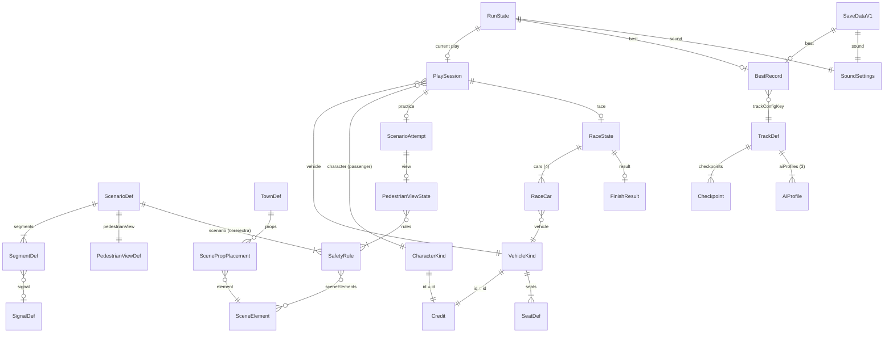

# Data Model: 아동용 3D 운전·보행 안전 게임 — 첫 버전

- 피처: `specs/001-kids-driving-safety-game/` · 작성 2026-10-12 · plan 단계 산출물
- 기준 원문: `spec.md`(plan 단계 사용자 결정 반영본), `docs/PRD.md`, `GLOSSARY.md`, `_workspace/02_plan_decisions.md`(리더 통합 결정·이름 통일표, 이 문서보다 우선), `_workspace/01_architect_architecture.md`(모듈 구조)
- 이 프로젝트에는 서버·DB가 없습니다. "데이터 모델"은 게임 state, 엔티티 관계, 정적 콘텐츠 데이터 형식, 브라우저 저장 형식입니다(AGENTS.md:25). DB 테이블·인덱스·마이그레이션 대신 TypeScript 타입, `src/content/*.ts` 데이터, localStorage 키 1개와 형식 버전을 정의합니다.
- `contracts/storage.md`와 `contracts/content-data.md`는 이 문서의 저장 형식(5장)과 콘텐츠 형식(6장)을 기준으로 합니다.

## 0. 표기 약속

| 항목 | 약속 | 근거 |
|---|---|---|
| ID(엔티티 식별자) | kebab-case 문자열(`'banana-car'`, `'signal-wait'`). 규칙 ID만 조사 ID 그대로(`'A6'`, 묶음은 `'A14-A15'`) | 02 결정 C |
| 상태·종류 값 | 02 결정 C의 표기 그대로(camelCase: `'loadFailed'`, `'overStopLine'`, `'lookLeft'`) | 02 결정 C |
| 게임 시간 | 모두 틱(1/60초) 정수. 상수 이름은 `*_TICKS`. 밀리초는 UI 꾸밈 애니메이션에만 | 02 결정 B14, FR-022, FR-074 |
| 좌표 | 판정은 바닥 2D 평면(x, z), 1 = 1 m. 높이(y)는 화면 표현에만. `heading`은 라디안, 0 = +Z 방향(모델 앞쪽을 +Z로 맞춤) | 01_architect "주행·충돌", "정규화" |
| 파일 찾기 | 에셋은 ID로 이름을 정해 찾음: 모델 `src/assets/models/<VehicleKindId 또는 CharacterKindId>.glb`, 규칙 그림 `src/assets/images/rules/<RuleId>.svg`, 음성 `src/assets/audio/voice/<RuleId 또는 VoiceLineId>.mp3`. 그래서 콘텐츠 데이터에 파일 경로 필드를 두지 않음. `AssetId`의 정확한 형식은 에셋 목록 계약이 정함(`contracts/assets.md`). 그림 SVG는 빌드 때 JS 번들 안에 인라인되어 따로 받지 않음 | 01_architect "에셋 파이프라인" |

공통 보조 타입:

```ts
type Vec2 = { x: number; z: number };
type Vec3 = { x: number; y: number; z: number };
type Pose = { x: number; z: number; heading: number };            // 라디안
type Rect = { minX: number; minZ: number; maxX: number; maxZ: number }; // 축 정렬 사각형(마을 구역)
```

---

## 1. Entity Overview

분류: **정적** = 빌드에 포함되는 콘텐츠·설정 / **상태** = 실행 중 메모리 값 / **저장** = localStorage / **계산** = 매번 계산하고 따로 두지 않음.
수명: **앱** = 배포 버전 / **브라우저** = 지우기 전까지 / **실행** = 페이지를 열고 닫거나 새로 고치기 전까지 / **플레이** = 차량·인물을 고른 뒤 한 번의 연습 흐름이나 경기 / **시도** = 안전 상황 하나를 시작해 끝내거나 나갈 때까지 / **경기** = 레이싱 1회 / **안내** = 보행자 시점 안내 1회.

| # | 엔티티 (spec Key Entities) | TS 타입 · 상수 | 분류 | 수명 | 위치 | 설명·근거 |
|---|---|---|---|---|---|---|
| 1 | 차량 종류 | `VehicleKind`, `VehicleKindId`, `VEHICLES` | 정적 | 앱 | `src/content/vehicles.ts` | 5종 외형 + 탑승객 좌석. 성능 필드 없음(FR-009, FR-011) |
| 2 | 인물 종류 | `CharacterKind`, `CharacterKindId`, `CHARACTERS` | 정적 | 앱 | `src/content/characters.ts` | 3종 외형. 보행자·주인공은 `'chicken-guy'` 고정(FR-096) |
| 3 | 탑승객 (용어집) | `SeatDef` + `RunState.selectedCharacter` | 정적+상태 | 앱 / 실행 | vehicles.ts, `src/app/session.ts` | 아이 차에 탄 고른 인물. 판정 무관(FR-097, FR-011) |
| 4 | 공통 운전 성능 | `DrivingSpec`, `DRIVING_SPEC` | 정적 | 앱 | `src/sim/vehicle.ts` | 모든 차가 쓰는 성능 1묶음(FR-011, FR-054) |
| 5 | 운전 입력 | `DriveInput` | 상태 | 틱 | `src/sim/vehicle.ts`(만드는 곳 `src/input/controls.ts`) | 조향·액셀·브레이크(우선순위 처리 후) + 후진 전환 사건(FR-014~017) |
| 6 | 주행 상태 | `DriveState`, `Gear` | 상태 | 시도·경기 | `src/sim/vehicle.ts` | 위치·방향·속도·전진/후진(FR-018, FR-019) |
| 7 | 교육용 마을 | `TownDef`, `TOWN` | 정적 | 앱 | `src/content/town.ts` | 구역·신호·장면 요소 배치(FR-028) |
| 8 | 장면 요소 | `SceneElementId`, `ScenePropPlacement` | 정적 | 앱 | town.ts | 마을 소품 12종 + 날씨 2종(FR-092) |
| 9 | 보행 안전 규칙 | `SafetyRule`, `RuleId`, `SAFETY_RULES` | 정적 | 앱 | `src/content/rules.ts` | 38문구 = 보행자 시점 안내 카드 38장(FR-044~046, FR-091) |
| 10 | 교통 신호 | `SignalDef` / `SignalState` | 정적 / 상태 | 앱 / 시도 | town.ts / `src/practice/townActors.ts` | 차량 신호·보행자 신호 구분(FR-042) |
| 11 | 등장 보행자 | `TownPedestrian` | 상태 | 시도 | townActors.ts | Chicken Guy 고정, 대기 → 횡단 → 완료(FR-039, FR-096) |
| 12 | 안전 연습 | 별도 타입 없음 → `RunState` 필드 + `PlaySession.flow` | 상태 | 실행 | session.ts | 조작 익히기 + 세 안전 상황(FR-027~030) |
| 13 | 안전 상황 | `ScenarioDef`, `ScenarioId`, `SCENARIOS` / `ScenarioAttempt` | 정적 / 상태 | 앱 / 시도 | `src/content/scenarios.ts` / `src/practice/scenario.ts` | 고정 3종(FR-028) |
| 14 | 연습 구간 | `SegmentDef` | 정적 | 앱 | scenarios.ts | 실패 시 다시 시작하는 단위(FR-033) |
| 15 | 안전 행동 | `SafetyActionStep` | 정적 | 앱 | scenarios.ts | 정지·대기·출발(FR-032) |
| 16 | 보행자 시점 안내 | `PedestrianViewDef` / `PedestrianViewState` | 정적 / 상태 | 앱 / 안내 | scenarios.ts / `src/pedestrianView/pedestrianView.ts` | 주인공 Chicken Guy, 카드 진행(FR-041, FR-091) |
| 17 | 전용 트랙 | `TrackDef`, `Checkpoint`, `AiProfile`, `TRACK` | 정적 | 앱 | `src/content/track.ts` | 중심선·폭·체크포인트·출발 칸·바퀴 수(FR-052, FR-058) |
| 18 | 레이싱 경기 | `RaceState` | 상태 | 경기 | `src/race/race.ts` | 4대, 경기 틱, 단계(FR-053, FR-055) |
| 19 | 참가 차량 | `RaceCar` | 상태 | 경기 | `src/race/progress.ts` | 플레이어/컴퓨터, 진행 필드(FR-057, FR-061) |
| 20 | 코스 진행도 | `RaceCar.lapsDone`·`nextCheckpoint` + `progressValue()` | 상태+계산 | 경기 | progress.ts | 순위·바퀴 인정 근거(FR-057, FR-059) |
| 21 | 완주 기록 | `FinishResult` | 계산 | 경기 | race.ts | 시간·순위·새 기록 여부. 저장 안 함 |
| 22 | 최고 기록 | `BestRecord` | 저장(+메모리) | 브라우저 | `src/storage/save.ts` | 트랙 구성당 0~1개(FR-064, FR-082) |
| 23 | 소리 설정 | `SoundSettings` | 저장(+메모리) | 브라우저 | save.ts | 배경음 / 안내·효과음(FR-069) |
| 24 | 브라우저 저장 기록 | `SaveDataV1` | 저장 | 브라우저 | save.ts | 형식 버전 + 3항목(FR-078) |
| 25 | 현재 실행 상태 | `RunState` | 상태 | 실행 | session.ts | 선택·완료·순환 위치 등(FR-051, FR-091) |
| 26 | 자료 출처 | `Credit`, `CreditId`, `CREDITS` | 정적 | 앱 | `src/content/credits.ts` | 모델 8종 + 채택 음원(FR-088~090) |

보조 타입: `PlaySession`, `ScreenState`(`src/app/flow.ts`), `VoiceLineId`·`VOICE_LINES`·`VIOLATION_LINES`(`src/content/voice.ts`), `SeatDef`, `PictureElementId`, `ViolationKind`, `RouteIssue`, `CharacterPose`.

---

## 2. Entity Details

### 2.1 정적 콘텐츠

#### VehicleKind — 차량 종류 (`VEHICLES`, 5개)

| 필드 | 타입 | 범위·기본값 | 근거 |
|---|---|---|---|
| `id` | `VehicleKindId = 'buggy' \| 'jeep' \| 'truck' \| 'wagon' \| 'banana-car'` | 배열 순서 = 선택 화면 순서 = 컴퓨터 차량 외형 순서(7장) | FR-009 |
| `label` | `string` | `'버기'`, `'지프'`, `'트럭'`, `'왜건'`, `'바나나 자동차'`. 보조 글자·접근성 이름 | FR-009, FR-012 |
| `yawDeg` | `number` (도) | 모델 앞쪽을 +Z로 돌리는 각. 렌더링 점검에서 눈으로 정함 | FR-011, 01_architect "정규화" |
| `seats` | `SeatDef[]` | **1개 이상**. `seats[0]` = 아이가 고른 탑승객 자리. 뒤에서 내려다보는 카메라에서 보여야 함 | FR-097, SC-032, 02 결정 A2 |

`SeatDef = { pos: Vec3; height: number }` — `pos`는 정규화된 차량 모델 기준 좌표(m), `height`는 그 자리에 앉힐 인물의 표시 키(m, 인물은 이 키로 맞춰 크기 조정).

- 성능·판정 크기 필드는 없습니다. 모든 차가 `DRIVING_SPEC` 하나를 쓰고 `stepVehicle`에 차량 종류 매개변수가 없어서, 차종 사이 성능 차이가 구조상 생길 수 없습니다(FR-011, SC-002).
- 모델 파일은 `models/<id>.glb`, 크레딧 ID는 차량 ID와 같습니다(파일·출처 연결 필드 없음, 6.3 검사로 보장).
- 바퀴 회전은 첫 버전에 없습니다(02 결정 B2).
- 컴퓨터 차량·마을 차량의 탑승객은 콘텐츠 설계가 정한 뒤 그 차를 놓는 데이터에 필드를 더합니다(Open Issues 4).

#### CharacterKind — 인물 종류 (`CHARACTERS`, 3개)

| 필드 | 타입 | 범위·기본값 | 근거 |
|---|---|---|---|
| `id` | `CharacterKindId = 'chicken-guy' \| 'cool-banana-guy' \| 'turtle'` | 배열 순서 = 인물 선택 화면 순서 | FR-097 |
| `label` | `string` | `'Chicken Guy'`, `'Cool Bannana Guy'`(원작 표기), `'Turtle'` | FR-097, PRD |
| `yawDeg` | `number` (도) | 앞쪽을 +Z로 | 01_architect "정규화" |
| `clips` | `{ idle?: string; walk?: string }` | `chicken-guy`는 `{ idle: 'Armature\|Idle', walk: 'Armature\|Walk' }`. 리깅한 나머지 둘은 `{ idle: 'Idle' }`이며 걷기 클립은 없음 | 02 결정 A1, 03 리깅 기록 |

- 2026-10-12 Cool Bannana Guy·Turtle 수정본에 각각 뼈대 16개와 `Idle`, `RaiseHand`, `LookLeft`, `LookRight`, `Sit` 클립을 추가했습니다. 두 수정본의 `yawDeg`는 0이며, 게임에서 기본 자세로 쓰는 `Idle`만 현재 `clips` 타입에 연결합니다. 추가 클립의 용도·좌석 자세 고정은 [리깅 작업 기록](_workspace/03_character-rigging.md)을 따릅니다. 세 캐릭터 모두 뼈대를 보존하여 로딩·복제해야 합니다.

- 등장 보행자와 보행자 시점 안내 주인공은 언제나 `'chicken-guy'`입니다. 그래서 `TownPedestrian`·`PedestrianViewState`에는 인물 필드가 없습니다(FR-096, 02 결정 A1).
- 손 들기·왼쪽/오른쪽 보기는 `Head`·`Hand.L`·`Hand.R` 관절을 코드로 돌려 만듭니다(`src/render/characters.ts`). 관절 이름은 Chicken Guy 전용 코드 상수이고 콘텐츠 데이터가 아닙니다. GLB 안 이름은 `Hand.L`/`Hand.R`이지만 three.js GLTFLoader가 노드 이름에서 `.`을 지우므로 코드 상수 값은 **`Head`, `HandL`, `HandR`**입니다(근거: `contracts/assets.md` 5장). `Armature|Sprint`·`Armature|Jump`는 쓰지 않습니다(FR-094).

#### DrivingSpec — 공통 운전 성능 (`DRIVING_SPEC`, 1개)

| 필드 | 타입 | 범위·기본값 | 근거 |
|---|---|---|---|
| `maxForwardSpeed` | `number` (m/s) | 플레이 점검 값(약 5분 경기에 맞춤) | FR-011, SC-011 |
| `maxReverseSpeed` | `number` (m/s) | 전진보다 작게 | FR-011 |
| `acceleration` | `number` (m/s²) | | FR-011 |
| `brakeDeceleration` | `number` (m/s²) | | FR-011 |
| `coastDeceleration` | `number` (m/s²) | 0보다 큼: 페달을 떼면 서서히 섬 | 02 결정 B4 |
| `stopSnapSpeed` | `number` (m/s) | 액셀 없이 속도가 이 값 아래로 내려가면 `speed = 0`으로 맞춤 | 02 결정 B4, spec.md:625 |
| `maxSteerRate` | `number` (rad/s) | 조향 식은 `src/sim/vehicle.ts`가 정함 | FR-011, SC-002 |
| `bodyLength` | `number` (m) | 판정용 차체 길이. 정지선 판정은 "차체 앞 끝 = 위치 + 진행 방향 × bodyLength/2" | FR-011, FR-033 |
| `bodyRadius` | `number` (m) | 차끼리 겹침 판정 원 반지름 | FR-011, FR-060 |

- "완전히 멈춤" = `speed === 0`(브레이크로 세웠든 자연 감속으로 섰든 같음, 02 결정 B4).

#### SafetyRule — 보행 안전 규칙 (`SAFETY_RULES`, 38개)

한 규칙 = 보행자 시점 안내 카드 한 장(그림 + 음성 + 주인공 행동)입니다.

| 필드 | 타입 | 범위·기본값 | 근거 |
|---|---|---|---|
| `id` | `RuleId` (`string`) | 조사 ID. 묶음은 `-`로 이음(`'A14-A15'`). 38개 고유 | spec 표(spec.md:445~484), SC-030 |
| `scenario` | `ScenarioId` | 배정된 안전 상황 | FR-044~046 |
| `tier` | `'core' \| 'extra'` | 핵심 / 추가 | FR-091 |
| `text` | `string` | 아이에게 들려줄 문장. spec 표 원문에서 시작해 콘텐츠 설계에서 다듬음. 음성 대본이자 검토 기준 | FR-095 |
| `researchIds` | `string[]` | `['A14', 'A15']`. 38행 합집합 = 41 | SC-030 |
| `sceneElements` | `SceneElementId[]` | 3D 마을에 있어야 하는 요소. `[]` 가능 | FR-092 |
| `pictureElements` | `PictureElementId[]` | **카드 그림에만** 그릴 사람·옷차림. 3D로 만들지 않음. A2·A25·A26·B13·B14에만 값이 있음 | FR-092, 02 결정 A4 |
| `weather` | `'rain' \| 'dark' \| null` | 이 카드 동안 보행자 시점 안내 장면을 그 날씨로 보여 줌 | FR-092 |
| `poses` | `CharacterPose[]` | 카드 길이 동안 주인공이 차례로 보여 줄 행동. `[]` = `'idle'`. 위험 동작은 타입에 없음 | FR-039, FR-094, US2-19 |
| `durationTicks` | `number` (정수 > 0) | 카드 표시 길이. 음성 길이 이상으로 정하되, 진행은 음성 끝을 기다리지 않음 | FR-070, 02 결정 B13 |

```ts
type SceneElementId =                 // FR-092 목록 12종 (마을 3D, 기본 도형으로 직접 만듦)
  | 'parked-cars' | 'reversing-car' | 'large-vehicle' | 'school-bus' | 'bus-stop'
  | 'alley' | 'no-sidewalk-road' | 'unsignalized-crosswalk' | 'yellow-wait-line'
  | 'overpass-or-underpass' | 'rolling-ball' | 'object-under-car';

type PictureElementId =               // 카드 그림 전용 (FR-092, 02 결정 A4)
  | 'adult-person' | 'person-across-street' | 'friend-person' | 'umbrella' | 'bright-clothes';

type CharacterPose = 'idle' | 'walk' | 'lookLeft' | 'lookRight' | 'raiseHand'; // 뛰기·점프 없음
```

- **순서**: 같은 안전 상황·같은 `tier` 안에서 배열 순서 = 안내 순서 = 추가 규칙 순환 순서. 핵심 순서가 의미를 갖는 곳은 FR-045의 다섯 단계입니다.
- 그림 파일 `images/rules/<id>.svg`, 음성 파일 `audio/voice/<id>.mp3`. 파일이 아직 없으면 자리표시 그림·무음으로 진행합니다(FR-070, 콘텐츠 작업 분리).
- 근거 출처 URL은 실행 중에 쓰지 않으므로 넣지 않고 `researchIds`로 `_workspace/02_pedestrian-safety-rules-research.md`를 가리킵니다.

#### ScenarioDef — 안전 상황 (`SCENARIOS`, 3개)

| 필드 | 타입 | 범위·기본값 | 근거 |
|---|---|---|---|
| `id` | `ScenarioId = 'signal-wait' \| 'crossing-check' \| 'turning-car'` | 배열 순서 = 처음 이용 흐름 순서 | FR-028, FR-029 |
| `segments` | `SegmentDef[]` | 1개 이상 | FR-033 |
| `pedestrianView` | `PedestrianViewDef` | 상황당 1개 | FR-041 |

- 연습 목록 그림은 `images/ui/` 아래 ID 이름 규칙으로 찾습니다(경로는 에셋 목록 계약).
- 이 상황에 배정된 규칙은 `SAFETY_RULES`에서 `scenario`로 골라냅니다(정보를 한 곳에만 둠).

#### SegmentDef — 연습 구간

판정 좌표는 구간마다의 차선 중심 경로 `path`이고, 차체 앞 끝을 경로에 투영한 거리 `s`(m)로 위치를 셉니다(01_architect "조작 익히기·안전 연습 판정").

| 필드 | 타입 | 범위·기본값 | 근거 |
|---|---|---|---|
| `id` | `string` | 상황 안에서 고유 | — |
| `start` | `Pose` | 재시도 시작 자세. 차는 전진·정지로 시작 | FR-019, FR-033 |
| `path` | `Vec2[]` | 차선 중심 경로. 회전 상황은 회전 경로까지 포함 | FR-034 |
| `stopLineS` | `number` | 정지선 위치(s) | FR-033 |
| `stopZone` | `{ fromS: number; toS: number }` | 정지 인정 범위. `toS ≤ stopLineS`. 3~5세 기준 넉넉하게 | spec.md:624 |
| `steps` | `SafetyActionStep[]` | 1개 이상, 순서대로 인정 | FR-032 |
| `violations` | `ViolationKind[]` | 이 구간에서 판정하는 잘못된 행동 | FR-033, SC-010 |
| `signal` | `SignalId \| null` | 이 구간이 쓰는 차량 신호 | FR-040 |
| `crosswalk` | `AreaId \| null` | 판정에 쓰는 횡단보도 구역 | FR-033 |
| `plan` | `ActorPlan` | 신호·보행자가 플레이어 위치·정지에 맞춰 움직이는 계획(형식 확정 T043) | FR-039, FR-040 |

```ts
type SafetyActionStep =
  | { action: 'stop' }                                             // stopZone 안에서 speed === 0
  | { action: 'wait'; until: 'vehicleGreen' | 'pedestriansClear' } // 조건까지 speed === 0 유지
  | { action: 'go' };                                              // 조건 뒤 출발, 차체 앞 끝이 path 끝에 닿음

type ActorPlan = {                       // 형식 확정(T043, Open Issues 1 해결)
  redAtS: number | null;                 // 차체 앞 끝이 이 s를 지나면 정지 신호(정지선까지 최대 속도 제동 거리 + 여유 이상 앞)
  greenAfterStoppedTicks: number | null; // stopZone에서 멈춘 뒤 이만큼 지나면 진행 신호
  pedestrianSignal: SignalId | null;     // 구간 차 신호(signal)와 짝인 보행자 신호. 차 신호가 없는 구간(회전 방향 횡단보도)은 초록 고정
  pedestrians: {
    path: Vec2[];                        // 보도 대기 위치 → 건너편
    poses: CharacterPose[];              // 건너기 전 보여 줄 올바른 행동 순서(예: lookLeft, lookRight, lookLeft, raiseHand)
    start: 'playerStopped' | 'pedestrianGreen'; // 출발 조건. 어느 쪽이든 플레이어가 멈췄거나 멈출 수 있는 거리일 때만
  }[];
};
```

#### ViolationKind / RouteIssue — 잘못된 행동 / 경로 문제

| `ViolationKind` | 판정(요약) | FR-033 | SC-010 |
|---|---|---|---|
| `turnedIntoCrossingPedestrian` | 회전 경로에서 보행자가 건너는 중인 횡단보도에 차체 앞 끝이 들어감 | 보행자가 건너는 횡단보도로 회전 | 회전 시 기다리지 않음 |
| `enteredCrosswalkWithPedestrian` | 직진 경로에서 보행자가 건너는 중인 횡단보도에 들어감 | 보행자가 건너는 횡단보도로 진입 | 보행자 횡단 중 출발 |
| `ranRed` | `stop` 단계, 차 신호 노랑·빨강, 이 구간 시도에서 한 번도 멈추지 않은 채 정지선을 넘으려 함 | 정지 신호에 멈추지 않고 통과 | 멈추지 않고 통과 |
| `earlyStart` | `wait` 단계(멈춘 뒤)에서 조건 충족 전에 정지선을 넘으려 함 | 안전해지기 전 출발 | 정지 신호 중 출발 |
| `overStopLine` | `go` 전 단계에서 정지선을 넘으려 하는데 `ranRed`·`earlyStart`가 아님(예: 정지 구역 앞에서 한 번 멈춘 뒤 다시 가서 넘음, 신호 없는 곳에서 넘음). 후보 위치로 판정하므로 차가 실제로 선을 넘은 채 서는 일은 없음(사용자 결정 2026-10-12) | 정지 위치를 넘어 진입 | 정지선 초과 |
| `enteredSidewalk` | 차체가 보도 구역에 들어감 | 보도 진입 | — |

- 한 틱에 여러 개가 걸리면 위 표의 위쪽 하나만 사건으로 냅니다(보행자 관련 설명을 우선). 사건 이름은 `violation`.
- `RouteIssue = 'stoppedTooFar' | 'wrongWay' | 'leftPath' | 'blocked'` — 실패가 아닙니다(FR-034, FR-035). 사건은 하나로 고정합니다.

  | `RouteIssue` | 뜻 | 사건 |
  |---|---|---|
  | `stoppedTooFar` | `stopZone`보다 앞에서 멈춤 | `hint`(`cue: 'closer'`, "조금 더 앞으로") |
  | `wrongWay` | 회전 대신 직진 등 가야 할 방향과 다름 | `hint`(`cue: 'way'`, 방향 안내) |
  | `leftPath` | 후진 등으로 구간 경로를 벗어남 | `redirect`(구간을 처음부터 다시 놓음, `failStreak` 그대로) |
  | `blocked` | 건물·연석에 닿은 채 `IDLE_HINT_TICKS` 동안 경로 진행 없음 | `redirect` |

  메모: `blocked` 판정 시간에 `IDLE_HINT_TICKS`(무입력 재안내 간격)를 재사용합니다. 의미가 다른 두 값을 한 상수로 묶은 것이며, 플레이 점검에서 따로 조정할 필요가 생기면 분리합니다.

#### PedestrianViewDef — 보행자 시점 안내 정의

| 필드 | 타입 | 범위·기본값 | 근거 |
|---|---|---|---|
| `segment` | `number` | 안내가 나오는 구간 번호 | FR-041 |
| `afterStep` | `number` | 그 구간의 몇 번째 단계를 마친 뒤 나오는지. 안내는 신호를 그 순간 상태로 멈춰 보여 주므로 **보행자 차례**(보행자 신호 초록·차 신호 초록 아님)인 단계 뒤에 둠 — 세 연습 모두 멈춘 직후(사용자 지적 2026-10-13: 차 신호 초록 뒤에 두면 주인공이 빨간불에 건너는 장면이 됨) | FR-041 "중요한 순간", FR-039, FR-094 |
| `camera` | `{ pos: Vec3; lookAt: Vec3 }` | 같은 장소, 아이 눈높이 | FR-041 |
| `protagonistPath` | `Vec2[]` | Chicken Guy가 서는 곳(첫 점)과 `walk` 행동 때 걷는 길 | FR-096, US2-19 |
| `introTicks` | `number` | 카메라가 보행자 시점으로 옮겨 가는 길이 | 01_architect "보행자 시점 안내" |

#### TownDef — 교육용 마을 (`TOWN`, 1개)

| 필드 | 타입 | 설명 | 근거 |
|---|---|---|---|
| `areas` | `{ id: AreaId; kind: 'road' \| 'crosswalk' \| 'sidewalk' \| 'building'; rect: Rect }[]` | 판정 구역. 건물은 이동 차단 + 감속, 보도 진입은 `enteredSidewalk` | FR-033, FR-035 |
| `signals` | `SignalDef[]` = `{ id: SignalId; kind: 'vehicle' \| 'pedestrian'; pose: Pose }[]` | 차량 신호와 보행자 신호를 따로 둠 | FR-042 |
| `props` | `ScenePropPlacement[]` = `{ element: SceneElementId; near: ScenarioId; pose: Pose }[]` | 세 연습 장소 주변 장면 요소 | FR-092 |

- 3D 표현은 이 데이터로 기본 도형(상자·원기둥·평면)을 만들어 그립니다(`src/render/townView.ts`). 버스·통학버스·정류장·육교 등도 기본 도형으로 만들어 외부 자료를 더하지 않습니다(02 결정 A4).

#### TrackDef — 전용 트랙 (`TRACK`, 1개)

| 필드 | 타입 | 범위·기본값 | 근거 |
|---|---|---|---|
| `id` | `string` | `'main'` | FR-052 |
| `revision` | `number` (정수 ≥ 1) | 중심선·폭·체크포인트가 바뀌면 1 올림 | FR-082 |
| `laps` | `1 \| 2` | **2(잠정)**, 트랙 플레이 점검에서 확정 | FR-058, 02 결정 B5 |
| `centerline` | `Vec2[]` | 닫힌 고리, 배열 순서 = 정상 진행 방향 | FR-057 |
| `width` | `number` (m) | 트랙 폭. 벽은 양쪽 가장자리 | FR-061 |
| `checkpoints` | `Checkpoint[]` | 3개 이상, **0번 = 결승선**, `arc` 오름차순 | FR-059 |
| `grid` | `[Pose, Pose, Pose, Pose]` | 출발 칸. **결승선을 지난 첫 구간 안**에 둠(출발 직후 결승선 통과를 따로 처리하지 않기 위해) | FR-055 |
| `playerSlot` | `0 \| 1 \| 2 \| 3` | 플레이어 출발 칸 | FR-053 |
| `aiProfiles` | `[AiProfile, AiProfile, AiProfile]` | 컴퓨터 차량 3대 | FR-054 |

- `Checkpoint = { arc: number }` — 중심선 시작점부터 이 체크포인트까지 거리(m). 통과선은 그 지점에서 중심선에 수직인 폭 `width`의 선분입니다(트랙 폭만 가로지르므로 안쪽 가로지르기로 통과가 생기지 않음).
- 복귀 자세는 데이터로 두지 않고 계산합니다(7장 "복귀 자세").
- `AiProfile = { laneOffset: number; targetSpeedRatio: number; reactionTicks: number }` — 중심선에서 옆으로 벗어난 주행선(m), 목표 속도 비율(0 < r ≤ 1, `DRIVING_SPEC` 한도를 넘지 않음), 앞 상황에 반응하는 지연(틱). 성능 한도를 올리는 필드는 없습니다(FR-054). `targetSpeedRatio`는 "액셀을 언제 떼는지"라는 주행 방식이고 성능 한도(`DRIVING_SPEC`)는 모든 차가 같으므로 FR-054(난이도는 주행 경로와 반응으로 조절)에 맞습니다(리더 결정 B17). 컴퓨터 차량도 `aiInput`이 만든 `DriveInput`(액셀 켬/끔)만 씁니다.
- 트랙 구성 키: `trackConfigKey(TRACK)` = `` `${id}:${revision}:${laps}` `` → 예 `"main:1:2"`(FR-082).

#### Credit — 자료 출처 (`CREDITS`)

| 필드 | 타입 | 범위·기본값 | 근거 |
|---|---|---|---|
| `id` | `CreditId` (`string`) | 모델은 모델 ID와 같음(`'buggy'`, `'chicken-guy'`) | FR-088 |
| `kind` | `'vehicleModel' \| 'characterModel' \| 'musicComposition' \| 'musicRecording' \| 'sfx' \| 'voice' \| 'font' \| 'icon'` | 곡과 녹음 음원은 따로 1행씩 | FR-088, FR-089 |
| `title` | `string` | 작품명 원문 | FR-088 |
| `author` | `string` | 제작자(곡은 작곡·편곡, 녹음은 연주·제작을 글로 구분) | FR-088, FR-089 |
| `sourceUrl` | `string` | 원출처 주소. 누를 수 없는 글자로만 표시(`textContent`, `<a>` 없음) | FR-086, FR-090 |
| `license` | `string` | `'CC BY 3.0'`, `'CC0 1.0'` 등 | FR-088 |
| `licenseUrl` | `string` | 글자로만 표시 | FR-090 |
| `changes` | `string \| null` | 변경 사실·내용 | FR-088 |
| `checkedOn` | `string` (`YYYY-MM-DD`) | 사용조건 확인일. 확인하지 않은 자료는 목록에 넣지 않음 = 배포하지 않음 | FR-089 |

모델 8종(PRD "제공된 차량·사람 모델", 확인일 2026-10-12):

| id | kind | title | author | sourceUrl | license |
|---|---|---|---|---|---|
| `buggy` | vehicleModel | Buggy | Nick Slough | https://poly.pizza/m/eZ_13w7qZh7 | CC BY 3.0 |
| `jeep` | vehicleModel | Jeep | Zsky | https://poly.pizza/m/AcSdGGrgYP | CC BY 3.0 |
| `truck` | vehicleModel | Truck | sugamo | https://poly.pizza/m/fbDxapxkwY9 | CC BY 3.0 |
| `wagon` | vehicleModel | Wagon | Poly by Google | https://poly.pizza/m/8HnKzYQeRYD | CC BY 3.0 |
| `banana-car` | vehicleModel | cartoon banana car | Felipe Lujan-Bear | https://poly.pizza/m/1RjuCX8gI9w | CC BY 3.0 |
| `chicken-guy` | characterModel | Chicken Guy | J-Toastie | https://poly.pizza/m/b2hbNsaTN0 | CC BY 3.0 |
| `cool-banana-guy` | characterModel | Cool Bannana Guy | Polygonal Mind | https://poly.pizza/m/TFlEjNafR1 | CC0 1.0 |
| `turtle` | characterModel | Turtle | marioba | https://poly.pizza/m/RvTg4XTOUH | CC BY 3.0 |

- `licenseUrl`: CC BY 3.0 → `https://creativecommons.org/licenses/by/3.0/deed.ko`, CC0 → `https://creativecommons.org/publicdomain/zero/1.0/deed.ko`(PRD).
- `changes` 기본 문구(차량 5종): "poly.pizza가 원작 파일을 GLB 형식으로 변환해 배포한 파일을 사용했습니다. 게임에서 크기·방향·바닥 위치를 맞추고, 여러 부분을 재질별로 합쳐 표시합니다."
- Cool Bannana Guy·Turtle: "poly.pizza가 변환한 GLB를 바탕으로 방향·크기·바닥 위치를 맞추고, 팔꿈치·손목 주변에 면을 나누는 선과 뼈대를 추가했습니다. 기본 자세·손 들기·좌우 보기·앉기 동작을 추가했으며 원래 재질을 유지했습니다."
- Chicken Guy: "poly.pizza가 원작 파일을 GLB 형식으로 변환해 배포한 파일을 사용했습니다. 게임에서 크기·방향·바닥 위치를 맞추고, 포함된 걷기·서 있기 동작을 사용하며, 머리·손 관절을 움직여 왼쪽·오른쪽 보기와 손 들기를 표현합니다."(02 결정 A1)
- 음원·안내 음성·효과음은 채택할 때 같은 모양으로 행을 더합니다. 지금은 0행(02 결정 B15).

#### 안내 음성 줄 — 규칙 밖 음성 (`VOICE_LINES`, `VIOLATION_LINES`)

```ts
type VoiceLineId = /* contracts/content-data.md 3장의 26개 kebab-case ID 합집합 */;
const VOICE_LINES: Readonly<Record<VoiceLineId, string>>;          // ID → 대본(검토 기준, SC-027)
const VIOLATION_LINES: Readonly<Record<ViolationKind, VoiceLineId>>; // 위험 직전 멈춤 설명 6종
```

- 파일은 `audio/voice/<VoiceLineId>.mp3`(FR-067). 없으면 무음으로 화면 안내만 진행합니다(FR-070).
- 코드가 ID로 부르므로 ID 목록은 코드 단계에서 정한 닫힌 목록 26개입니다(시범·경로 안내·후진 거절·위험 직전 멈춤 설명 6·칭찬·잠김·열림 축하·완주·새 기록·화면 안내). 목록과 쓰는 곳은 `contracts/content-data.md` 3장. 대본은 콘텐츠 단계에서 씁니다(02 결정 B15).
- `Record`라서 줄이 하나라도 빠지면 타입 검사에서 빌드가 실패합니다. `VIOLATION_LINES`도 6종이 빠짐없이 있어야 빌드됩니다. 설명 카드 표시 길이는 `EXPLAIN_TICKS` 하나입니다(FR-033, FR-037).
- 규칙 카드의 음성은 `SafetyRule.text`·`RuleId`(`audio/voice/<RuleId>.mp3`)를 쓰고 여기에 중복해 적지 않습니다.

### 2.2 실행 중 상태

#### RunState — 현재 실행 상태 (`src/app/session.ts`, 저장 안 함)

| 필드 | 타입 | 시작값 | 근거 |
|---|---|---|---|
| `selectedVehicle` | `VehicleKindId \| null` | `null`. 다음 선택 화면의 기본 강조 | FR-010 |
| `selectedCharacter` | `CharacterKindId \| null` | `null`. **아이 차에 태울 탑승객** | FR-097 |
| `tutorialDone` | `boolean` | 검사를 통과한 저장 값, 아니면 `false`. 세 번째 완료 순간 `true`. 레이싱 열림 = 이 값 | FR-047, FR-050, FR-079 |
| `completedThisRun` | `Set<ScenarioId>` | 빈 집합 | FR-030, FR-051 |
| `drivingLessonDone` | `boolean` | `false`. 조작 익히기 통과 | FR-027 |
| `practiceStarted` | `boolean` | `false`. 이번 실행에서 안전 연습을 시작한 적이 있는지(처음 이용 흐름 판단) | FR-029, 02 결정 B8 |
| `extraCursor` | `Record<ScenarioId, number>` | 모두 `0` | FR-091 |
| `sound` | `SoundSettings` | 저장 값, 아니면 `{ music: true, voiceSfx: true }` | FR-069 |
| `best` | `BestRecord \| null` | 저장 값 중 현재 트랙 구성과 같은 것, 아니면 `null` | FR-064, FR-082 |
| `storageNoticeShown` | `boolean` | `false`. 저장 불가 안내는 실행당 1회 | FR-080, SC-017 |
| `audioUnlocked` | `boolean` | `false`. 시작 버튼 뒤 소리 활성화 성공 시 `true` | FR-066 |

- 메모리 값(`best`, `sound`, `tutorialDone`)이 늘 실행 중의 진짜 값이고 저장소는 사본입니다. 그래서 spec의 "저장 불가 시 이번 실행의 최고 기록·소리 설정"이 따로 필요 없습니다.
- spec의 "저장 기능 사용 가능 여부"도 따로 두지 않습니다. 필요한 동작은 "안내 1회"와 "저장할 때마다 다시 시도" 둘뿐이라 `storageNoticeShown` 하나로 충분합니다(4.11).

#### PlaySession — 한 번의 플레이 (`src/app/flow.ts`)

```ts
type PlaySession = { vehicle: VehicleKindId; character: CharacterKindId } &
  ({ mode: 'race' } | { mode: 'practice'; flow: 'sequence' | 'menu' });
```

차량·인물을 고른 뒤 만들어 null 없이 넘깁니다. `character`는 아이 차 `seats[0]`에 앉습니다(FR-097, SC-032).

#### ScreenState — 화면 흐름 (`src/app/flow.ts`)

| 필드 | 타입 | 근거 |
|---|---|---|
| `screen` | `'boot' \| 'unsupported' \| 'loading' \| 'loadFailed' \| 'start' \| 'credits' \| 'pickVehicle' \| 'pickCharacter' \| 'drivingLesson' \| 'practiceMenu' \| 'practice' \| 'race' \| 'raceResult' \| 'fatal'` | 02 결정 C |
| `paused` | `null \| 'user' \| 'auto'` | `'auto'` = 숨김·세로·컨텍스트 손실로 저절로 멈춤(보행자 시점 안내를 처음부터 다시 보여 주는 조건) |
| `rotate`, `storageNotice`, `contextLost`, `confirmExit` | `boolean` | 겹침 표시 |

#### DriveInput / DriveState / Gear

| 타입 | 필드 | 설명 | 근거 |
|---|---|---|---|
| `DriveInput` | `steer: number`(−1..1), `throttle: boolean`, `brake: boolean` | `toDriveInput(pressedButtons(...))` 결과. 좌우 동시 = `steer 0`, 액셀·브레이크 동시 = `throttle false, brake true`. 컴퓨터 차량도 같은 모양 | FR-014, FR-015, FR-054 |
| `DriveState` | `x`, `z`(m), `heading`(rad), `speed`(m/s, ≥ 0), `gear: Gear` | 움직이는 방향은 `gear`가 정함. 멈춤 = `speed === 0` | FR-018, 02 결정 B4 |
| `Gear` | `'forward' \| 'reverse'` | 구간 재시도·복귀·경기 진입 때 `'forward'` | FR-019 |

- 후진 전환은 상태가 아니라 누르는 순간의 사건이며 `requestGearToggle(state)`가 `speed === 0`일 때만 바꿉니다. 거절된 요청은 기억하지 않습니다(FR-018).
- 모든 입력을 놓는 시점(`releaseAll`): 일시정지, 숨김, `blur`, 회전·크기 변화, 보행자 시점 안내 시작, 구간 재시도, 코스 복귀, 경기 화면 진입, 위험 직전 멈춤. 예외: 카운트다운 중 새로 누른 액셀은 출발 순간 반영(FR-017).

#### 조작 익히기 진행 (`src/practice/drivingLesson.ts`, `stepDrivingLesson`)

`DrivingLessonState = { step: 'steer' | 'accel' | 'brake' | 'reverse'; idleTicks: number; drive: DriveState }` — 순서 고정, 시범 → 직접 해 보면 다음. `drive`는 연습 차이며 시작은 `restingAt(SCENARIOS[0].segments[0].start)`(전진·정지). 마지막을 마친 틱에 사건 `lessonDone`, flow가 `RunState.drivingLessonDone = true`(FR-027). 사건은 `contracts/events.md` 4장.

#### ScenarioAttempt — 안전 상황 시도 1회 (`src/practice/scenario.ts`, `stepScenario`)

| 필드 | 타입 | 시작값 | 근거 |
|---|---|---|---|
| `scenario` | `ScenarioId` | | |
| `phase` | `'driving' \| 'explaining' \| 'pedestrianView' \| 'done'` | `'driving'` | 02 결정 C |
| `segment`, `step` | `number` | `0`, `0` | FR-032 |
| `viewDone` | `boolean` | `false`. 같은 시도 안 구간 재시도에도 유지 | FR-032, 02 결정 B10 |
| `violation` | `ViolationKind \| null` | 설명 중인 잘못된 행동 | FR-033 |
| `phaseTicks` | `number` | 현재 단계(설명 등) 경과 틱 | FR-074 |
| `failStreak` | `number` | 같은 구간 연속 실패 수. `DEMO_AFTER_FAILS`에 닿으면 시범 다시 | FR-034, US2-8 |
| `idleTicks` | `number` | 안내된 행동이 없는 틱. `IDLE_HINT_TICKS`마다 재안내(실패 아님) | FR-031 |
| `stoppedTicks` | `number` | `0`. `stop` 단계를 마친(stopZone에서 멈춘) 뒤 지난 운전 틱. 구간 시도 안에서 줄지 않음(`stepTownActors` 입력) | FR-040 |
| `stoppedOnce` | `boolean` | `false`. 이 구간 시도에서 움직이다 멈춘 적 있음(`ranRed`·`overStopLine` 구분) | FR-033 |
| `blockedTicks` | `number` | `0`. 건물에 닿은 채 경로 진행이 없는 틱(`blocked`) | FR-035 |
| `drive` | `DriveState` | 구간 `start` | |
| `signals` | `SignalState[]` | 구간 시작 상태 | FR-040 |
| `pedestrians` | `TownPedestrian[]` | 구간 시작 상태 | FR-039 |
| `view` | `PedestrianViewState \| null` | `null` | FR-041 |
| `picked` | `{ rules: readonly RuleId[]; extrasCount: number }` | 시도 시작 때 `pickRules(scenario, isReplay(scenario, run), run.extraCursor[scenario])` 결과(`startScenario`의 인자). 시도 동안 바뀌지 않음 | FR-091 |

#### PedestrianViewState — 보행자 시점 안내 1회 (`stepPedestrianView`)

| 필드 | 타입 | 설명 | 근거 |
|---|---|---|---|
| `rules` | `RuleId[]` | `ScenarioAttempt.picked.rules`(시도 시작 때 `pickRules`가 정한 핵심 전부 + 추가 묶음). 안내 중에 바뀌지 않음 | FR-091 |
| `extrasCount` | `number` | 이번 묶음의 추가 규칙 수. 끝까지 봤을 때 커서를 이만큼 옮김 | FR-091 |
| `card` | `number` | `-1` = 카메라 이동(`introTicks`), `0..` = 지금 카드, `rules.length` = 끝남(그 뒤 no-op) | FR-041 |
| `cardTicks` | `number` | 지금 카드(또는 카메라 이동) 경과 틱. `-1` = `'card'` 되감기 직후(다음 틱이 그 카드의 0틱이라 `cardShown`이 다시 나옴) | FR-070 |

주인공은 언제나 Chicken Guy이므로 인물 필드가 없습니다. 날씨·행동은 지금 카드 규칙의 `weather`·`poses`에서 읽습니다.

#### SignalState / TownPedestrian (`src/practice/townActors.ts`)

| 타입 | 필드 | 값 | 근거 |
|---|---|---|---|
| `SignalState` | `id: SignalId`, `light` | 차량 신호 `'green' \| 'yellow' \| 'red'`, 보행자 신호 `'red' \| 'green' \| 'flashing'` | FR-042, FR-043 |
| `TownPedestrian` | `state: 'waiting' \| 'crossing' \| 'crossed'`, `pos: Vec2`, `heading: number`, `pose: CharacterPose`, `plan: number`(ActorPlan.pedestrians 순번), `ticks: number`(지금 state 경과 틱: 건너기 전 행동 순서·걸은 거리) | Chicken Guy 고정, 올바른 행동만 | FR-039, FR-096 |

#### RaceState — 레이싱 경기 (`src/race/race.ts`, `stepRace`)

| 필드 | 타입 | 시작값 | 근거 |
|---|---|---|---|
| `phase` | `'countdown' \| 'running' \| 'finished'` | `'countdown'` | 02 결정 C |
| `countdownTicks` | `number` | `COUNTDOWN_TICKS`(남은 틱) | FR-055 |
| `raceTicks` | `number` (정수) | `0`. 출발 신호 뒤 진행한 틱. 일시정지 중 늘지 않음 | FR-055, FR-074 |
| `trackConfigKey` | `string` | `trackConfigKey(TRACK)` | FR-082 |
| `cars` | `[RaceCar, RaceCar, RaceCar, RaceCar]` | 플레이어 1 + 컴퓨터 3 | FR-053 |
| `result` | `FinishResult \| null` | `null`. `stepRace`는 채우지 않음. 플레이어 완주(`playerFinished`) 틱에 flow가 최신 저장 값을 읽어 `finishResult()`로 계산해 넣음(7장) | FR-063 |

재도전은 이 객체를 새로 만듭니다. 위치·바퀴·순위·시간·입력·후진 상태가 남을 수 없습니다(FR-065).

#### RaceCar — 참가 차량 (`src/race/progress.ts`)

| 필드 | 타입 | 시작값 | 근거 |
|---|---|---|---|
| `slot` | `0 \| 1 \| 2 \| 3` | 출발 칸 | — |
| `isPlayer` | `boolean` | | FR-053 |
| `vehicle` | `VehicleKindId` | 플레이어 = 고른 차, 컴퓨터 = 7장 | spec.md:608 |
| `drive` | `DriveState` | `TRACK.grid[slot]`, 전진·정지 | FR-019 |
| `lapsDone` | `number` | `0` | FR-059 |
| `nextCheckpoint` | `number` | `1`(출발 칸이 결승선 뒤 첫 구간에 있으므로) | FR-059 |
| `status` | `'normal' \| 'contactSlow' \| 'finished'` | `'normal'` | FR-060 |
| `slowTicks` | `number` | 접촉 감속 남은 틱 | FR-060 |
| `stuckTicks` | `number` | 진행도가 늘지 않은 연속 틱 | FR-061 |
| `finish` | `{ tick: number; overshoot: number } \| null` | `null`. `overshoot` = 그 틱에 결승선을 넘어선 거리(m) | spec.md:610 |
| `ai` | `AiProfile \| null` | 플레이어는 `null` | FR-054 |

### 2.3 저장 — 5장 (`SaveDataV1`, `BestRecord`, `SoundSettings`)

### 2.4 계산값 — 7장 (`FinishResult`, `progressValue`, `rankCars` 등)

---

## 3. 관계

| 관계 | 카디널리티 | 연결 | 근거 |
|---|---|---|---|
| 차량 종류 → 자료 출처 | 1 : 1 | `Credit.id === VehicleKind.id` | FR-088 |
| 인물 종류 → 자료 출처 | 1 : 1 | `Credit.id === CharacterKind.id` | FR-088 |
| 차량 종류 → 좌석 | 1 : 1..N | `VehicleKind.seats` | FR-097, SC-032 |
| 현재 실행 → 탑승객(고른 인물) | N : 0..1 | `RunState.selectedCharacter` | FR-097 |
| 등장 보행자·주인공 → 인물 종류 | N : 1 (`chicken-guy` 고정) | 코드 상수 | FR-096 |
| 공통 운전 성능 → 모든 주행 상태 | 1 : N (참조 필드 없음) | `stepVehicle`이 상수로 씀 | FR-011, FR-054 |
| 안전 상황 → 연습 구간 | 1 : 1..N | `ScenarioDef.segments` | FR-033 |
| 안전 상황 → 보행자 시점 안내 정의 | 1 : 1 | `ScenarioDef.pedestrianView` | FR-041 |
| 안전 상황 ← 보행 안전 규칙 | 1 : N (핵심 1+, 추가 0+) | `SafetyRule.scenario` | FR-091 |
| 보행 안전 규칙 ↔ 장면 요소 | N : M | `SafetyRule.sceneElements` | FR-092 |
| 교육용 마을 → 장면 요소 배치 | 1 : N | `TownDef.props` | FR-092 |
| 연습 구간 → 교통 신호 / 횡단보도 구역 | N : 0..1 / N : 0..1 | `SegmentDef.signal` / `.crosswalk` | FR-040 |
| 전용 트랙 → 체크포인트 / 컴퓨터 차량 설정 | 1 : 3..N / 1 : 3 | `TrackDef.checkpoints` / `.aiProfiles` | FR-059, FR-054 |
| 현재 실행 → 플레이 | 1 : 0..1 (동시에 하나만) | flow | spec.md:252 |
| 플레이 → 안전 상황 시도 또는 경기 | 1 : 0..1 | flow | — |
| 안전 상황 시도 → 보행자 시점 안내 | 1 : 0..1 | `ScenarioAttempt.view` | FR-041 |
| 경기 → 참가 차량 | 1 : 4 | `RaceState.cars` | FR-053 |
| 참가 차량 → 차량 종류 | N : 1 | `RaceCar.vehicle` | spec.md:608 |
| 경기 → 완주 기록 | 1 : 0..1 | `RaceState.result` | FR-063 |
| 최고 기록 → 트랙 구성 | N : 1 (구성당 0..1) | `BestRecord.trackConfigKey` | FR-082 |
| 저장 기록 → 3항목 | 1 : 1 | `SaveDataV1` 필드 | FR-078 |



---

## 4. 상태 전이

공통: 게임 안 시간(신호 변화, 카운트다운, 안내 카드, 재안내 대기, 끼임 판정, 설명 카드)은 모두 틱으로 셉니다. 일시정지 중에는 틱이 진행되지 않으므로 숨김 시간이 반영되지 않습니다(FR-074). 한 프레임 최대 `MAX_TICKS_PER_FRAME = 8`틱(02 결정 B7).

### 4.1 화면 흐름 (`ScreenState.screen`)

| 현재 | 사건 | 가드 | 다음 / 동작 | 근거 |
|---|---|---|---|---|
| `boot` | 3D 확인 | WebGL2 없음·렌더러 생성 실패 | `unsupported`(끝, 보호자용 안내) | FR-005 |
| `boot` | 3D 확인 | 가능 | `loadSave` → `loading` | FR-003, FR-079 |
| `loading` | 필수 파일(GLB 8) 실패·정체 | — | `loadFailed` | FR-004 |
| `loadFailed` | 다시 시도 | HTTP 404(새 배포로 이전 파일 없음) | 페이지 새로 열기(저장 유지) | FR-004, 02 결정 A5 |
| `loadFailed` | 다시 시도 | 그 밖 실패, 진행 중 아님 | `loading`(실패한 파일만) | FR-004 |
| `loading` | 필수 파일 완료 | — | `start` | FR-003 |
| `start` | 시작(안전 연습) | — | `pickVehicle`, mode = practice, 소리 활성화 시도 | FR-008, FR-066 |
| `start` | 레이싱 | `tutorialDone` | `pickVehicle`, mode = race | FR-049 |
| `start` | 레이싱 | `!tutorialDone` | 그대로, 잠김 안내(그림·음성). 단 이번 실행에서 소리가 아직 활성화되지 않았으면(시작 버튼 전) 그림만 — FR-066 우선, 사용자 결정 2026-10-12 | FR-048, FR-066 |
| `start` ⇄ `credits` | 크레딧 / 돌아가기 | — | | FR-087 |
| `pickVehicle` | 차량 고름 | — | `pickCharacter` | FR-097 |
| `pickCharacter` | 인물 고름 | mode = race | `race` | FR-049 |
| `pickCharacter` | 인물 고름 | practice ∧ `!tutorialDone` ∧ `!practiceStarted` | flow = sequence, `practiceStarted = true` → `!drivingLessonDone`이면 `drivingLesson`, 아니면 `practice('signal-wait')` | FR-027, FR-029, 02 결정 B8 |
| `pickCharacter` | 인물 고름 | practice ∧ 그 밖 | flow = menu → `practiceMenu` | FR-029, FR-030, 02 결정 B8 |
| `practiceMenu` | 상황 고름 | `!tutorialDone` ∧ `!drivingLessonDone` | `drivingLesson` 뒤 고른 상황 | FR-027 |
| `practiceMenu` | 상황 고름 | 그 밖 | `practice(고른 상황)` | FR-029 |
| `drivingLesson` | 4조작 통과 | — | `drivingLessonDone = true` → 다음 상황 | FR-027 |
| `practice` | 상황 완료 | 이번 완료로 세 상황이 처음 다 참 | 축하(그림·음성) → `start` | FR-047, spec.md:611 |
| `practice` | 상황 완료 | flow = sequence ∧ 미완료 남음 | `practice(순서상 다음 미완료)` | FR-029 |
| `practice` | 상황 완료 | flow = menu ∧ 위 아님 | `practiceMenu` | FR-030 |
| `race` | `playerFinished` | — | `raceResult` | FR-063 |
| `raceResult` | 재도전 / 시작 화면으로 | — | `race`(새 `RaceState`) / `start` | FR-065 |
| `drivingLesson`·`practice`·`race` | 일시정지 → 시작 화면으로 → 확인 | — | `start`(시도·경기 버림, 기록 반영 없음) | FR-075 |
| 아무 화면 | `contextLost` 뒤 복구 실패 | — | `fatal`(새로 고침 안내, 저장 유지) | FR-006 |
| 아무 화면 | 같은 전환 요청 반복 | 전환 진행 중이거나 현재 화면과 맞지 않음 | 무시 | spec.md:252 |

### 4.2 레이싱 잠금 (`RunState.tutorialDone`)

| 상태 | 사건 | 가드 | 다음 / 동작 | 근거 |
|---|---|---|---|---|
| (실행 시작) | `loadSave` | 검사를 통과한 `tutorialDone === true` | 열림 | spec 주요 상태 흐름 |
| (실행 시작) | `loadSave` | 그 밖(기록 없음·읽기 실패·잘못된 값·모르는 형식). 읽기는 됐고 시험 쓰기만 실패하면 읽은 값을 따름(4.11) | 잠김 | 같음 |
| 잠김 | `scenarioCompleted` | `completedThisRun.size === 3` | 열림 → **같은 틱에** `commitSave('tutorial')`(실패해도 열림 유지, 안내만) | FR-047, FR-080 |
| 열림 | 어떤 사건이든 | — | 열림 유지(잠김으로 가는 전이 없음) | FR-050 |

### 4.3 안전 상황 진행 (`ScenarioAttempt.phase`)

| 현재 | 사건 | 가드 | 다음 / 동작 | 근거 |
|---|---|---|---|---|
| (시작) | 상황 고름 | — | `startScenario(scenario, pickRules(…))` → `driving`(구간 0, 단계 0), `picked` 확정, 사건 `hint`(첫 단계) | FR-028, FR-091 |
| `driving` | 현재 단계 충족 | (segment, step) = 안내 위치 ∧ `!viewDone` | `pedestrianView`(규칙 = `picked.rules`), 차 `speed = 0`, 사건 `pedestrianViewStart`(flow가 `releaseAll`) | FR-041, FR-017 |
| `driving` | 현재 단계 충족 | 구간의 마지막 단계 아님 | 단계 + 1 | FR-032 |
| `driving` | 구간 마지막 단계 충족 | 다음 구간 있음 | 다음 구간, `failStreak = 0` | FR-033 |
| `driving` | 마지막 구간 마지막 단계 충족 | `viewDone` | `done`, `completedThisRun`에 추가, 사건 `scenarioCompleted` | FR-032 |
| `pedestrianView` | 안내 끝(4.5) | — | `viewDone = true`, 커서 이동, 모든 단계를 마쳤으면 `done`, 아니면 `driving` | FR-032, FR-091 |
| `driving` | 잘못된 행동 감지 | 그 구간 `violations`에 있음 | `explaining`(게임 전체 멈춤, `releaseAll`), 사건 `violation` | FR-033, FR-037 |
| `explaining` | `EXPLAIN_TICKS` 경과 | — | 4.4대로 같은 구간 처음부터, `failStreak + 1`, 사건 `segmentReset`(`DEMO_AFTER_FAILS`에 닿으면 `demoReplay`) | FR-033, FR-034 |
| `driving` | 경로 문제 `stoppedTooFar`·`wrongWay` | — | `driving` 유지, 사건 `hint`(`closer`/`way`) (실패 아님) | FR-034 |
| `driving` | 경로 문제 `leftPath`·`blocked` | — | 4.4대로 같은 구간 처음부터(`failStreak` 그대로), 사건 `redirect`(flow가 `releaseAll`, 실패 아님) | FR-034, FR-035 |
| `driving` | `idleTicks ≥ IDLE_HINT_TICKS` | — | 시범·음성 다시, `idleTicks = 0`(실패 아님) | FR-031 |
| 아무 단계 | 나가기(일시정지 → 확인) | — | 시도 버림. 이미 완료한 상황은 완료 유지, 이번 시도는 미완료 | FR-050, FR-075 |
| `done` | 같은 상황 다시 | — | 새 시도(완료 표시 유지) | FR-050 |

완료 조건은 "모든 구간의 모든 단계 충족 **그리고** `viewDone`" 하나뿐입니다. 시간 경과·끝 지점 도착은 단계가 아니므로 완료로 이어지지 않습니다(FR-032, SC-008).

### 4.4 연습 구간 재시도 — 무엇이 처음으로 돌아가는가

| 처음으로 돌아감 | 유지 |
|---|---|
| 차 자세(`segment.start`), 전진, `speed = 0` | `viewDone`(이미 끝낸 안내는 다시 보이지 않음, 02 결정 B10) |
| 이 구간의 단계 번호(0) | 앞 구간 통과 인정 |
| 신호 상태, 등장 보행자 위치·상태 | `completedThisRun`, `extraCursor` |
| 운전 입력(모두 놓임), `idleTicks`, `phaseTicks` | `failStreak`(1 증가) |

근거: FR-033("그 구간의 시작 위치에서 신호·보행자 상황을 처음부터"), FR-017, FR-019.

### 4.5 보행자 시점 안내 (`PedestrianViewState`)

| 현재 | 사건 | 가드 | 다음 / 동작 | 근거 |
|---|---|---|---|---|
| (시작) | 안내 위치 도달 | — | `rules = ScenarioAttempt.picked.rules`, `card = -1`(카메라 이동) | FR-091, 8장 |
| `card = -1` | `introTicks` 경과 | — | `card = 0`, 사건 `cardShown` | FR-041 |
| `card = i` | 그 규칙 `durationTicks` 경과 | i < 마지막 | `card = i + 1`, `cardShown`. 음성이 끝났는지 보지 않음 | FR-070, 02 결정 B13 |
| 마지막 카드 | `durationTicks` 경과 | — | 사건 `ended` → 4.3 | FR-041 |
| 아무 카드 | 일시정지(`'user'`) → 계속하기 | — | 같은 카드 처음부터(틱·음성 모두) | FR-076 |
| 아무 카드 | 일시정지(`'auto'`) → 계속하기 | — | `card = -1`부터 같은 `rules`로 다시 | FR-041, spec.md:280 |
| 아무 카드 | 건너뛰기·운전 입력 | — | 없음 / 반영하지 않음 | FR-041 |
| 아무 카드 | 나가기 | — | 커서 이동 없음 | FR-091 |

### 4.6 주행 방향 (`DriveState.gear` + 멈춤 여부)

| 현재 | 사건 | 가드 | 다음 / 동작 | 근거 |
|---|---|---|---|---|
| 전진·멈춤 | 후진 전환 누름 | `speed === 0` | 후진·멈춤 | FR-018 |
| 후진·멈춤 | 후진 전환 누름 | `speed === 0` | 전진·멈춤 | FR-018, spec 연타 Edge |
| 움직이는 중 | 후진 전환 누름 | `speed > 0` | 변화 없음 + "먼저 멈춰요" 그림(소리 켜짐이면 짧은 음성). 요청을 기억하지 않음 | FR-018, SC-004 |
| 멈춤 | `throttle` | — | `gear` 방향으로 움직임 | FR-014 |
| 움직이는 중 | `brake` 또는 자연 감속 | 속도 < `stopSnapSpeed` ∧ `!throttle` | `speed = 0`(멈춤) | 02 결정 B4 |
| 아무 상태 | 구간 재시도·코스 복귀·경기 진입 | — | 전진·멈춤 | FR-019 |

### 4.7 레이싱 경기 (`RaceState.phase`)

| 현재 | 사건 | 가드 | 다음 / 동작 | 근거 |
|---|---|---|---|---|
| (진입) | 레이싱 시작·재도전 | — | `countdown`, 4대 출발 칸, `releaseAll`, `raceTicks = 0` | FR-055, FR-065 |
| `countdown` | 틱 | `countdownTicks > 0` | `countdownTicks − 1`. 첫 틱과 남은 초(`ceil(countdownTicks / TICK_HZ)`)가 바뀌는 틱에만 사건 `countdownTick`(1초마다 1번). 차는 움직이지 않고 후진 전환도 받지 않음 | FR-055, FR-019 |
| `countdown` | `countdownTicks === 0` | — | `running`, 사건 `go`(+ 첫 `rankChanged`). 누르고 있던 액셀은 다음 틱부터 반영(`go` 때 입력 해제 없음) | FR-055, FR-017 단서 |
| `running` | 틱 | — | `raceTicks + 1`, 모든 차 진행, 순위 변화 시 `rankChanged` | FR-056 |
| `running` | 플레이어 결승 | 마지막 바퀴 | `finished`, 사건 `playerFinished { timeCs, rank }` → 같은 틱에 flow가 최신 저장 값을 읽어 `FinishResult` 계산(`finishResult`)·`result`에 넣고 새 기록이면 저장(7장) | FR-063, FR-064 |
| `running` | 시간 경과 | — | 변화 없음(강제 종료 없음) | FR-062 |
| `countdown`·`running` | 일시정지 | — | 틱 멈춤(카운트다운·경기 시간·모든 차) | FR-071 |
| `countdown`·`running` | 나가기 확인 | — | 경기 버림, 기록 반영 없음 | FR-075 |

### 4.8 참가 차량 주행 (`RaceCar.status` + 진행 필드)

| 현재 | 사건 | 가드 | 다음 / 동작 | 근거 |
|---|---|---|---|---|
| `normal` | 다른 차와 차체 원 겹침 | — | 겹친 만큼 떼고 `contactSlow`(`CONTACT_SLOW_TICKS` 동안 감속, 튕김·회전 없음) | FR-060 |
| `contactSlow` | `slowTicks` 끝 | — | `normal` | FR-060 |
| `normal`·`contactSlow` | `stuckTicks ≥ STUCK_TICKS` | 진행도가 늘지 않음(벽 끼임·이탈·막힘) | 복귀(7장 "복귀 자세"), 전진·멈춤, 플레이어면 `releaseAll`, 사건 `respawned` | FR-061, SC-014 |
| `normal`·`contactSlow` | 체크포인트 k를 정방향 통과 | `k === nextCheckpoint` ∧ k ≠ 0 | `nextCheckpoint = (k + 1) % n` | FR-059 |
| `normal`·`contactSlow` | 결승선 정방향 통과 | `nextCheckpoint === 0` ∧ `lapsDone + 1 < laps` | `lapsDone + 1`, `nextCheckpoint = 1`, 사건 `lapCompleted` | FR-059 |
| `normal`·`contactSlow` | 결승선 정방향 통과 | `nextCheckpoint === 0` ∧ `lapsDone + 1 === laps` | `finished`, `finish = { tick, overshoot }`. 플레이어면 사건 `playerFinished`(그 틱의 마지막 사건). 컴퓨터 차량 완주는 사건 없음(순위는 `rankChanged`) | FR-059 |
| 아무 상태 | 그 밖의 통과(역방향, 차례가 아닌 체크포인트) | — | 변화 없음 | FR-059, SC-013 |

"다음 차례만 인정" 규칙 하나로 결승선 후진 왕복(차례 아님), 역주행(역방향), 안쪽 가로지르기(사이 체크포인트를 건너뛰어 다음 차례가 오지 않음)를 함께 막습니다.

### 4.9 소리

| 현재 | 사건 | 가드 | 다음 / 동작 | 근거 |
|---|---|---|---|---|
| 잠김 | (시작 버튼 전) | — | 아무 소리 없음 | FR-066, SC-020 |
| 잠김 | 시작 버튼 | — | 활성화 시도 → 성공 `audioUnlocked = true` / 실패 시 다음 사용자 동작마다 다시 | FR-066 |
| 활성 | 안내 음성 시작 | `sound.voiceSfx` | 이전 안내 끊음, 배경음 낮춤 | FR-068 |
| 활성·낮춤 | 안내 끝·끊김 | — | 배경음 원래 크기 | FR-068 |
| 활성 | 설정 변경(시작·일시정지 화면) | — | 재생 중인 소리에 즉시 반영 + `commitSave('sound')` | FR-069 |
| 활성 | 일시정지 → 재개 | — | 모두 멈춤 → 배경음 이어서, 안내는 현재 단계 처음부터 | FR-071, FR-076 |
| 아무 상태 | 로딩·재생 실패 | — | 그 소리만 없이 진행(진행은 틱 기준) | FR-070, SC-021 |

### 4.10 일시정지·숨김 (`ScreenState` 겹침)

| 현재 | 사건 | 가드 | 다음 / 동작 | 근거 |
|---|---|---|---|---|
| 진행 | 일시정지 버튼 | 플레이 화면(`drivingLesson`·`practice`·`race`) | `paused = 'user'`, `releaseAll` | FR-071 |
| 진행 | 페이지 숨김 | — | `paused = 'auto'`, `releaseAll` | FR-073 |
| 진행 | 세로 전환·너무 작은 화면 | — | `paused = 'auto'`, `rotate = true` | FR-007, FR-073 |
| 진행 | WebGL 컨텍스트 손실 | — | `paused = 'auto'`, `contextLost = true` | FR-006 |
| 진행 | 가로 180° 뒤집기·주소창 변화 | 가로 유지 | 배치 다시 맞춤, `releaseAll`, 일시정지 안 함 | spec.md:243~244, 02 결정 B11 |
| 일시정지 | 복귀·가로 복귀·컨텍스트 복구 | — | 겹침만 지움, `paused` 유지(자동 재개 없음) | FR-073, SC-006 |
| 일시정지 | 계속하기 | 보임 ∧ 가로 ∧ 컨텍스트 있음 | `paused = null`, 루프 기준 시각 초기화·누적 시간 버림 | FR-072, FR-074 |
| 일시정지 | 시작 화면으로 | — | `confirmExit = true` | FR-075 |
| `confirmExit` | 확인 / 취소 | — | `start`(시도·경기 버림) / 일시정지로 | FR-075 |

### 4.11 저장 가능 여부

| 현재 | 사건 | 가드 | 다음 / 동작 | 근거 |
|---|---|---|---|---|
| (실행 시작) | `loadSave`(읽기 + 시험 쓰기·지우기) | 예외 없음 | 저장 값 적용 | FR-079 |
| (실행 시작) | `loadSave`가 `ok: false`(저장소 API 예외) | 접근·읽기 실패 | 기본값으로 시작, 시작 화면이 처음 나올 때 `storageNotice = true`, `storageNoticeShown = true`(로딩 중에 띄우면 보호자가 보기 전에 저절로 사라짐) | FR-080, US3-8 |
| (실행 시작) | `loadSave`가 `ok: false`(저장소 API 예외) | 읽기는 됐고 시험 쓰기·지우기만 실패 | 읽은 값(`data`) 적용, 시작 화면이 처음 나올 때 `storageNotice = true`, `storageNoticeShown = true`(contracts/storage.md 5장) | FR-079, FR-080, 사용자 결정 2026-10-12 |
| 아무 때 | `commitSave`가 `false`(저장소 API 예외) | — | 메모리 값으로 계속, flow가 아직 안 보였으면 안내 1회. 다음 저장 때 또 시도 | FR-080, spec.md:256 |
| 아무 때 | 값 손상·변조·모르는 형식 | 저장소 API는 정상 | 해당 항목만 기본값, **안내 없음** | FR-081, 02 결정 B9 |

### 4.12 교통 신호·등장 보행자

- 차량 신호: 초록 → 노랑 → 빨강 → 초록. 보행자 신호: 빨강 → 초록 → 깜빡임 → 빨강. 같은 횡단보도를 직진으로 지나는 차량 신호 초록과 보행자 신호 초록은 동시에 켜지지 않습니다. 회전 차량은 보행자 초록에도 횡단보도를 지날 수 있다는 점이 `turning-car`의 학습 대상입니다.
- 연습 중 변화는 주기가 아니라 플레이어 상태로 일어납니다(`ActorPlan`, 사용자 결정 2026-10-12): 차 신호는 차체 앞 끝이 `redAtS`를 지나면 노랑, 멈추거나 `stopZone`에 들어오면 빨강, `stoppedTicks ≥ greenAfterStoppedTicks` ∧ 보행자 신호 빨강 ∧ 건너는 사람 없음이면 초록. 짝 보행자 신호는 차 빨강이면 초록, `greenAfterStoppedTicks − FLASH_TICKS`부터 깜빡임(단, 아직 건너기 시작하지 않은 보행자가 있으면 미룸 — 보행자는 깜빡임에 새로 출발하지 않으므로, 사용자 결정 2026-10-12), `greenAfterStoppedTicks` 뒤 건너는 사람이 없으면 빨강. 차 신호가 없는 구간의 보행자 신호는 초록 고정. 보행자는 플레이어가 멈췄거나 멈출 수 있는 거리일 때만 출발합니다(FR-039, FR-040). 그래서 멈출지 지나갈지 애매한 순간이 생기지 않습니다(spec.md:278). 사건은 `signalChanged`(신호가 바뀐 틱)뿐이고, 보행자 출발은 렌더러가 state로 그립니다.
- 등장 보행자: `waiting`(출발 조건이 맞으면 계획의 `poses`를 `POSE_TICKS`씩 차례로) → `crossing`(`walk`, `WALK_SPEED`) → `crossed`. 행동 중에 조건이 깨지면(차가 가까이 달려옴, 보행자 신호 깜빡임) `idle`로 돌아가 처음부터 다시 기다립니다. 건너는 중에는 신호가 바뀌어도 멈추지 않습니다(FR-043). 구간 재시도 때 `waiting`으로 돌아갑니다.

### 4.13 동시에 일어나는 사건 처리 (FR-077)

1. 상태는 틱 안에서만 바뀝니다. 일시정지·숨김·회전은 틱 사이에 처리되고, 루프는 남은 누적 시간을 버립니다. 그래서 경기 시간은 요청 시점에서(1틱 이내) 멈춥니다.
2. 이미 진행한 틱의 사건은 취소되지 않습니다. 결승선 통과·바퀴 완료·상황 완료·위험 직전 멈춤 시작은 그 틱 안에서 결과 계산과 저장(localStorage는 동기 호출)까지 끝납니다.
3. 플레이어가 `finished`이거나 시도가 `done`인 뒤의 일시정지 요청은 결과 화면·축하 표시를 막지 않습니다(플레이 화면이 아님).
4. 같은 틱에 여러 차가 결승선을 넘으면 7장의 동점 규칙을 따릅니다.
5. 위험 직전 멈춤 설명 중 일시정지: 둘 다 멈춥니다. 재개하면 설명으로 돌아가고 그 음성은 처음부터 나옵니다(FR-071, FR-076).
6. 세 번째 상황 완료와 저장 실패가 겹치면: 메모리에서 먼저 열고(`tutorialDone = true`) 그다음 저장을 시도합니다. 실패해도 안내만 띄우고 축하·열림을 늦추지 않습니다(FR-080).
7. 화면 전환 요청이 중복되면 전환 중에는 같은 요청을 무시합니다. 플레이는 늘 하나입니다(spec.md:252).

---

## 5. 브라우저 저장 형식

`src/storage/save.ts`만 localStorage를 만집니다.

### 5.1 키와 JSON 모양

| 항목 | 값 | 근거 |
|---|---|---|
| 저장소 | `window.localStorage` | 승인 스택 |
| 키 | `driving_game:save` | GitHub Pages 프로젝트 사이트(`https://<owner>.github.io/<repositoryname>`)는 같은 소유자의 모든 저장소가 출처 하나를 함께 쓰고([GitHub Pages](https://docs.github.com/en/pages/getting-started-with-github-pages/about-github-pages)), localStorage는 출처 단위([MDN localStorage](https://developer.mozilla.org/en-US/docs/Web/API/Window/localStorage)) → 키에 프로젝트 이름을 붙임 |
| 시험 키 | `driving_game:probe` | 실행 시작 때 쓰고 바로 지움. 값을 남기지 않으므로 "3가지만 저장"(FR-078)에 어긋나지 않음 |

```json
{
  "v": 1,
  "tutorialDone": true,
  "best": { "trackConfigKey": "main:1:2", "timeCs": 29520 },
  "sound": { "music": true, "voiceSfx": false }
}
```

```ts
type SoundSettings = { music: boolean; voiceSfx: boolean };          // 배경음 / 안내·효과음
type BestRecord   = { trackConfigKey: string; timeCs: number };      // 1/100초 정수
type SaveDataV1   = { v: 1; tutorialDone: boolean; best: BestRecord | null; sound: SoundSettings };
```

- 개인정보·기기 식별값·선택 차량·선택 인물을 담을 자리가 없습니다(FR-078, FR-084).
- 키가 배포 경로에 기대지 않으므로 저장소 이름이 바뀌어도 기록이 유지됩니다. GitHub 사용자 이름이 바뀌면 출처가 바뀌어 이어지지 않으며, 이는 "브라우저 데이터 삭제"와 같은 결과로 봅니다(spec.md:619).

### 5.2 항목별 검사 (FR-081)

| 단계 | 통과 조건 | 통과 못 하면 |
|---|---|---|
| 원문 | `getItem` 결과가 `null` | 첫 방문: 3항목 기본값(오류 아님, 안내 없음) |
| 원문 | `JSON.parse` 성공 | 3항목 기본값 |
| 전체 | 배열이 아닌 객체 ∧ `v === 1` | 3항목 기본값(모르는 형식) |
| `tutorialDone` | `=== true` 또는 `=== false` | `false` |
| `best` | 객체 ∧ `trackConfigKey === 현재 trackConfigKey(TRACK)` ∧ `Number.isSafeInteger(timeCs)` ∧ `1 ≤ timeCs ≤ MAX_RECORD_CS` | `null`(기록 없음) |
| `sound` | 객체 ∧ `typeof music === 'boolean'` ∧ `typeof voiceSfx === 'boolean'` | `{ music: true, voiceSfx: true }` |

- `MAX_RECORD_CS = 35_999_999`(99:59:59.99). 검사를 통과한 값은 늘 표시 형식(7장)에 맞게 보입니다(SC-018 "이상한 값 표시 0건").
- 알려진 필드만 골라 새 객체로 옮기고 나머지는 무시합니다(다음 저장 때 사라짐). `JSON.parse`는 `"__proto__"` 키를 일반 속성으로 만들 뿐이라 추가 처리가 필요 없습니다.
- 화면에 나가는 저장 값은 검사를 통과한 정수 `timeCs`를 `formatRecord`로 바꾼 글자뿐이며 `textContent`로 넣습니다. `trackConfigKey`는 비교에만 씁니다. 저장 값을 HTML·코드로 해석하는 경로가 없습니다(FR-081).
- 값이 손상된 경우에는 안내를 띄우지 않습니다. 저장소 API 예외에만 안내합니다(02 결정 B9).

SC-018 손상·변조 시험 6종(Node `JSON.parse`로 값 해석 확인, 2026-10-12):

| 시험 | 저장 원문 예 | 결과 |
|---|---|---|
| 빈 값 | `""` / `"{}"` | 파싱 실패 / `v` 없음 → 3항목 기본값 |
| 잘못된 형식 | `"abc"`, `"[1,2]"`, 잘린 JSON | 3항목 기본값 |
| 숫자가 아닌 기록 | `"timeCs":"29520"` | `best`만 `null`, 나머지 유지 |
| 0 이하 기록 | `"timeCs":0`, `"timeCs":-5` | `best`만 `null` |
| 무한대 기록 | `"timeCs":1e999`(파싱하면 `Infinity`) | `best`만 `null` |
| 모르는 형식 | `"v":2`, `v` 없음 | 3항목 기본값 |

완료 여부를 `true`로 바꾸는 변조는 정상 값으로 받아 레이싱이 열립니다(다른 사람에게 영향 없음, spec.md:257).

### 5.3 기본값

| 항목 | 기본값 | 근거 |
|---|---|---|
| 튜토리얼 전체 완료 여부 | `false`(미완료) | FR-081 |
| 최고 기록 | `null`(기록 없음) | FR-081 |
| 소리 설정 | `{ music: true, voiceSfx: true }`(둘 다 켬) | FR-069, FR-081 |

### 5.4 최고 기록: 트랙 구성과 정밀도

- **트랙 구성(FR-082)**: `trackConfigKey` = `"<id>:<revision>:<laps>"`를 함께 저장합니다. 바퀴 수를 바꾸면 키가 저절로 바뀌고, 코스 모양을 바꾸면 `revision`을 올립니다. 키가 다르면 "기록 없음"으로 보고 비교하지 않습니다. 개발 중 기록도 출시 전에 `revision`을 올리면 섞이지 않습니다.
- **정밀도(FR-064)**: 1/100초 정수 `timeCs`. 플레이어 완주 틱에서 `timeCs = Math.round(raceTicks * 100 / TICK_HZ)`(`TICK_HZ = 60`)로 **한 번만** 바꾸고 저장·비교·표시에 모두 이 정수를 씁니다. 표시는 1/100초까지 보여 주고 더 반올림하지 않으므로 "같은 숫자인데 새 기록"이 생길 수 없습니다(spec.md:259, 02 결정 B3).
- **갱신**: `isNewBest = 기존 === null || timeCs < 기존.timeCs`(엄격히 짧을 때만). 순위·차량 종류는 보지 않습니다. 중간에 나간 경기는 `FinishResult`가 없어 반영될 수 없습니다(FR-064, FR-075, SC-015). `timeCs > MAX_RECORD_CS`(100시간 이상)인 완주는 저장 후보에서 뺍니다.

### 5.5 여러 탭 합치기 (FR-083)

모든 저장은 `commitSave` 하나로 처리합니다. 순서는 **최신 값 다시 읽기 → 5.2 검사 → 항목별 합치기 → 쓰기**입니다.

| 항목 | 합치는 규칙 | 근거 |
|---|---|---|
| `tutorialDone` | `저장값 \|\| 메모리값`(게임 동작으로 `false`를 쓰는 일이 없음) | FR-083, SC-019 |
| `best` | 같은 구성끼리 더 짧은 값. 저장값이 다른 구성이면 검사에서 이미 `null`이 되어 메모리값만 남음 | FR-082, FR-083 |
| `sound` | 이번 저장이 소리 변경이면 메모리값, 아니면 저장값(검사 통과 시) — 다른 탭의 마지막 변경을 덮지 않음 | FR-083 |

참고 구현(규칙을 모호하지 않게 적은 것이며 함수 모양은 `contracts/storage.md`가 정함):

```ts
const SAVE_KEY = 'driving_game:save';
const MAX_RECORD_CS = 35_999_999;
type Loaded = { tutorialDone: boolean; best: BestRecord | null; sound: SoundSettings | null };
const isObj = (x: unknown): x is Record<string, unknown> =>
  typeof x === 'object' && x !== null && !Array.isArray(x);

function parseSave(raw: string | null, trackConfigKey: string): Loaded {
  const none: Loaded = { tutorialDone: false, best: null, sound: null };
  if (raw === null) return none;
  let d: unknown;
  try { d = JSON.parse(raw); } catch { return none; }
  if (!isObj(d) || d.v !== 1) return none;
  const b = d.best, s = d.sound;
  const t = isObj(b) ? b.timeCs : undefined;
  return {
    tutorialDone: d.tutorialDone === true,
    best: isObj(b) && b.trackConfigKey === trackConfigKey && Number.isSafeInteger(t)
      && (t as number) >= 1 && (t as number) <= MAX_RECORD_CS
      ? { trackConfigKey, timeCs: t as number } : null,
    sound: isObj(s) && typeof s.music === 'boolean' && typeof s.voiceSfx === 'boolean'
      ? { music: s.music, voiceSfx: s.voiceSfx } : null,
  };
}

const shorter = (a: BestRecord | null, b: BestRecord | null) =>
  a === null ? b : b === null ? a : b.timeCs < a.timeCs ? b : a;

function commitSave(current: Omit<SaveDataV1, 'v'>, changed: 'tutorial' | 'best' | 'sound', trackConfigKey: string): boolean {
  try {
    const latest = parseSave(localStorage.getItem(SAVE_KEY), trackConfigKey);
    const merged: SaveDataV1 = {
      v: 1,
      tutorialDone: latest.tutorialDone || current.tutorialDone,
      best: shorter(latest.best, current.best),
      sound: changed === 'sound' || latest.sound === null ? current.sound : latest.sound,
    };
    localStorage.setItem(SAVE_KEY, JSON.stringify(merged));
    return true;
  } catch {
    return false; // FR-080: 진행은 메모리 값으로 계속. 안내(실행당 1회)는 flow가 띄움
  }
}
```

- 저장 모듈은 UI를 부르지 않습니다. `loadSave(trackConfigKey)`는 `{ data: SaveDataV1; ok: boolean }`(기본값이 채워진 값과 저장소 API 성공 여부), `commitSave`는 `boolean`을 돌려주고 셋 다 던지지 않습니다. 저장 불가 안내는 `false`를 받은 flow가 `storageNoticeShown`을 보고 1회 띄웁니다(`contracts/storage.md`).

- 완주 때는 저장 전에 최신 값을 읽어 `기존 = shorter(run.best, 최신.best)`와 비교합니다. 다른 탭이 더 좋은 기록을 남겼다면 이 탭의 결과 화면도 그 기록을 최고 기록으로 보여 주고 "새 기록"을 띄우지 않습니다(7장).
- 다른 탭이 남긴 `tutorialDone = true`를 이 탭의 레이싱 열림에 바로 반영하지 않습니다. 열림 조건은 "실행 시작 시 저장 값"과 "이번 실행 완료"뿐이며(spec 주요 상태 흐름), 다음 새로 고침 때 반영됩니다. `storage` 이벤트는 듣지 않습니다.
- 한계: 읽기와 쓰기 사이의 아주 짧은 순간에 다른 탭이 쓰면 그 값이 덮일 수 있습니다(브라우저가 탭 사이 잠금을 보장하지 않음). 두 탭이 거의 같은 순간에 저장해야 생기므로 받아들입니다. spec FR-083·SC-019도 이 틈을 보장 범위에서 제외합니다(사용자 결정 2026-10-12). 문제가 되면 쓰기 직후 다시 읽어 비교하는 단계를 더합니다.

### 5.6 읽기·쓰기 시점

| 시점 | 동작 | 근거 |
|---|---|---|
| 실행 시작(`boot` → `loading`) | `loadSave(key)`: `getItem(SAVE_KEY)` → 5.2 → 기본값 채움 → `setItem(PROBE_KEY, '1')`·`removeItem(PROBE_KEY)` → `{ data, ok }`. `createRunState(data)`, `ok === false`면 안내 1회 | FR-079, FR-080 |
| 세 번째 상황 완료 순간 | `commitSave(run, 'tutorial', key)` | FR-047 |
| 플레이어 완주 순간 | `loadSave(key).data.best`로 최신 값 읽기 → `finishResult` → 새 기록이면 `commitSave(run, 'best', key)` | FR-063, FR-064 |
| 소리 설정 변경 순간 | `commitSave(run, 'sound', key)` | FR-069 |
| 그 밖 | 읽지도 쓰지도 않음(매 틱 저장 없음) | — |

예외 근거: 접근이 막히면 `localStorage`를 읽는 순간 `SecurityError`([MDN localStorage](https://developer.mozilla.org/en-US/docs/Web/API/Window/localStorage)), 공간이 없으면 `setItem`이 `QuotaExceededError`([MDN setItem](https://developer.mozilla.org/en-US/docs/Web/API/Storage/setItem)). 둘 다 같은 `try/catch`로 처리합니다. 사생활 보호 탭은 저장되지만 마지막 사생활 보호 탭을 닫으면 지워지며(MDN 같은 페이지), 게임이 알 수 없으므로 "브라우저 데이터 삭제"와 같게 봅니다.

### 5.7 형식 버전

- 지금 형식은 `v: 1` 하나입니다. 기존 저장 데이터가 없으므로 첫 버전에 옮길 데이터가 없습니다.
- `v`가 1이 아니면(없음·문자열·2 이상) 3항목 모두 기본값으로 시작하고, 다음 저장 때 `v: 1`로 덮어씁니다(FR-081 "알려진 저장 형식"). 실행이 멈추거나 빈 화면이 되지 않습니다.
- 형식을 바꿀 때: 새 코드는 `v: 1`을 읽어 새 형식으로 옮기는 함수를 갖습니다. 기록 단위(1/100초)나 `trackConfigKey` 형식을 바꾸면 반드시 버전을 올립니다.
- 한계: 새 형식 배포 직후 옛 캐시 탭이 새 형식을 `v: 1`로 덮어써 기록을 잃을 수 있습니다. `v: 2`가 생기기 전에는 일어날 수 없으므로, `v: 2`를 만들 때 "모르는 더 큰 버전이면 쓰지 않기"를 함께 넣습니다.

### 5.8 저장하지 않는 것

| 값 | 어디에 두나 | 근거 |
|---|---|---|
| 선택 차량 | `RunState.selectedVehicle` | FR-010, FR-078 |
| 선택 인물(내 차 탑승객) | `RunState.selectedCharacter` | FR-097, FR-078 |
| 이번 실행의 상황별 완료 | `RunState.completedThisRun` | FR-051 |
| 보여 준 추가 규칙(순환 위치) | `RunState.extraCursor` | FR-091 |
| 조작 익히기 통과, 연습 시작 여부 | `RunState.drivingLessonDone`, `practiceStarted` | FR-027, FR-051 |
| 경기 중 위치·진행·시간, 미완료 연습 | `RaceState`, `ScenarioAttempt` | FR-078 |
| 완주 기록(최고가 아닌 기록) | `FinishResult` | spec Key Entities |
| 저장 불가 안내를 보였는지 | `RunState.storageNoticeShown` | FR-080 |
| 기기 식별값·개인정보 | 만들지 않음 | FR-084 |

---

## 6. 정적 콘텐츠 데이터 형식

### 6.1 파일과 형식

형식: 타입 검사가 되는 TypeScript 데이터 모듈(`export const X = [...] as const satisfies readonly T[]`). 새 의존성 없이 빌드 때 오타·빠진 필드·없는 ID 참조를 잡고, 콘텐츠 작업자는 객체 글자만 고칩니다. JSON은 문자열 합집합 검사(`ScenarioId` 등)를 잃어서 쓰지 않습니다. 타입은 그 데이터를 내보내는 파일에 둡니다.

| 파일 | 내보내는 것 | 개수 | 주로 채우는 사람 | 코드와 따로 진행되는 부분 |
|---|---|---|---|---|
| `src/content/vehicles.ts` | `VEHICLES`, `VehicleKind`, `SeatDef` | 5 | 코드 + 렌더링 점검 | `yawDeg`, `seats` |
| `src/content/characters.ts` | `CHARACTERS`, `CharacterKind` | 3 | 코드 + 렌더링 점검 | `yawDeg` |
| `src/content/rules.ts` | `SAFETY_RULES`, `SafetyRule` | 38 | **콘텐츠** | 문구 다듬기, `poses`, `durationTicks`, 그림·음성 파일 |
| `src/content/scenarios.ts` | `SCENARIOS`, `ScenarioDef`, `SegmentDef` | 3 | 코드 + 레벨 설계 | 구간, `ActorPlan` 값, 안내 시점·카메라 |
| `src/content/town.ts` | `TOWN`, `TownDef` | 1 | 레벨 설계 | 구역, 장면 요소 배치 |
| `src/content/track.ts` | `TRACK`, `TrackDef`, `AiProfile` | 1 | 레벨 설계 + 플레이 점검 | 중심선, 체크포인트, 바퀴 수, 컴퓨터 차량 설정 |
| `src/content/voice.ts` | `VOICE_LINES`, `VIOLATION_LINES`, `VoiceLineId` | 26 / 6 | 콘텐츠 | 대본(ID 목록은 `contracts/content-data.md` 3장으로 고정) |
| `src/content/credits.ts` | `CREDITS`, `Credit` | 8 + 음원 | 콘텐츠 | 음원 채택 시 추가 |
| `src/sim/vehicle.ts` | `DRIVING_SPEC` | 1 | 플레이 점검 | 값 전부 |

다른 코드는 규칙을 `RuleId`로만 가리키므로, 그림·음성이 없는 상태(자리표시)로도 게임 흐름을 만들고 시험할 수 있습니다(콘텐츠 작업 분리).

### 6.2 보행 안전 규칙 38행 데이터 (spec 표 spec.md:447~484에서 옮김, `text`는 spec 표 원문)

| # | id | scenario | tier | sceneElements | pictureElements | weather | poses(정해진 것만) |
|---|---|---|---|---|---|---|---|
| 1 | A6 | signal-wait | core | — | — | — | |
| 2 | A7 | signal-wait | core | — | — | — | |
| 3 | A5 | signal-wait | core | — | — | — | |
| 4 | A9 | signal-wait | core | — | — | — | |
| 5 | A1 | signal-wait | extra | — | — | — | |
| 6 | A2 | signal-wait | extra | — | adult-person | — | |
| 7 | A3 | signal-wait | extra | — | — | — | |
| 8 | A4 | signal-wait | extra | — | — | — | |
| 9 | A8 | signal-wait | extra | — | — | — | |
| 10 | A25 | signal-wait | extra | — | person-across-street | — | |
| 11 | A26 | signal-wait | extra | — | friend-person | — | |
| 12 | B4 | signal-wait | extra | rolling-ball | — | — | |
| 13 | B8 | signal-wait | extra | school-bus, bus-stop | — | — | |
| 14 | B12 | signal-wait | extra | yellow-wait-line | — | — | |
| 15 | B13 | signal-wait | extra | — | umbrella | rain | |
| 16 | B15 | signal-wait | extra | overpass-or-underpass | — | — | |
| 17 | A10 | crossing-check | core | — | — | — | |
| 18 | A11 | crossing-check | core | — | — | — | lookLeft, lookRight, lookLeft |
| 19 | A14-A15 | crossing-check | core | — | — | — | raiseHand |
| 20 | A16-A17 | crossing-check | core | — | — | — | |
| 21 | A19-A20 | crossing-check | core | — | — | — | walk |
| 22 | A12 | crossing-check | extra | — | — | — | |
| 23 | A13 | crossing-check | extra | — | — | — | |
| 24 | A18 | crossing-check | extra | — | — | — | |
| 25 | B1 | crossing-check | extra | parked-cars | — | — | |
| 26 | B5 | crossing-check | extra | large-vehicle | — | — | |
| 27 | B7 | crossing-check | extra | school-bus | — | — | |
| 28 | B11 | crossing-check | extra | unsignalized-crosswalk | — | — | |
| 29 | A22 | turning-car | core | — | — | — | |
| 30 | A21 | turning-car | core | — | — | — | |
| 31 | A24 | turning-car | core | — | — | — | |
| 32 | A23 | turning-car | extra | — | — | — | |
| 33 | B2 | turning-car | extra | parked-cars, reversing-car | — | — | |
| 34 | B3 | turning-car | extra | parked-cars, object-under-car | — | — | |
| 35 | B6 | turning-car | extra | large-vehicle | — | — | |
| 36 | B9 | turning-car | extra | alley | — | — | |
| 37 | B10 | turning-car | extra | no-sidewalk-road | — | — | |
| 38 | B14 | turning-car | extra | — | bright-clothes | dark | |

- 합계: `signal-wait` 핵심 4·추가 12, `crossing-check` 핵심 5·추가 7, `turning-car` 핵심 3·추가 7 = 핵심 12·추가 26·전체 38. `researchIds` 합집합 41(spec 표와 대조 확인).
- B14의 날씨는 `dark`로 두었고, 콘텐츠 설계에서 `rain`으로 바꿀 수 있습니다(spec 표 "어두운 날·비 오는 날").
- 빈 `poses`는 콘텐츠 설계가 채웁니다. A11·A14-A15·A19-A20은 문구가 행동 자체라 여기서 정했습니다(US2-19, SC-032의 "왼쪽·오른쪽 보기와 손 들기 3/3").
- B4(굴러가는 공)는 공만 찻길로 굴러가고, 인물이 공을 쫓는 모습은 만들 수 없습니다(`CharacterPose`에 뛰기 없음, FR-094).

### 6.3 콘텐츠 무결성 검사 (Vitest `tests/unit/`, 데이터만 읽음)

| 검사 | 기대 | 근거 |
|---|---|---|
| 규칙 수, ID 고유 | 38, 중복 0 | SC-030 |
| `researchIds` 합집합 | 41, 중복 0 | SC-030 |
| 상황마다 핵심 규칙 | 1개 이상 | FR-091 |
| 사용자가 고른 네 행동 | `A10`, `A11`, `A14-A15`, `A9`가 `core` | spec 규칙 배정 안내문 |
| 손 들기 다음 멈춤 확인 | `crossing-check` 핵심 순서에서 `A14-A15` 바로 뒤가 `A16-A17` | FR-093, SC-027 |
| 주인공 행동 | 핵심 규칙 `poses` 합집합에 `lookLeft`, `lookRight`, `raiseHand`가 모두 있음 | SC-032 |
| 그림 전용 요소 | `pictureElements`가 비어 있지 않은 규칙 = 정확히 A2, A25, A26, B13, B14 | FR-092, 02 결정 A4 |
| 장면 요소 배치(**콘텐츠 완성 단계**에서 켬) | 규칙이 요구하는 `sceneElements`마다 같은 상황 근처(`props.near`)에 배치 1개 이상. 코드 단계는 최소 자리표시 장면 요소로 진행하므로 그 전에는 건너뜀 | FR-092 |
| 카드 길이 | 모든 `durationTicks > 0`, `introTicks ≥ 0` | FR-070 |
| 좌석 | 차량 5종 모두 `seats.length ≥ 1` | FR-097, SC-032 |
| 크레딧 | 차량 5·인물 3 ID마다 같은 ID의 `Credit`이 있고 `license`·`licenseUrl`·`changes`·`checkedOn`이 채워짐 | FR-088, SC-026 |
| 트랙 | 체크포인트 3개 이상·`arc` 오름차순, `laps ∈ {1, 2}`, 출발 칸 4개가 결승선과 1번 체크포인트 사이 | FR-058, FR-059 |
| 사고 장면 방지 거리 | 각 구간에서 보행자 경로(대기 위치 포함)의 모든 점이 위반 경계(정지선, 횡단보도의 차 쪽 가장자리, 보도 가장자리)의 **차가 오는 쪽 반대편**에 있고, 경계까지 거리 ≥ 사람 반지름 + 여유(테스트 상수, 1 m 제안). 잘못된 행동은 다음 틱 후보 위치에서 판정해 후보를 버리므로 차체가 경계를 넘는 틱이 없음(`contracts/modules.md` 4.4) | FR-036 |
| 콘텐츠 완성(출시 전) | 규칙 38개 모두 그림 파일 있음 | SC-030 |

장면 요소 배치와 마지막 줄은 콘텐츠 단계가 끝날 때까지 실패하는 것이 정상이며, 언제부터 필수로 둘지는 tasks 단계에서 정합니다. 검사 전체 목록(23항목, 항상/완성 구분)은 `contracts/content-data.md` 4장입니다.

### 6.4 플레이 점검·콘텐츠 단계에서 값을 정하는 상수

| 이름 | 뜻 | 근거 |
|---|---|---|
| `TICK_HZ = 60` | 틱 주기(확정) | 02 결정 B3 |
| `MAX_TICKS_PER_FRAME = 8` | 한 프레임 최대 틱(확정) | 02 결정 B7 |
| `EXTRAS_PER_VIEW` | 보행자 시점 안내 1회에 더할 추가 규칙 수 | FR-091 |
| `IDLE_HINT_TICKS` | 무입력 재안내 간격. 연습 중 `blocked`(건물·연석에 막혀 진행 없음) 판정 시간으로도 씀 — 의미가 다른 두 값을 한 상수로 묶음, 플레이 점검에서 따로 조정할 필요가 생기면 분리 | FR-031, FR-035 |
| `DEMO_AFTER_FAILS` | 연속 실패 몇 번이면 시범 다시 | FR-034 |
| `EXPLAIN_TICKS` | 위험 직전 멈춤 설명 카드 길이 | FR-033 |
| `STUCK_TICKS` | 끼임·이탈 판정 시간 | FR-061 |
| `CONTACT_SLOW_TICKS` | 접촉 감속 시간 | FR-060 |
| `COUNTDOWN_TICKS` | 출발 신호 전 카운트다운 | FR-055 |
| `MAX_RECORD_CS = 35_999_999` | 저장 가능한 최고 기록 상한(확정) | 5.2 |
| `POSE_TICKS` | 등장 보행자가 건너기 전 행동 하나를 보이는 틱 | FR-039 |
| `WALK_SPEED` | 등장 보행자 걷는 속도(m/s) | FR-039 |
| `FLASH_TICKS` | 진행 신호 몇 틱 전부터 보행자 신호 깜빡임 | FR-043 |
| `STOP_MARGIN` | 보행자 출발 판단에서 최고 속도 제동 거리에 더하는 여유(m) | FR-039 |
| `WAY_OFFSET`, `LEAVE_OFFSET`, `LEAVE_BACK` | 경로 문제 판정 거리: 방향 안내(`wrongWay`), 구간 다시(`leftPath`: 옆으로 / 시작 뒤로) | FR-034 |
| `DRIVING_SPEC`의 값, `stopZone` 크기, `durationTicks`, `introTicks`, `ActorPlan` 값 | 데이터 값 | spec.md:624 |

---

## 7. 계산값

| 값 | 계산 | 근거 |
|---|---|---|
| `DriveInput` | `toDriveInput(pressedButtons(...))`: `steer = (left ? 1 : 0) − (right ? 1 : 0)`(부호 약속은 `src/sim/vehicle.ts`), `brake = 브레이크 눌림`, `throttle = 액셀 눌림 ∧ !brake` | FR-015 |
| 멈춤 | `drive.speed === 0` | 02 결정 B4 |
| 코스 진행도 `progressValue(car)` | `last = (nextCheckpoint − 1 + n) % n`, `seg` = 체크포인트 `last`에서 다음 체크포인트까지 중심선 길이, `along` = 그 구간 범위 안에서만 차 위치를 중심선에 투영한 거리. **`progress = lapsDone × L + cp[last].arc + clamp(along, 0, seg)`**(L = 한 바퀴 길이) | FR-057, FR-059 |
| 순위 `rankCars(cars)` | ① 완주한 차가 앞 ② 완주끼리 `finish.tick` 작은 순 → `finish.overshoot` 큰 순 ③ 미완주끼리 `progress` 큰 순 ④ 그래도 같으면 플레이어 앞 → `slot` 작은 순. 순위 = 정렬 위치 + 1 | FR-057, spec.md:610 |
| 복귀 자세 | 마지막 통과 체크포인트(`last`)를 기준으로 후보 4곳: 그 지점의 중심·좌·우(`width/3`) 3칸과, 그 지점에서 중심선 접선의 반대 방향으로 **직선** `5 × bodyRadius` 물러난 1칸(곡선에서도 직선거리 기준). 이 순서로 다른 차와 겹치지 않는 첫 후보, 방향은 중심선 접선. 후보끼리 직선거리가 `4 × bodyRadius`보다 크고(`width/3 > 4 × bodyRadius`, 트랙 검사 #18) 차 한 대는 반지름 `2 × bodyRadius` 안의 후보만 막으므로 두 후보를 함께 막을 수 없고, 다른 차는 3대뿐이라 빈 후보가 늘 하나 이상 있음. 뒤 후보도 트랙 안(#18). 복귀 뒤 `progress = lapsDone × L + cp[last].arc` ≤ 복귀 전 | FR-061, 사용자 결정 2026-10-12 |
| 완주 시간 | `timeCs = Math.round(raceTicks × 100 / TICK_HZ)`, 플레이어 완주 틱에서 1회 | FR-055, FR-064 |
| `FinishResult` | 순수 함수 `finishResult({ timeCs, rank, runBest, storedBest, trackConfigKey })`(`src/race/race.ts`). 플레이어 완주 틱에 flow가 `storedBest = loadSave(key).data.best`를 읽어 부르고 결과를 `RaceState.result`에 넣음. 계산: `기존 = shorter(run.best, 최신 저장값.best)`, `isNewBest = timeCs ≤ MAX_RECORD_CS ∧ (기존 === null ∨ timeCs < 기존.timeCs)`, `run.best = isNewBest ? { trackConfigKey, timeCs } : 기존`, 결과 `{ timeCs, rank, isNewBest, best: run.best }` | FR-063, FR-064 |
| 기록 표시 `formatRecord(timeCs)` | 1시간 미만 `m:ss.cc`(예 `4:55.20`), 이상 `h:mm:ss.cc`. 입력은 정수 `timeCs`만 | FR-062, FR-064, 02 결정 B3 |
| 바퀴 표시 | `min(lapsDone + 1, laps)` / `laps` | FR-056 |
| 레이싱 열림 | `run.tutorialDone` | FR-047, FR-050 |
| 컴퓨터 차량 외형 | `VEHICLES` 순서에서 플레이어 차를 뺀 4종 중 앞 3종 | spec.md:608 |
| 트랙 구성 키 `trackConfigKey(track)` | `` `${track.id}:${track.revision}:${track.laps}` `` | FR-082 |
| 다시 하는 연습 `isReplay`, 안내 규칙 `pickRules` | 8장 | FR-091 |

- 진행도는 마지막으로 정상 통과한 체크포인트의 다음 구간 끝을 넘지 못합니다. 그래서 후진·역주행으로 줄어들 수는 있어도 가로지르기·복귀로 늘 수 없습니다(SC-013). 투영을 현재 구간으로 제한해 트랙이 가까이 접히는 곳에서 엉뚱한 구간에 붙지 않습니다.
- 플레이어 순위는 플레이어 완주 틱의 정렬로 확정하고 그 뒤 바꾸지 않습니다(FR-063). 순위는 저장하지 않습니다.
- 경기 시간은 틱이라 화면 갱신 속도·기기 시계와 무관합니다(FR-022, spec.md:253). 7.5 fps 미만 기기에서는 한 프레임 최대 8틱 제한 때문에 게임 시간이 실제보다 느려지므로, SC-012는 지원 기기 기준으로 확인합니다(02 결정 B7).

---

## 8. 추가 규칙 순환 (FR-091)

| 항목 | 정의 |
|---|---|
| 상태 | `RunState.extraCursor: Record<ScenarioId, number>`, 시작 0, 저장 안 함, 새로 고치면 0 |
| 다시 하는 연습 | `isReplay(scenario, run) = run.completedThisRun.has(scenario) \|\| run.tutorialDone` (사용자 확정, FR-091) |
| 이번 안내 목록 `pickRules` | 그 상황 핵심 전부(배열 순서) + `isReplay`이면 추가 규칙 묶음 |
| 묶음 크기 | `k = min(EXTRAS_PER_VIEW, 그 상황 추가 규칙 수)` — 한 안내에서 같은 규칙이 두 번 나오지 않음 |
| 묶음 고르기 | 추가 규칙 배열에서 커서부터 k개, 끝에 닿으면 처음으로 이어서 |
| 고르는 시점 | 시도 시작 때 한 번(`startScenario`의 `picked`). 시도 안에서 안내는 한 번뿐이므로(02 결정 B10) 안내 시작 때 고르는 것과 결과가 같음 |
| 커서 이동 | 안내를 **끝까지 본 순간**(`ended`) flow가 `run.extraCursor[s] = advanceExtraCursor(s, cursor, extrasCount)` = `(cursor + k) % 추가 수`. 중간에 나가거나 `'auto'` 일시정지로 처음부터 다시 볼 때는 이동하지 않음 |
| 모두 본 뒤 | 나머지 연산으로 저절로 처음부터 다시 돎(spec.md:283) |

```ts
// src/practice/ruleRotation.ts — nextExtras는 모듈 안 함수
function nextExtras(scenario: ScenarioId, cursor: number): RuleId[] {
  const extras = SAFETY_RULES.filter(r => r.scenario === scenario && r.tier === 'extra');
  const k = Math.min(EXTRAS_PER_VIEW, extras.length);
  return Array.from({ length: k }, (_, i) => extras[(cursor + i) % extras.length].id);
}
```

- 추가 규칙을 모두 한 번 이상 보는 데 필요한 "다시 하는" 횟수 = `ceil(추가 수 / k)`. 예: `k = 2`이면 `signal-wait` 6회, 나머지 두 상황 각 4회. SC-031의 "콘텐츠 설계에서 정한 횟수"는 이 식으로 정해집니다.
- 안내 길이 = 핵심 수 + k장(`signal-wait` 4 + k, `crossing-check` 5 + k, `turning-car` 3 + k). 3~5세 집중 시간은 `EXTRAS_PER_VIEW`와 `durationTicks`로 맞춥니다(FR-091).
- 완료 기록이 있으면 새 방문의 첫 연습부터 추가 규칙이 나오지만, 순환 위치는 저장하지 않으므로 방문마다 첫 추가 규칙부터 다시 시작합니다(FR-091의 "저장하지 않음"을 따른 결과).
- Vitest 검사: 같은 상황을 `ceil(n / k)`번 반복하면 추가 규칙 n개가 모두 나오고 매번 핵심이 모두 들어 있음(SC-031). 안내를 끝내지 않고 나가면 다음 묶음이 같음. `isReplay`가 거짓이면 추가 규칙 0개.

---

## Open Issues

해결되지 않은 것만 적습니다.

1. **(해결, T043) `ActorPlan` 형식**: `pedestrianSignal` 하나를 더해 세 상황을 표현합니다. signal-wait = 차 신호 + 짝 보행자 신호, 보행자 출발 `pedestrianGreen` / crossing-check = 차 신호 + 짝 보행자 신호(사용자 결정 2026-10-12), 단계 `stop → wait(pedestriansClear) → wait(vehicleGreen) → go`, 출발 `playerStopped` / turning-car = 회전 방향 횡단보도의 보행자 신호만(`signal: null`, 초록 고정), 출발 `playerStopped`(사용자 결정 2026-10-12). 두 상황 모두 정지선을 횡단보도 앞 가장자리에 둠(T053·T054). turning-car 정지 구역은 회전하기 전(차체 앞 끝 40 m, 모퉁이 직전)부터 정지선까지이고, 교차로는 네거리라 회전 대신 직진하면 방향 안내 → 구간 다시(FR-034)(사용자 결정 2026-10-12).
2. **값 미정**: `EXTRAS_PER_VIEW`, `durationTicks`, `introTicks`, `EXPLAIN_TICKS`, `IDLE_HINT_TICKS`, `DEMO_AFTER_FAILS`, `STUCK_TICKS`, `CONTACT_SLOW_TICKS`, `COUNTDOWN_TICKS`, `POSE_TICKS`, `WALK_SPEED`, `FLASH_TICKS`, `STOP_MARGIN`, `WAY_OFFSET`, `LEAVE_OFFSET`, `LEAVE_BACK`, `DRIVING_SPEC` 값, 바퀴 수(2 잠정)는 콘텐츠 설계·플레이 점검에서 정합니다. 형식은 확정입니다.
3. **(해결, 리더 결정 B17) `AiProfile.targetSpeedRatio`와 FR-054**: 목표 속도 비율은 "액셀을 언제 떼는지"라는 주행 방식이고 성능 한도(`DRIVING_SPEC`)는 모든 차가 같으므로 FR-054(난이도는 주행 경로와 반응으로 조절)에 맞습니다. 필드를 유지합니다.
4. **다른 차량의 탑승객**: 컴퓨터 차량·마을 차량에 탑승객을 태울지와 어떤 모델을 쓸지는 콘텐츠 설계 결정입니다(FR-096). 정해지면 그 차를 놓는 데이터(`AiProfile` 또는 `ScenePropPlacement`)에 `passengers: CharacterKindId[]`를 더합니다.
5. **좌석이 보이는지**: 왜건·트럭 운전석처럼 지붕이 있는 차에서 `seats[0]`의 탑승객이 뒤에서 내려다보는 카메라에 보이는지는 모델 렌더링 점검 항목입니다(02 결정 A2). 안 보이면 장난감 같은 표현(열린 칸·지붕 위 좌석)으로 `seats` 값을 조정합니다.
6. **02 결정 이름표에 없는 이름**: `PictureElementId`, `SeatDef` 필드(`pos`, `height`), `VoiceLineId`, `VIOLATION_LINES`, `EXPLAIN_TICKS`, `ActorPlan`, `AreaId`, `SignalId`, `Rect`, `RunState.drivingLessonDone`·`practiceStarted`, `SoundSettings` 필드(`music`, `voiceSfx`), `driving_game:probe`는 이 문서에서, `DrivingLessonState.drive`, `ScenarioAttempt.picked`, 사건 `lessonDone`과 함수 이름들은 `contracts/modules.md`에서 새로 정했습니다. 두 문서는 맞춰 두었습니다(2026-10-12). 02 결정 C절의 보행자 출발 사건과 컴퓨터 차 완주 사건은 받는 곳이 없어 리더 결정으로 뺐습니다(필요해지면 추가).
7. **(해결, 사용자 결정 2026-10-12) 시작 버튼 전 잠긴 레이싱을 누를 때의 소리**: 소리 활성화 전이면 잠김 안내를 그림으로만 보여 줍니다(FR-066 우선, spec FR-048에 반영). 4.1 표가 이 결정을 따릅니다.
